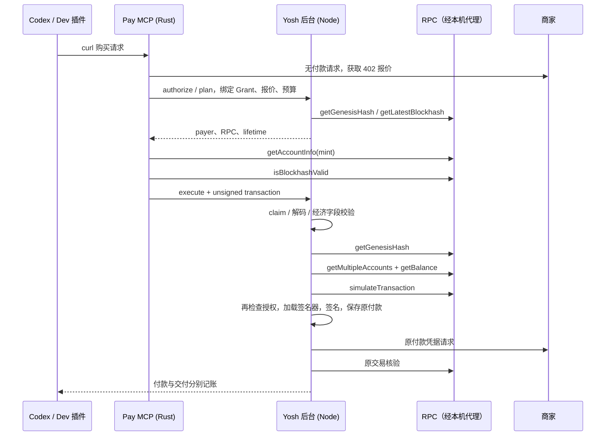

# Mainnet 两条 RPC 路径诊断（2026-11-12）

> 历史实现与验收快照；文内“当前”、版本、进程和未完成项均指各段记录时点。最新插件 0.2.3 主网成功购买及本次归档验证见 [插件版里程碑](plugin-milestone-20261112.md)。
本轮仅只读 RPC、已安装 Pay 的 `--unsigned-preflight`、进程检查及隔离测试。没有调用购买、恢复付款、签名器、提交交易、修改代理配置或提高产品超时。网络实验代码位于 `build.noindex/rpc-chain-diagnosis-20261112/`，不是产品修复。

## 结论与证据边界

1. **已复现代理路径建立 TLS 时的间歇停顿。** 同一已安装 Pay 二进制（SHA256 `ef04a20cbe6ecbd63280bcbcf2ab9e98502f47699006cbc0af14bf53fda17823`），相同报价、每次新 blockhash、相同 5 秒 RPC 期限，系统代理路径构建未签名交易 1/3 成功；只在探针子进程设置 `NO_PROXY=*` 后 3/3 成功。样本少，不承诺直连永久可靠，也没有修改产品环境。
2. **代理变量不一致，但不能据此判断 Pay 直连。** Yosh 后台 PID 88526 有 HTTP_PROXY/HTTPS_PROXY=`http://127.0.0.1:6074`、NODE_USE_ENV_PROXY=1；Pay 子进程仅保留 PATH/HOME/NODE_ENV/运行标志。锁定 reqwest 0.12.28 启用了 system-proxy，缺少环境代理时仍读取 macOS 代理。实际 socket 证实两者默认都连接本机 6074（监听进程 AtlasCore）。
3. **期限与复用差异放大冷连接失败。** Pay 每次构建创建新的 RpcClient，单请求及连接池空闲期限均为 5 秒；backend 为长期运行的 Node v24.21.0，https globalAgent keepAlive=true，安全请求仍使用这个 Agent。backend 预检 10 秒、lifetime/simulation 15 秒。诊断 SDK 探针仅把期限设为 15 秒时，getAccountInfo 首次 6548ms，复用后 614/579ms；后台代理对照首次 4043ms，复用后 170/196ms。
4. **不是已证明的单一 RPC 方法故障。** SDK getGenesisHash/getAccountInfo 出现约 5002ms 超时；同方法直连成功。backend getGenesisHash 曾在约 5008ms 返回 ECONNRESET，随后同进程其他方法成功。SDK 构建实际最先读取 mint（getAccountInfo），然后 isBlockhashValid；后端先 getGenesisHash，再并发 getMultipleAccounts/getBalance，然后 simulateTransaction。连接失败落在谁的首请求，日志就显示谁。
5. **旧进程确实存在。** 11 个 Mainnet pay-mcp 进程仍映射旧二进制 a55bb03573f9…；另有 5 个旧隔离 Dev pay-mcp。插件宿主仍有 0.2.1 缓存及 9ac93ce8…运行目录。磁盘安装为 0.2.2 并不能让既有 stdio 子进程热更新。本轮未终止这些进程。前次 v0 购买已通过新的 app-server 加载新二进制，不能把那一笔失败直接归咎于旧进程。

**不能倒推出上一笔购买的确切失败方法。** `pay_062cad…` 已进入 execute/CLAIMED，表明那次 SDK 的 unsigned 构建已返回；随后后端异常被 approved-payment 的统一 catch 覆盖成通用错误。当前只读复现证明共同的传输风险，不能证明过去那一笔一定是 SDK getAccountInfo、后台 getGenesisHash 或模拟失败。应依靠新增阶段日志取得下一次明确授权操作的证据。

## 调用链

两条 RPC 路径共享目标域名，但并非同一客户端或同一连接池；插件转发本地管理请求不会自动统一网络行为。

## TLS 定位与 DNS

额外的只读 TCP 中继仅用于观察代理隧道时序，不解密 TLS，不记录支付载荷。失败样本：连接本机代理 0ms，CONNECT 200 为 1ms，发送 TLS 数据为 1ms，5002ms 关闭，**没有收到第一段上游 TLS 数据**。成功样本收到首段上游 TLS 数据分别为 3348ms、2792ms。这把停顿定位到 CONNECT 之后、HTTP RPC 响应之前；无法从该证据进一步区分代理上游线路、远端 TLS 端点或代理实现。

Node DNS lookup(all, verbatim) 返回公共 IPv4/IPv6，采样约 5ms（另一次 230ms），顺序会变化。直接路径实际连接公网 IPv6；代理路径实际连接 127.0.0.1，目标主机由隧道传递给代理。没有拿到代理上游 DNS 证据，因此不宣称 DNS 被排除或已确定为原因。两端都有连接复用，但 Pay 的客户端每次构建新建；持续后台可复用之前的连接。

## 原始证据与排除项

- `processes.json`：白名单环境、PID/父进程、启动时间、实际映射路径及哈希；不输出连接令牌。
- `comparison.json`：两条实现、同一方法参数、系统代理/强制直连/显式代理。
- `account-reuse-comparison.json`：同一 getAccountInfo 连续三次及 5s/15s 探针对照。
- `unsigned-comparison.json`：已安装二进制 9 次无签名构建与 TLS 隧道时序。
- `discarded-invalid-parameters.json`：首版探针错误选到报价列表中的 EVM 资产，导致 -32602；该轮参数错误已修正，**不作为产品故障证据**。
- SDK 探针复用锁定 Pay/Pay-kit 依赖，RPC client 4.2.2；只允许白名单读取。探针的 15 秒/NO_PROXY 选项未写回产品。

实际 Yosh MCP 状态复核：余额 99000 原子单位（0.099 USDC），今日 paid=0、reserved=0；目标购买 FAILED/NOT_PAID、无交易、无保存的 originalPayment。钱包、Grant、额度和暂停状态未修改。

## 仅诊断记录的补丁

保留现有 `pay-controller-diagnostics.jsonl`，新增购买 ID、失败阶段、稳定失败码、RPC 方法、HTTP 状态及白名单传输错误。执行层给错误附加安全元数据，购买层继续返回原先通用错误，但不再丢弃这些元数据。日志不包含错误原文、RPC URL、请求参数、签名载荷或私钥。支付状态迁移、预算、超时、代理、SDK、签名器和提交顺序不变。

当前 SDK 原生 unsigned 失败仍由已安装 SDK 返回 `UNSIGNED_PREPARE_FAILED`，本补丁不修改 SDK；其具体方法此次由隔离只读探针确认，不能伪称产品日志已增加该 SDK 内部方法信息。

验证：开发源码与实际安装基线的候选源码各通过 50 项定向测试；发布边界 24 项测试通过；typecheck、lint、production build 通过。主网候选为 `build.noindex/mainnet-diagnostics-023-20261112/Yosh.app`，先完整重现当前后台后再加五文件日志改动；校验 Pay/Node/MCP/原生代码未变，新增链式 provenance 保留历史证据。

## 安装与实际宿主核验

用户确认正常退出后，核对 Mainnet App 与 13449 后台安全停止，通过现有 `scripts/install-macos-app.sh --stable-app` 更新同一 `/Users/irin/Applications/Yosh.app` 并重新打开。安装与候选整树一致、签名有效；运行后台 PID 95418 监听 loopback 13449。Pay 二进制 hash 保持 ef04a20…，未改代理/RPC 期限。旧 App 备份位于候选目录的 previous-install。

同一 marketplace、同一插件 ID 已升级 **0.2.3**；Dev runtime digest 为 `7fe7f03e5f54b9762c312f179b705f2dcce2d88a6494b102909d7ab4b2992cf5`。显式安全升级保留 Dev 数据。通过私有 CODEX_HOME 的真实 Codex app-server 加载已安装 0.2.3，执行且仅执行 local_setup_status 与 Mainnet get_spending_status；主网可用，余额 99000，原 Grant v5 ACTIVE，limit=1000、paused=false、paid=reserved=0；目标购买仍 FAILED/NOT_PAID、无交易。证据 `host-023/result.json`。安装前、重新启动后、实际宿主查询后，七张经济状态表指纹完全一致。

现有聊天持有的旧 stdio MCP 进程不会自动热更新，未强制结束其它聊天的进程；下次通过当前桌面聊天执行购买前仍需确保重连到 0.2.3。新宿主核验不能冒充旧连接已刷新。未进行真实购买、提交、推送或对外发布。
