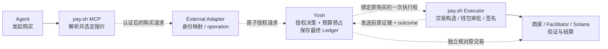

# Yosh × pay.sh：External Spending Authority 集成审计

审计日期：2026-10-17。范围：只读代码审计与集成设计；本文是本轮唯一新增文件。未实现 Adapter、未启动服务或 App、未运行测试、未访问运行时账本或 Keychain、未付款、未提交或推送。

## 1. 结论与证据边界

**推荐先设计并验证方案 B 的无资金 PoC：保留 pay.sh MCP，在选定 x402 exact 报价之后接入 Yosh 的原子授权与预占；同时验证单次执行、发送前证据及结果恢复合同。** 这条路线有真实代码接缝，但当前没有现成 External Authority Hook，也尚不具备安全实付所需的完整生命周期。不能只加一次 `allow: true` 查询就启用付款。

最重要的三个门槛是：可信 Agent 映射、独立执行器的提交/崩溃恢复、钱包与预算归属。撤销与外部签名的顺序如果不能得到保证，仍是实付 Blocker。UTA 不进入本轮方案。

| 审计对象 | 本地基线 | 说明 |
|---|---|---|
| Yosh | `/Users/irin/Desktop/yosh`；HEAD `f65c9bd30a2cad65493d2e70b15624be26e216ed` | 存在此前未提交修改，含 wallet/runtime/ledger 与测试；以当前工作区源码为准，不能用 HEAD 链接代替这些修改 |
| pay.sh | `/Users/irin/Desktop/open-source/pay`；HEAD `df57843e1f728fcc8ff8e42db78e0ad99372cd9d` | 已有未跟踪 `docs/architecture/`，生产源码未显示本地修改；未拉取、切分支或更新依赖 |
| pay-kit | Cargo 锁定 `solana-pay-kit` revision `f8ef055b1d1c8ca8245f19bbca819faed9cfa058` | 阅读了本机 Cargo checkout 中的这一版本，不根据另一个版本的文档推断能力 [P0][K1] |
| Yosh SDK | lockfile：`@x402/core` / `@x402/svm` **2.25.0**，`@solana/kit` **5.5.1** | 现有生产实现已经复用官方 x402 SDK [Y7] |

已阅读 `plan.md`、当前架构与恢复文档，并用源码交叉核对。计划中的旧状态快照不是当前运行证据。历史 Mainnet 单笔 GET 购买见[原验收记录](../demo/first-mainnet-purchase-20261008.md)，本轮没有重验链上、安装版或实际 Codex 宿主。

[RFC #505](https://github.com/solana-foundation/pay/issues/505) 提出外部经济授权与执行后证据的组合；讨论中的 UTA 示例属于建议，不能当作 pay.sh YAML 或已实现接口。Yosh 的原链接现重定向至 [Niri7981/Yosh](https://github.com/Niri7981/Yosh)；技术判断以本地源码为准。

## 2. Yosh 当前实际架构

### 请求、身份与授权

真实 Mainnet 主线是：

```text
Agent → scripts/mcp.ts → /api/agent/purchases
      → AppRuntime.requestPurchase / performPurchaseRequest
      → requestPaidResourcePurchase → requestRegisteredResourcePurchase
      → PurchaseLedger.reserve → executeApprovedPayment
      → official x402 SDK + guarded Yosh signer
      → 原交易核对 → Ledger 确认 → 独立交付状态/恢复
```

- **Agent 身份由后端绑定。** `AgentConnection.authenticate` 校验 loopback、无浏览器 Origin、bearer、capability 和 active CardMember，返回 descriptor 中的 `cardMemberId / connectionId / connectionGeneration`。它是安装连接能力，不证明某个模型或调用进程身份；MCP session 心跳也不是授权证明。Agent 不能自行提交 `agent_id` 或 `approved` 改变这个 principal。[Y1][Y2]
- **用户管理通道独立。** `requireManagementRequest` 使用独立 token、时间窗、nonce 和 method/path/body HMAC；创建 Grant、修改 Daily Authority/暂停经管理入口。普通 MCP 只暴露发现、注册已验证资源、报价、购买和本人结果等操作。注册 Resource 不产生 Spend Grant。[Y2][Y3]
- **Grant 持久保存。** `SpendGrantSchema` 包含成员、resource/provider/operation、network、mint/decimals、payee、scheme、POST policy hash、总额/单笔限额、版本、到期与撤销状态。`createSpendGrant` 事务替换同成员、同 monetary scope、同 Resource 的 active Grant；唯一索引允许该成员同时持有多个 Resource Grant。`activeSpendGrant` / `spendAuthorityForDecision` 查询，`evaluateGrant` / `assertGrantCovers` 判断范围与剩余承诺额度。[Y4][Y5]
- Grant 的 connection 字段被保存，但当前匹配重点是成员、Grant 版本和经济范围；不能声称每次签名都逐字段比较 connection generation。连接启停路径 `AppRuntime.setAgentConnection` 先撤销相关 Grants，再更新连接。[Y5][Y12]
- `requestRegisteredResourcePurchase` 从后端 registry 取 Resource，用 `requestForPurchase` 固定实际请求，获取新鲜 challenge，再用同一请求与报价生成 `createX402SpendIntent`。已存在的 `(member, requestId)` 直接重放/恢复；同键异参拒绝，不重新购买。[Y6]

### 预算、付款与恢复

| 阶段 | 真实实现与不变量 |
|---|---|
| Daily Authority | `evaluateSpendAuthority` 检查未知付款阻挡、暂停、未设置/零额度和日额度；`activeDay` 管理持久自然日时钟。共享范围是 **environment + walletIdentity + network + mint + decimals**，同 scope 下所有 Agent 共用，不能解释成跨钱包/资产的统一美元池。[Y5][Y8] |
| 原子预占 | SQLite WAL、`synchronous=FULL`；`atomic` 用 `BEGIN IMMEDIATE`。`reserve` 在同一事务内查重、计算 committed、匹配 Grant、写 decision/购买/事件。日承诺额为所有 `APPROVED/PAYING/PAYMENT_UNKNOWN` 加当日 `PAID`；未决预占跨日保留。Grant 累计额覆盖该 Grant 生命周期的上述状态和所有 `PAID`，不每日重置。[Y5] |
| 单次执行 | `claim` 事务领取 `APPROVED → PAYING`，复核当前 Grant、日额度、暂停、资源、过期和未决付款；`assertCanSign` 再检查。不是把预检查结果长期缓存为支付权。[Y5] |
| 构造与签名 | `prepareSolanaPayment` 使用 `ExactSvmScheme` / `x402Client` 的 spend controls 和 policy。`checkedSigner` 校验实际 unsigned transfer、模拟交易，最后再次检查授权，再进入真实 `signTransactions`。`loadBuyerSigner` / `loadEnvironmentWalletSigner` 从对应现存 Keychain 钱包加载并核对公钥，私钥留在 Yosh 后端。[Y7][Y13] |
| 保存与发送 | `executeApprovedPayment` 的关键顺序是 **claim → guarded sign → `savePayload` + original evidence → `markSubmissionAttempt` → HTTP submit**。首次发送前的 marker 与提交调用紧邻，当前单后端可对暂停/退出排序。[Y9] |
| 确认消费 | `reconcileStoredOriginalPayment` 根据原交易身份和正确网络核对 RPC；`confirmOriginalPayment` 幂等写 `PAID`，预占转为已付，`confirmed_day` 属于确认当天；付款与商家回执、交付成功分开。[Y5][Y10] |
| 释放预占 | `expireUnclaimed` 仅处理未 claim、未签名的过期批准；`failUnsubmitted` 仅处理可证明未提交的状态；`failOriginalPayment` 需要精确原交易的 finalized failure。普通异常或 HTTP 失败不足以释放。[Y5] |
| Unknown | `unknown` 持久保留预占与原证据。链上查不到、RPC 超时、blockhash 过期都不能自行证明没付款。当前阻挡有 scope/resource/request 语义，不是所有 Unknown 一律永久冻结全部无关消费。[Y5][Y10] |
| 重启/交付 | `recoverOnStartup` 恢复原付款和执行 claims，绝不重新签名替代付款。`recoverPaidDelivery` 仅在 `PAID` 后复用原凭据/声明的恢复方式；首次交付尝试之外，最多 4 次恢复重试、次数与退避持久，未声明支持则 `UNSUPPORTED`。[Y11][Y12] |

**耦合判断：经济判断已部分解耦，完整授权执行仍与 x402 紧密相连。** `authority-policy.ts` 与整数金额运算可复用；Grant 匹配、累计、日额度的事务语义也应保留。但 `SpendIntent` 保存 HTTP/x402 challenge，`reserve` 接受 `PaymentRequirements`，生产门禁绑定 registered x402 Mainnet，原交易识别器限制 Solana exact 的实际指令形状。现有 `APPROVED` 不是可直接导出的通用外部付款许可。[Y4][Y5][Y6][Y7][Y8]

## 3. pay.sh 当前实际架构

### MCP 支付调用链

```text
pay mcp 启动 → McpCommand.options → McpOptions → LocalContext
Agent curl 工具 → PayContext.scope → CallScope
→ curl.run / do_paid_fetch → 首次 HTTP fetch / RunOutcome 分类
→ 选定 MPP 或 x402 offer → McpPermissions.authorize_*
→ pay-core build_*_with_override → wallet approval / signer
→ pay-kit 构造并签名 → 携付款凭据重试 HTTP → interpret_retry
```

`do_paid_fetch` 还处理 SIWX、MPP session/subscription、x402 upto/batch 等分支；部分缓存凭据可在第一次 fetch 前附加。因此通用 hook 不能只覆盖一次 `X402Challenge` match arm，也不能只拦截“新钱包签名”。外部模式第一阶段应明确拒绝这些未纳入合同的模式。[P3]

### YAML 在何时检查，四种授权对象各做什么

| 对象 | 当前职责 | 不能据此推断的能力 |
|---|---|---|
| `ClientPermissions` | pay-kit 的无状态 offer 检查：origin、Solana network、mint、单笔 cap；`McpPermissions` 将协议 challenge 转成 `PaymentCandidate` 调用它。[P2][K1] | 不识别 Agent，不预占日预算，不保存授权或交易结果 |
| `ApprovalPolicy` | `CallScope.auth_override` 通过 `gate(peer)` 为一次 signing operation 选择钱包审批 gate；本地 `LocalApproval` 用平台认证或 MCP elicitation。[P4] | 不是 reserve/commit/unknown/recovery 接口 |
| `AuthGate` | 秘密访问/签名前的同步 `authenticate(AuthIntent)`；`AuthIntent` 主要携带展示消息、USD 万分之一单位金额、recurring 标记。[P6] | 没有结构化 Resource、mint、payee、operation ID，也不见证链上结果 |
| `PolicyGate` | hosted subject 的单次 ceiling + 每 UTC 日 cap；`check_and_record` 在签名审批时计入，mutex 防同进程并发超额。[P5] | 不是 Yosh 式按链上付款终态结算的持久账本 |

`McpCommand.options` 启动时读 YAML，`PermissionConfig.build` 编译，`LocalContext` 保存 `Arc<McpPermissions>`；当前没有文件监听/热重载。**无 YAML 且无权限 flags 时 `permissions=None`，保留交互钱包审批，并未自动启用 `$1` 静态 cap。** 只有构造权限模型时，才应用其默认 any origin/mainnet/known stablecoins/$1。[P1][P2][P4][K1]

**“允许付款”没有一个可以取代所有约束的单一开关。** 本地选定 offer 必须满足已配置的 Permissions；之后还需满足钱包/账户审批。Hosted 使用 `PolicyApproval`，先 `PolicyGate` 后可选 elicitation；它不自动启用本地 YAML。协议构造和服务端结算仍可能拒绝。`PolicyGate` 用默认 `MemoryLedger`，重启清零；MCP 后续 elicitation 拒绝或签名失败并没有对应自动 rollback。另一个 hosted CLI 签名路径有 RAII reservation，但也以签名为 commit，不是链上确认。[P4][P5][P7]

### 构造、钱包、结算及异常

| 问题 | 代码事实 |
|---|---|
| 谁构造交易？ | pay-core `x402::build_payment_with_override` / `mpp::build_credential_with_override` 解析上下文并加载 signer，委托 pay-kit。exact builder `build_payment` 构造 transfer/memo/fee-payer 并调用 `TransactionSigner`；MPP charge 的 `build_prepared_charge` 可返回 unsigned transaction。这两类客户端凭据构造本身不广播交易。[P8][P9][K2][K3] |
| 谁接触钱包/签名？ | `load_signer_for_network_payment_with_intent_and_override` 等从 accounts 配置选择 local/remote/hardware/ephemeral；`ResolvedSigner.sign_transaction` 委托实际 signer。local keystore 可解出 keypair 到内存，remote/hardware 委托 provider。[P10] |
| 谁知道支付成功？ | 商家/facilitator 验证结算并由链上形成结果。pay-kit 有协议服务端结算与 receipt 逻辑；但当前 MCP exact 路径 `interpret_retry` 只保留 exit-code/body/content-type，丢掉响应 headers，没有用精确原交易独立确认后再记一笔持久购买的步骤。[P3][K4] |
| HTTP 失败或重复 402？ | paid retry 的重复 402 被映射为拒绝/错误；其他 HTTP 响应可成为 `RunOutcome::Completed`，包括 HTTP 错误。这个名字不表示付款确认。不能把错误等同于未付款。[P3][P11] |
| 超时？ | fetch 仅在 hosted `PublicInternetOnly` 路径明确设置连接 10 秒、请求 60 秒 timeout；本地 `Unrestricted` 在此处没有同样的显式配置。错误返回本身不证明链上未执行。未见 exact MCP 的持久 Unknown/预算冻结/原交易核对合同。[P11] |
| 重复请求/崩溃？ | `curl::Params` 无稳定购买/operation ID；重复调用可重新构造付款。session request lock/缓存及 batch watermark 是局部控制，不能代替跨重启 exact 购买幂等。pay-core 另有 push journal、session/subscription 等专用恢复，不应把这些外推成 MCP exact 的恢复能力。[P3][P12] |

本地 `LocalContext.scope(_call)` 忽略调用者，只使用全局账户与 `LocalApproval`；没有可信的 per-Agent identity。Hosted 的 bearer/OAuth 认证产生 `Tenant`，`CloudContext.scope` 从 request extensions 取 tenant wallet/policy，是用户/租户维度，不天然等同 Yosh CardMember。`TenantRegistry.bind/remove` 可以修改内存记录，但已取得的 scope 保存了 policy 快照，未发现等价于 Yosh 的动态 Grant 管理及在途强撤销合同。[P4][P7]

## 4. 能力对照

“已实现”仅指下列源码范围存在，非本轮运行验收；“未见”限定所审计版本及生产路径。

| 能力 | Yosh | pay.sh | 判断 |
|---|---|---|---|
| Agent Identity | 后端 CardMember 绑定认证连接；不是模型/进程证明 [Y1] | 本地共享账户；hosted 认证 Tenant [P4][P7] | **语义差异**；per-Agent 可信授权绑定仅 Yosh 已实现 |
| Resource Scope | registered Resource + immutable method/URL/headers/body + Grant [Y4][Y6] | Permissions 限 origin，协议有 resource URL；不等价 API Grant [P2][K1] | **两边都有，语义差异** |
| Single Payment Limit | 原子 Grant `singleLimit` 与报价约束 [Y4][Y5] | YAML atomic/USD cap；hosted `per_call_ceiling` [P2][P5] | **两边都有，金额/资产语义差异** |
| Daily Budget | 同 monetary scope 下共享，持久 paid+reserved [Y5] | hosted UTC `MemoryLedger` 签名意图计数；本地 YAML 没有 [P5][P7] | **两边都有，持久性/归属/记账时点不同** |
| Cumulative Spending | Grant 生命周期总额含 paid/未决承诺 [Y5] | daily total、channel cumulative 状态；未见同义持久 Resource Grant 总额 [P5][P12] | **Yosh 已实现同义能力** |
| Dynamic Revocation | 撤销/版本、pause、claim/签名前复核 [Y5][Y9] | token/tenant 可失效；无同义 Resource Grant 强撤销 [P7] | **语义差异**；支付级强撤销需新增 |
| Runtime Grant Changes | 管理创建/替换/撤销，同 Resource 版本变化生效 [Y3][Y5] | YAML 启动 snapshot；hosted policy scope snapshot [P1][P4][P7] | **Yosh 已实现；pay.sh 无同义机制** |
| Wallet Authorization | Yosh Keychain 身份校验、guarded signer [Y7][Y13] | platform/elicitation、local/remote/hardware 等 [P6][P10] | **两边都有**；不能把密钥共用当成集成 |
| Transaction Execution | official x402 V2/SVM exact 主线 [Y7][Y9] | x402/MPP 多支付模式 [P3][P8][P9] | **两边都有，支持集合不同** |
| Payment Confirmation | 原 signed identity + buyer RPC；receipt/交付独立 [Y10] | 协议服务端结算；MCP exact paid retry 无等价持久独立确认 [P3][K4] | **两边都有局部能力，端到端语义不同** |
| Idempotency | member/requestId、同键异参拒绝、单次 claim [Y5][Y6] | 协议局部缓存/channel/push permit；MCP exact 无稳定购买键 [P3][P12] | **Yosh 已实现购买级；pay.sh 局部实现** |
| Crash Recovery | 原证据/Unknown/持久对账与交付恢复 [Y10][Y11][Y12] | push journal/特定协议恢复；未见 MCP exact 对等购买恢复 [P12] | **两边都有局部能力，需要区分路径** |
| Audit Evidence | 购买、Grant 版本、事件、原 payload/签名身份、付款/交付事实 [Y5][Y10] | 协议凭据/receipt、专用 channel/push 状态；MCP exact 无同义完整 ledger [P3][P12][K4] | **两边都有，持久证据范围不同** |
| External Authority 生命周期 | 无已开放的外部 executor authority API [Y5][Y9] | 无 reserve/execute/outcome 外部 hook [P3][P4][P6] | **当前均未实现** |

## 5. 最合适的接口位置与最小合同

### 真实接缝：选定报价之后，付款交易构造/签名之前

pay.sh `curl.rs::do_paid_fetch` 已有正确粒度的本地权限检查。未来外部 hook 应紧随 `permissions.authorize_*`，在对应 `build_*` 前执行。硬件设备准备、signer 能力检查和余额查询可能更早发生，不能将此接缝描述成首次接触钱包之前。x402 exact 至少有三条入口：

1. MPP negotiation 选中 exact：`curl.rs:1176` 的 `build_payment_with_override` 前。
2. 直接 exact：`curl.rs:1221` 前。
3. SIWX fallback exact：`curl.rs:1381` 前。

每次更换报价或 corrective challenge 都必须重新绑定，不能复用旧许可；PoC 不支持的分支直接拒绝，并在首次 fetch 前禁用 session/subscription 等缓存付费凭据自动附加，防止缓存命中绕过新检查。复用 `PayContext / CallScope` 注入受信任服务依赖是合理的；**该外部接口目前不存在**。[P3][P4]

**只实现一个 `AuthGate` 不够。** `Gate::for_policy` 在 `auth_required=false` 时丢弃 override；ephemeral、部分 hardware/legacy OnePassword 路径也不经过该 gate。它缺少完整付款事实与结果接口，并且通常只保护 signer 加载，不能在实际每次签名/提交时见证授权。外部强制授权必须独立于钱包是否要求交互认证。[P6][P10][P13]

### 授权请求：最小必要事实

以下是**未来合同要求**，不是已有 JSON API 或已经存在的字段。

| 事实 | 可信来源/用途 |
|---|---|
| executor identity + Agent binding | executor 经独立窄权限凭据/受控 IPC 认证；由用户配置的映射绑定 Yosh CardMember、连接/代次。不能信任工具参数或 clientInfo 自报身份；本地可先限定一个专用 pay MCP 实例对应一个成员 |
| 稳定 operation ID | 首次可能付款前持久创建，通过未来 MCP/受信任 wrapper 的明确 purchase handle 或幂等 key 续接；重试、崩溃、回调均复用，不是瞬时 MCP JSON-RPC ID。Yosh 用 `(executor, member, operationId)` 唯一约束，并校验同键同参；每次 curl 自动生成新 ID 无法解决丢响应后的重复付款，单凭 URL/body 相同也不能区分重试与有意再次购买 |
| registered Resource ID/version + 请求指纹 | Yosh 已登记资源；精确实际 method、完整 URL、受限 headers/body 或可验证的不可变实例，含 POST consent hash。纯 origin 不足够；敏感请求内容仅进受限存储 |
| observed origin 与选定 payment requirements | 来自 pay.sh 实际 HTTP 结果，仍经 Yosh runtime schema 与 Resource 绑定校验；保留协议版本、scheme、完整 challenge/选定 option fingerprint、有效期及必要 extensions |
| network / mint / decimals / 原子金额 / recipient | 标准化且与实际 selected offer 相等；JSON 金额用整数十进制字符串。不能用显示 `$0.01` 或 `USDC` ticker 做权威判断 |
| 执行钱包与费用约束 | buyer 公钥、executor/account 引用、实际 fee payer、受限 RPC/网络身份；若存在 reimbursement/额外支出，明确最大总承诺，不能只批准 quote 面额再签额外转账 |
| 用途与时间 | 记录购买用途、报价观察时间/有效期；executor 提供的钟和 nonce不能替代 Yosh 本地时钟与防重放 |

`GrantId/version` 与 monetary scope 应由 Yosh 找到并绑定，不接受 Agent 任意指定为授权证明。未经登记、身份无法映射、资产/报价不兼容或需额外用户同意时，应拒绝或返回待批准；外部请求不创建 Grant，也不自动调用管理 API。[Y3][Y4][Y5][Y6]

### 授权响应：需要预占与一次执行权

响应至少需要稳定 decision/reason、Yosh purchase ID、reservation 引用、Grant/version、scope、operation ID、不可变请求与 selected terms hash、executor/Agent/wallet 绑定和过期时间。可用随机 opaque handle 加服务端记录，或受完整性保护的凭据；后者仍须查持久状态。**它不是离线可无限重放的 bearer `allow`。**

`APPROVED` 必须与预算预占同事务产生。执行器再通过单次 claim 获取执行权，签名前重查当前授权，保存原签名证据并得到持久确认后才允许提交。相同 operation 的重试返回原状态；相同 operation 改金额/收款方/请求拒绝。过期只可自动释放可证明未执行且已 fenced 的预占，不能释放 Unknown。[Y5][Y9]

### 支付结果与 Ledger finalization

| pay.sh 观察结果 | Yosh 必须如何处理 |
|---|---|
| 报告成功 | 认证 outcome、匹配原 operation/许可/证据；独立核对精确链上事实后幂等确认一次 `PAID`；交付另记。HTTP 200/receipt/签名字符串单独均不足 |
| 付款失败 | 仅原交易 finalized failure，或已封住继续执行且有可靠未提交证明时释放；普通 SDK/HTTP error 保持未决 |
| 用户拒签 | 只有能证明该 operation 尚未签/未发，且执行权已取消并不可再使用，才安全释放。拒绝发生在另一笔签名之后不能推翻原事实 |
| 已可能签名或提交后的网络超时/状态不明 | `PAYMENT_UNKNOWN`、保留预占与原 payload，禁止新签/替代付款；只查原交易 |
| pay.sh 崩溃 | 从 durable operation journal 对账；Yosh 自己重启或没有收到证据不证明外部没发送。无法证明则 Unknown |
| 已付但结果回传失败 | executor 持久 outbox 可重复发送同 outcome；Yosh 按 operation+原交易幂等接受，或主动核对原 signed identity；不能重新执行付款 |
| 付款确认但交付失败 | 保持已消费；仅使用原凭据和已验证商家恢复能力。没有能力就明确交付失败，不再付款 |

发送前证据不能只存 txid。赞助方 fee payer 可能稍后补签，客户端此时尚无 canonical txid；需要原部分签名 payload、buyer 公钥/签名、message hash、完整经济绑定、memo、blockhash/lifetime 和网络/scope。pay-kit exact 的赞助结算只补签、不改 message，因此 Yosh 现有 buyer RPC 有界历史扫描有复用基础；扫描无结果仍是 Unknown。需用锁定版本 fixture 验证指令形状、v0/无 ALT 与 payload 转换，不承诺任意 pay-kit 交易都可直接进入现有识别器。[K2][K4][Y10]

### 安全边界与不可绕过的执行顺序

- executor 使用独立窄 capability，只能 reserve/claim/报告或查询自己的 operation；不持有 Yosh management token。loopback、CORS 或普通 Agent bearer 不能替代 executor 认证。[Y1][Y3]
- 模型不能批准 Grant、改 Daily Authority、选择任意 signer 或获得管理接口；钱包管理和任意签名不得作为普通 MCP 集成工具开放。当前 pay MCP router 未暴露通用钱包管理/任意签名；hosted wallet REST 是另一通道。[Y2][P14]
- Yosh 私钥不交给 Adapter/pay.sh。外部钱包必须明确身份与独立归属；若复用 Yosh signer，也只能在 Yosh 受控后端对原购买验证后签名，不能新增通用 `signTransaction` MCP 工具。[Y7][Y13]
- 认证失败、超时、scope/钱包不匹配、授权状态不确定均拒绝新的执行权；不得退回无需 Yosh 的默认路径。
- reserve 与额度判断必须同一事务；claim 唯一；签名/提交必须与暂停、撤销 ack 有明确序列化。**短 TTL、一次远程 precheck、token 或心跳不能消除跨进程 TOCTOU。** 若 pay.sh 已持有可自主签名的 signer，必须有可信执行 fence，并在在途签名/提交安全停住前不确认“已暂停”；断连时可能无法及时确认暂停。做不到则不满足 Yosh 当前强语义，实付继续 Blocked。
- 即使合同完善，也不能防止完全被攻陷且直接持有付款钱包的 executor 绕过 Yosh；可信 executor/signer 是威胁模型的一部分。以 Yosh signer 作强制边界会缩小该风险，但增加跨语言/进程签名适配，不属于零改动集成。

## 6. YAML 可以怎样复用

保持已有 schema：`origins`、`networks`、`max_payment`、`unlimited_amount`、`allow_any_asset`、`assets[{network,asset,max_payment_atomic}]`、`origin_overrides[{origin,max_payment,unlimited_amount,asset_caps}]`。结构启用 `deny_unknown_fields`，不能加入自创的 `agent/grants/daily_budget/authority_url`。[P2]

| Yosh 约束 | 现有 YAML 映射 |
|---|---|
| 已批准 API 的 origin 集合 | 可作粗粒度 allowlist；origin 标准化会去掉 path/query，不能替代 Resource scope |
| Solana 网络 | `networks` 可限制；仍需链/RPC 与实际交易一致性校验 |
| 保守单笔上限 | `max_payment`；特定 network/mint 用 `assets.max_payment_atomic`，不可丢精度或向上取整 |
| USDC-only | **不能精确映射**；`assets` 为追加，默认仍允许其它 known stablecoins |
| Agent→Resource、recipient、method/body、POST consent、到期 | 无对应字段 |
| Daily Authority、Grant 累计、预占、动态撤销、幂等与恢复 | 无对应字段；不能靠周期重写 YAML 模拟 |

示意 Snapshot 仅使用真实 schema，**不是本轮导出文件或付款授权**：

```yaml
origins:
  - https://api.example.com
networks: [mainnet]
max_payment: "$0.001"
allow_any_asset: false
```

以上仍允许同 origin 的其他路径和 known stablecoins，不等价于任何实际 Yosh Grant。还需注意：[K1][P1][P2]

- cap 优先级为 origin asset → origin stablecoin → global asset → global stablecoin，**是替换，不是自动取最小值**；override 可以升高全局上限。
- `allow_any_asset:true` 下，未明确配置 cap 的未知 mint 不受全局美元 cap 保护。
- CLI origins/networks 会追加 YAML，`--max-payment` 会覆盖，`--unlimited-amount` 可移除 cap；应控制实际启动配置。
- 配置的 USD/atomic cap 必须正数，空 origins 被拒绝；没有直接表达 paused/no Grants 的 deny-all 格式。没有适用 Grant 时不要导出默认宽松配置再独立启用执行。

**Snapshot 应是 pay.sh 的额外安全限制，不是 Yosh 的替代品。** 最终条件为 `pay.sh 静态限制 ∧ Yosh 当前授权/预算 ∧ 钱包审批 ∧ 实际交易绑定`。旧 snapshot 更严时明确报静态限制拒绝；更宽时 Yosh 仍实时收紧。多 Agent origins 的并集会丢失主体关联，不能作为完整 Grant 导出。当前只能设计 exporter，未运行或创建 YAML。

## 7. 集成方向比较

| 维度 | A：Yosh → pay.sh executor | B：pay.sh → Yosh authority | C：仅复用 pay-kit 构造/受控 signer |
|---|---|---|---|
| 入口 | 保持 Yosh MCP、Resource/Grant 流程 | 保持 pay MCP；新增可信成员映射 | 保持 Yosh MCP |
| 最小仓库改动 | Yosh 执行器适配；若调用现成 pay CLI，仍缺外部证据/claim/恢复接口，通常需改 pay | pay MCP 接口与执行生命周期；Yosh 外部 authority、scope 和恢复适配 | Yosh 加 Rust helper/跨语言边界；使用 kit trait，可能无需改 pay 主仓库 |
| 上游配合 | 自定义库/helper可自建；想用正式 CLI 接口需上游 | 本地 fork 可验证；可维护的 upstream hook 需维护者接受合同 | 通常不需 pay 主仓库；不代表现有 CLI 有 build-only 模式 |
| 安全/账本 | 能保留 Yosh signer 和 send 顺序则较易保持；黑箱 CLI 成败回传不安全 | 明确双向 reserve/evidence/outcome；跨进程 fence 是额外难点 | Yosh 保留 signer/提交/ledger 最有利；需验证新交易形状与边界 |
| 现有 Yosh 用户 | 可选 executor，默认旧管线保留；仍需回归 | 独立 opt-in 接入，现有 MCP 可保持；共享账本代码改动需严谨回归 | 构造器变化接触已验收付款核心，不宜为实验默认替换 |
| 钱包 | 黑箱 pay 执行会切到 pay 钱包；要保留 Yosh 钱包需受控 signer 适配 | 可用 pay 自己的钱包，但不能冒充原 Yosh scope/继承旧 Grant | 可保持 Yosh 钱包，私钥留后端；无现成 TS↔Rust signer bridge |
| 扩展性 | 适合统一 Yosh 购买编排；MPP 仍需新会计模型 | 外部 authority 合同可服务更多客户端；协议模式逐项加入 | 最少双进程账务，但不是验证“外部 spending authority”完整目标 |

C 有真实基础：MPP `build_prepared_charge` 返回 unsigned transaction；x402 exact builder 接受自定义 `TransactionSigner`，但会直接调用 signer。当前没有统一的 unsigned-only pay CLI，也没有 Yosh signer 的现成跨语言 bridge。不能把这些接口描述为已经可插拔的 Yosh executor。[K2][K3][P10]

**第一阶段选择 B 的原因：** 它直接验证 RFC 的分工，且在已选定 offer、未签名前有明确接缝；无需先替换 Yosh 已工作的官方 JS SDK。A 的“调用 CLI 后记账”省略关键安全状态，并非较小的完整方案；C 可作为未来保持 Yosh 签名控制的备选，但额外语言桥并不更小，也不验证 pay MCP 外部授权本身。

### 建议 PoC 的架构图（虚线接口均需新增）



用户仍只在 Yosh 管理 Grant 和预算；Agent 不参与批准。pay.sh 执行支付，商家/facilitator/链决定结算事实，Yosh 核对后保存权威消费记录。图表示未来职责合同，不表示已实现；第一阶段不连接真实钱包或结算网络。

## 8. 风险与 Blockers

| 级别 | 问题 | 解除条件 |
|---|---|---|
| **Blocker** | pay MCP 无可信 per-Agent identity / 稳定 operation ID | 专用受认证 executor 配置映射成员；MCP/wrapper 明确续接原 purchase handle，durable ID、唯一约束及同键异参冲突；拒绝模型自报身份 |
| **Blocker** | 当前无发送前 durable evidence、一次 claim 与 durable outcome/outbox | 付款凭据发送前有可恢复持久记录；重复/崩溃不新签；结果报告可重放且幂等，不把回调失败当未支付 |
| **Blocker** | Yosh 的 `recoverUnsubmittedOnStartup` 假设不存在其他 live signer；Yosh 的 owner lock 不锁 pay.sh | external record 不走原来的“本机无 payload 即未提交”释放推断；新增 executor 所有权/fencing、journal 对账与保守 Unknown [Y5][Y12] |
| **Blocker** | 跨进程 allow→sign/submit 与暂停/撤销竞态 | 执行 critical section、撤销 ack 和在途 drain 有可证明顺序；网络断连时不宣称暂停已完成。TTL/预检查不能替代 |
| **Blocker** | 外部钱包不能放入现有 Mainnet scope | `PurchaseLedger.scope/paymentScope` 绑定产品 Keychain identity，`reserve` 拒绝其它 Mainnet scope，RPC 使用 config buyer。需明确 executor wallet scope/新授权与迁移合同；不改写旧记录、不共享私钥。若仍要求跨两钱包同一个 Daily Authority，需显式父预算聚合，不能新建 scope 就获得一份额外额度 [Y5][Y10] |
| **Blocker（超出 PoC）** | MPP sessions/subscriptions、x402 upto/batch 带 escrow/累计/未来 pull | 单独定义最大承诺、已结算/未结算、费用、重复凭据和恢复；第一阶段全部拒绝，不能按 exact 一次金额强行记账 [P3][P5] |
| **需验证** | pay-kit exact 与 Yosh 严格识别器兼容 | 锁定版本、原版 SPL USDC、v0/无 ALT、受限 compute/memo/transfer 指令、fee payer、网络身份和 lifetime fixtures；不放宽原识别器来适配未知交易 |
| **需验证** | 商家付费后交付恢复及赞助交易查询 | buyer signed identity 核对、商家支持边界、RPC 历史可见性；无结果保持 Unknown，无法恢复交付明确记录，绝不补付款 |

## 9. 推荐的最小 PoC 与未来文件范围

### PoC 设计；本轮不执行

限定 **一个专用本地 pay MCP 实例 → 一个 Yosh fixture CardMember → 一个已登记 fixture Resource → Solana x402 V2 exact / 原版 USDC / v0**。仅使用隔离临时数据库、固定测试身份和不会产生真实签名/网络提交的测试执行器；不连接现有 ledger、Keychain 或任何 RPC。先证明合同，再决定是否授权带真实 signer 的下一阶段。

验收必须覆盖：可信主体映射；无 Grant/过期/撤销/暂停拒绝；并发不同 operation 不超额、同 operation 只 claim 一次；同键改报价拒绝；签名前/提交前撤销竞态；用户拒签；发送后超时；executor/Yosh 分别重启且另一方仍存活；发送成功但回调丢失；乱序/重复 outcome；Unknown 不释放且不产生替代付款。用故障注入验证 journal 和状态转换，不将模拟结果称为真实链上或实际宿主验收。

PoC 的第一检查点是接口与 journal 是否足以维持不变量。若 executor 无法做到证据先落盘或签名/提交 fence，就停止于合同失败结论，不能用模拟 `allow` 绕过。后续真实网络测试、钱包 scope、新 Grant、安装版验证与任何付款均需另行审阅授权。

### 若进入实现，最小可能涉及的文件

以下是**候选改动清单**，本轮全部未修改；新增文件名是设计建议，不是现存接口。

| 仓库/文件 | 原因与适用方向 |
|---|---|
| pay：`rust/crates/mcp/src/context.rs` | B：注入可信 caller/executor binding 与独立 external authority；保持 wallet `ApprovalPolicy` 职责 |
| pay：`rust/crates/mcp/src/tools/curl.rs` | B：三个 exact 入口统一 reserve/claim，非支持模式拒绝，证据先持久后 retry，outcome/query；保留 response headers/状态 |
| pay：`rust/crates/mcp/src/external_authority.rs`（新增建议） | B：窄 typed authority client、认证、operation journal/outbox、恢复；不授予管理权限 |
| pay：`rust/crates/mcp/src/lib.rs`、`rust/crates/cli/src/commands/mcp.rs` | B：显式 opt-in 配置并接入 LocalContext；外部认证配置不能塞入现有 PermissionConfig 或工具参数 |
| pay：`rust/crates/core/src/client/x402.rs`、`rust/crates/core/src/signer.rs` | A/B：传递稳定执行上下文、原签名证据/lifetime、实际签名前的 mandatory guard；不得依赖可被账户策略禁用的 AuthGate |
| pay：`rust/crates/core/src/client/fetch.rs`（视封装选择） | B：如果无法在 curl retry 调用前后保留所需原始 HTTP 事实，在这里提供窄返回信息；不改变未知付款语义 |
| Yosh：`src/modules/authority/external-authority.ts`（新增建议） | B：可信主体/报价映射，复用现有授权计算与事务，严禁只公开纯 policy 的 APPROVED |
| Yosh：`src/modules/http/executor-auth.ts` 与 `src/app/api/external-authority/route.ts`（新增建议，或改选受控 IPC） | B：独立 executor 认证、schema、大小/timeout/replay/所有权限制；不是 Agent/management 通道复用 |
| Yosh：`src/modules/purchases/purchase-ledger.ts`、`src/modules/purchases/original-payment-record.ts`、`src/modules/purchases/monetary-scope.ts`，新增建议 `src/modules/purchases/external-executor-migration.ts` | B：external operation/executor/wallet 归属、唯一 claim、证据状态、预算聚合边界；显式增量迁移，保留现有记录与本地管线不变量 |
| Yosh：`src/modules/app/app-runtime.ts` | B：外部 records 的启动恢复和退出顺序，防外部 still-live 时错误释放；已有本地 records 规则不全局替换 |
| Yosh：`src/modules/payment/original-payment-evidence.ts`、`reconcile-transaction.ts` | B/C：只在 verified payload/config 适配确需时修改；保留严格交易验证和 buyer RPC 核对，可复用的函数不重写 |
| Yosh：`src/modules/purchases/request-registered-resource-purchase.ts`、`src/modules/purchases/approved-payment.ts`、`src/modules/payment/solana-payment.ts`、`src/modules/purchases/purchase-signing-authorization.ts` | A/C 才需要：接入替代 executor/构造器，继续保留 Yosh claim→guard→evidence→send→reconcile 的顺序；不是 B 无资金合同验证的首批必要修改 |
| 测试新增建议：Yosh `tests/unit/external-authority.test.ts`、`tests/integration/external-executor-recovery.test.ts`；pay `rust/crates/mcp/tests/external_authority.rs` | external-authority lifecycle / operation journal 隔离回归；复用现有 Grant、并发预占、Mainnet signing、original-payment recovery fixture；不动真实用户数据 |

这意味着“完整安全实付 Adapter”不是单个 HTTP handler；最小 PoC 的任务是验证上述不可省略的合同，不是一次性实现所有方案或协议。

## 10. 核对结果与源码索引

本轮只阅读了已有测试定义，**没有运行或宣称测试通过**。有意义的现有覆盖包括 Yosh `spend-grant.test.ts`、`monetary-ledger.test.ts`、`purchase-request.test.ts`、`mainnet-signing.test.ts`、`original-payment-recovery.test.ts`；pay MCP `permissions.rs`、`policy.rs`、`curl.rs` 的内联测试和 CLI `mcp.rs` 测试。它们分别说明既有边界有测试代码，不能证明跨项目集成已成立。[T1][T2][T3][T4][T5][P1][P2][P3][P5]

只新增本文；未运行生产代码、编译、App 安装或资金实验。交付前核对 Markdown 引用与 diff，并对两仓库原有文件做只读内容指纹比对。审计在此结束，等待用户审阅，不进入 PoC。

下列链接均指向本轮本地源码的起始行；同一文件的其它关键函数行号列在说明中。

| 引用 | 文件与关键函数 |
|---|---|
| Y1 | [mcp/connection.ts:36][Y1]：`authenticate:82`、`principal:76`、connection descriptor |
| Y2 | [mcp/server.ts:89][Y2]：`request_purchase` strict input；`scripts/mcp.ts:17/50` → `api/agent/purchases/route.ts:9` |
| Y3 | [app/management-auth.ts:20][Y3]：`requireManagementRequest`、`managementRoute:47`；管理 settings/grant routes |
| Y4 | [authority/spend-grant.ts:22][Y4]：Grant input/scope/record；`SpendIntentSchema` 在同目录 `spend-intent.ts` |
| Y5 | [purchases/purchase-ledger.ts:675][Y5]：`scope:155`、`atomic:264`、resource active index `269`、`grantCommitted:352`、create/revoke/query `361–417`、`activeDay:463`、`assertCanSign:509`、startup release `538`、`claim:732`、`savePayload:756`、submission `806`、confirm/fail `835/850/866`、Unknown `939`、Grant match `1013/1039` |
| Y6 | [request-registered-resource-purchase.ts:26][Y6]：`reuse:32`、`requestForPurchase:17`、quote/reserve/execute `58–68` |
| Y7 | [payment/solana-payment.ts:55][Y7]：`prepareSolanaPayment`、checked signer `86`、official SDK policy `126` |
| Y8 | [authority/authority-policy.ts:52][Y8]：`evaluateSpendAuthority` |
| Y9 | [purchases/approved-payment.ts:136][Y9]：`executeApprovedPayment`、reconcile `88`、recover `197` |
| Y10 | [payment/reconcile-transaction.ts:115][Y10]：`reconcileStoredOriginalPayment`、`searchHistory:54`、`inspect:96`；[原始 signed identity][Y10b] `createSignedPaymentIdentity:76` / `matchesSignedPaymentIdentity:182` |
| Y11 | [purchases/delivery-recovery.ts:53][Y11]：`recoverPaidDelivery`；`delivery-state.ts:8` retry limit；`purchase-delivery-store.ts:45` durable claim |
| Y12 | [app/app-runtime.ts:288][Y12]：`recoverOnStartup`、`prepareQuit:380`、`authenticateAgent:583`、`setAgentConnection:621`、`createSpendGrant:656`、`requestPurchase:721` |
| Y13 | [app-wallet/product-wallet.ts:127][Y13]：`loadEnvironmentWalletSigner`、`loadStoredSigner:76`；`payment/wallet.ts:7` |
| P0 | [rust/Cargo.toml:118][P0]：锁定 pay-kit 与 solana-keychain revisions |
| P1 | [CLI commands/mcp.rs:34][P1]：`McpCommand.options` |
| P2 | [MCP permissions.rs:14][P2]：schema、`from_yaml_file:65`、`build:74`、`authorize_*:173` |
| P3 | [MCP tools/curl.rs:1036][P3]：`do_paid_fetch`，`run:196`、`Params:69`、exact 入口 `1176/1221/1381`、`interpret_retry:1599` |
| P4 | [MCP context.rs:17][P4]：`PayContext`、`CallScope:24`、`ApprovalPolicy:63`、`LocalContext.scope:129` |
| P5 | [MCP policy.rs:55][P5]：`SpendLedger`、`MemoryLedger:75`、`PolicyGate.authenticate:158`、`ChainedGate:207`、`PolicyApproval:224` |
| P6 | [keystore/auth.rs:14][P6]：`AuthIntent`；`AuthGate:614` |
| P7 | [connect/tenants.rs:137][P7]：default MemoryLedger、`reserve_cli_transaction:164`、`bind/remove:320`、`CloudContext.scope:544`；[MCP bearer middleware:223][P7b] |
| P8 | [core/client/x402.rs:161][P8]：`build_payment_with_override`、signer load `214`、kit build `264` |
| P9 | [core/client/mpp.rs][P9]：`build_credential_with_override` |
| P10 | [core/signer.rs:125][P10]：`ResolvedSigner.sign_transaction`、`AuthOverride:145`、network loaders `238`、ephemeral branch `481` |
| P11 | [core/client/fetch.rs:769][P11]：`fetch_raw` 路径、HTTP client timeout `790`、`RunOutcome` 位于 `client/runner.rs` |
| P12 | [core/client/push/executor.rs][P12]：专用 batch execution/recovery；不等价 MCP exact purchase ledger |
| P13 | [core/backend/mod.rs:185][P13]：`Gate.for_policy`；legacy OnePassword 在 `backend/local.rs:292` |
| P14 | [MCP server.rs][P14]：当前 tools/router，普通 MCP 与 hosted wallet API 分离 |
| K1 | [锁定 pay-kit client/permissions.rs:303][K1]：`ClientPermissions.builder`、`authorize:336`、asset/cap `365–396`、origin normalize `625` |
| K2 | [pay-kit x402 exact/payment.rs:25][K2]：`build_payment`，构造并签名 `86–97` |
| K3 | [pay-kit MPP charge.rs:274][K3]：`build_prepared_charge` |
| K4 | [pay-kit x402 server/exact.rs:667][K4]：exact 结算补 fee-payer 签名及广播 |

[Y1]: /Users/irin/Desktop/yosh/src/modules/mcp/connection.ts:36
[Y2]: /Users/irin/Desktop/yosh/src/modules/mcp/server.ts:89
[Y3]: /Users/irin/Desktop/yosh/src/modules/app/management-auth.ts:20
[Y4]: /Users/irin/Desktop/yosh/src/modules/authority/spend-grant.ts:22
[Y5]: /Users/irin/Desktop/yosh/src/modules/purchases/purchase-ledger.ts:675
[Y6]: /Users/irin/Desktop/yosh/src/modules/purchases/request-registered-resource-purchase.ts:26
[Y7]: /Users/irin/Desktop/yosh/src/modules/payment/solana-payment.ts:55
[Y8]: /Users/irin/Desktop/yosh/src/modules/authority/authority-policy.ts:52
[Y9]: /Users/irin/Desktop/yosh/src/modules/purchases/approved-payment.ts:136
[Y10]: /Users/irin/Desktop/yosh/src/modules/payment/reconcile-transaction.ts:115
[Y10b]: /Users/irin/Desktop/yosh/src/modules/payment/original-payment-evidence.ts:76
[Y11]: /Users/irin/Desktop/yosh/src/modules/purchases/delivery-recovery.ts:53
[Y12]: /Users/irin/Desktop/yosh/src/modules/app/app-runtime.ts:288
[Y13]: /Users/irin/Desktop/yosh/src/modules/app-wallet/product-wallet.ts:127
[P0]: /Users/irin/Desktop/open-source/pay/rust/Cargo.toml:118
[P1]: /Users/irin/Desktop/open-source/pay/rust/crates/cli/src/commands/mcp.rs:34
[P2]: /Users/irin/Desktop/open-source/pay/rust/crates/mcp/src/permissions.rs:14
[P3]: /Users/irin/Desktop/open-source/pay/rust/crates/mcp/src/tools/curl.rs:1036
[P4]: /Users/irin/Desktop/open-source/pay/rust/crates/mcp/src/context.rs:17
[P5]: /Users/irin/Desktop/open-source/pay/rust/crates/mcp/src/policy.rs:55
[P6]: /Users/irin/Desktop/open-source/pay/rust/crates/keystore/src/auth.rs:14
[P7]: /Users/irin/Desktop/open-source/pay/rust/crates/connect/src/tenants.rs:137
[P7b]: /Users/irin/Desktop/open-source/pay/rust/crates/connect/src/mcp.rs:223
[P8]: /Users/irin/Desktop/open-source/pay/rust/crates/core/src/client/x402.rs:161
[P9]: /Users/irin/Desktop/open-source/pay/rust/crates/core/src/client/mpp.rs
[P10]: /Users/irin/Desktop/open-source/pay/rust/crates/core/src/signer.rs:125
[P11]: /Users/irin/Desktop/open-source/pay/rust/crates/core/src/client/fetch.rs:769
[P12]: /Users/irin/Desktop/open-source/pay/rust/crates/core/src/client/push/executor.rs
[P13]: /Users/irin/Desktop/open-source/pay/rust/crates/core/src/backend/mod.rs:185
[P14]: /Users/irin/Desktop/open-source/pay/rust/crates/mcp/src/server.rs
[K1]: /Users/irin/.cargo/git/checkouts/pay-kit-faefdef5c8b4a8fb/f8ef055/rust/crates/kit/src/client/permissions.rs:303
[K2]: /Users/irin/.cargo/git/checkouts/pay-kit-faefdef5c8b4a8fb/f8ef055/rust/crates/kit/src/x402/client/exact/payment.rs:25
[K3]: /Users/irin/.cargo/git/checkouts/pay-kit-faefdef5c8b4a8fb/f8ef055/rust/crates/kit/src/mpp/client/charge.rs:274
[K4]: /Users/irin/.cargo/git/checkouts/pay-kit-faefdef5c8b4a8fb/f8ef055/rust/crates/kit/src/x402/server/exact.rs:667
[T1]: /Users/irin/Desktop/yosh/tests/unit/spend-grant.test.ts:85
[T2]: /Users/irin/Desktop/yosh/tests/unit/monetary-ledger.test.ts:28
[T3]: /Users/irin/Desktop/yosh/tests/unit/purchase-request.test.ts:223
[T4]: /Users/irin/Desktop/yosh/tests/unit/mainnet-signing.test.ts:78
[T5]: /Users/irin/Desktop/yosh/tests/unit/original-payment-recovery.test.ts:142
