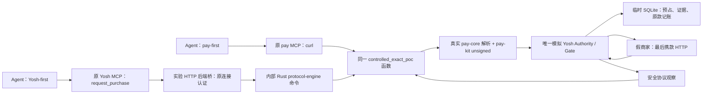

# Yosh × pay.sh — Dual-Entry / Single Execution PoC

实际执行日期：**2026-10-18，Asia/Shanghai**；文件名按原指定保留 `20261017`。本报告按最新《Dual-Entry, Single Execution Contract》验收，覆盖此前单入口目标。

## 1. 结论与证据等级

**双入口隔离 PoC：NEW PASS。** 真实 pay MCP 和未修改的 Yosh MCP 脚本分别通过 stdio `tools/call`，进入同一个真实 Rust pay 受控执行函数，复用 pay-core challenge/receipt 解析、pay-kit unsigned 构造，以及同一模拟 Yosh Authority/Gate。跨入口重放保持一个 operation、一笔预占、一次 claim/签名/首次付款和记账。

**生产集成：PARTIAL / NO-GO。** Yosh MCP 前端入口是真代码；它后面的 HTTP 协调桥和 Authority/Ledger 是隔离实验实现，**没有调用生产 AppRuntime 或现有 Ledger**。不能据此宣称生产 Yosh/pay 已集成或可以实付。

| 证据 | 结果 | 边界 |
| --- | --- | --- |
| ALREADY VERIFIED | 之前 Phase 1.5 SDK/原交易兼容及双进程模型；本次修订前单入口 10 场景通过 | 旧材料仍在；[单入口快照][old]，不冒充双入口证明 |
| NEW PASS | **15 个场景，15 PASS、0 FAIL** | 本轮在双入口合同下实际运行；不是旧 235 项回归，也不是生产验收 |
| NEW PASS | 原锁定 Rust builder 与新 prepare 的 **10 项断言通过** | 真 SDK、断网、内存测试密钥；message、买方签名及签后整 wire 相同 |
| NEW PASS | 沙箱 1 组、3 项探测通过 | 私有 canary 两种路径均 EPERM；未授权但实际监听的 loopback 端口 EPERM，对照连接成功 |
| PARTIAL / BLOCKED | 生产身份/Grant、兼容迁移、旧版写入保护、真实网络与完整协议矩阵 | 本轮未接入或未验证，不能借 Mock 结论清零 |

## 2. 已有成果检查与本轮调整

原 Yosh/pay 工作树、临时 Fork、patch 和实验日志均实际存在。临时根目录为 `/var/folders/l7/7_2w6sp51p57k00hbxp2k5c40000gn/T/yosh-real-mcp-gate-xg2dt3oy`；`/private/var/...` 是同一目录的规范路径。

| 已有 1.5c 成果 | 保留/复用 | 为双入口修改 |
| --- | --- | --- |
| 真正 pay stdio server/router/curl 的 opt-in controlled 分支 | 复用真实 MCP 协商、工具 schema、handler 和协议代码 | 同一函数额外提供内部调用出口；不让 Yosh 再调用 pay 的 Agent 工具入口 |
| Rust unsigned prepare | 原实现与 parity 证据保留 | 无需另写 builder；仍是同一份 SPL/memo 构造 |
| 临时 SQLite Gate、严格验证、签名/发送/恢复、OS owner lock | 保留并继续运行 | 加入统一身份字段和 `/authorize`；先取得真实报价，再原子预占；增加 claim 两侧 barrier |
| 单入口 10 PASS | 完整快照保留 | 不再作为最终验收；双入口合同下重跑，并新增跨入口、claim 和协议错误场景 |

之前控制端的 `allow` 会直接预占，不能证明新合同要求的报价顺序。现在它只登记 **Mock Grant/允许的资源事实（ELIGIBLE，无预算承诺）**；只有真实 pay 取到报价后调用 `/authorize` 才产生 RESERVED。原单入口代码/结果没有被覆盖。

临时 pay 副本中缺失的未修改源码已从同一原工作树补齐，保留[补齐记录][restoration]；实验改动未覆盖，最终双入口二进制从完整副本重新离线构建。没有假定临时源码一直完整，也没有使用丢失材料伪造结果。

## 3. 两个真实入口、一个协议实现

**pay-first 实际链：** 原 `run_server → PayMcp router → curl::run → controlled_exact_poc → classify_402 → /authorize → prepare_unsigned_payment → /complete → decode_response_receipt / interpret_retry → MCP result`。[P1][P2][P3]

**Yosh-first 实际链：** 原 `scripts/mcp.ts → createAgentServer.request_purchase → callApp('/api/agent/purchases')`；原 `readConnection` 读取临时连接，实验后端用原 `AgentConnection.authenticate` 验证成员；新增桥启动内部 `yosh-protocol-engine` 命令，调用 `execute_controlled_operation → 同一个 controlled_exact_poc`。没有启动另一个假 Yosh MCP，也没有经过 pay MCP 再递归调用 Yosh MCP。[Y1][Y2][Y3][P3][H2]

两条路径共享的是**同一源函数/协议实现和操作合同**，不要求使用同一 OS 进程。内部命令是实验新增入口，不是第三个经济服务；所有财务转换仍只在 Gate 的一份临时数据库中完成。

**与原约 1221 行分支的区别：** 实验在原 curl handler 的入口 early dispatch，以避开普通流程此前已发生的账户/硬件/缓存准备。没有执行原自由持头并 fetch 的分支；不得描述成原分支未经修改已兼容。正常 pay 功能未迁进 Yosh，受控实例只开放 curl。[P1]

## 4. Shared Execution Contract v1：实际字段与作用

这是一份受控请求语义，不是新 Ledger 或通用多链框架。两个入口均经同一实现产生如下消息，Gate 验证它们：

| 合同事实/接口 | 实际行为 |
| --- | --- |
| `contractVersion=1`、`operationId`、`idempotencyKey` | 本 PoC 两个 ID 相同；绑定固定成员、资源、钱包和不可变请求。跨入口回传 operation/handle/state/evidenceDigest 完全相同 |
| `memberId/resourceId/wallet/instance/token` | 来自隔离可信配置/连接，不接受 Agent 自报身份或 `approved:true`。Yosh-first 用真实连接认证；pay 的 capability 映射到相同 Mock Grant 成员 |
| `request`、`paymentRequiredHeader`、`accepted` | 固定 GET/URL/headers/body，保留原 challenge；Gate 与预先登记的资源/经济约束比对，绝不只验证 pay 自报内容彼此一致 |
| `POST /query` | 只读；Unknown、PAID、在途原操作重连先查询，不产生新签名或付款。已有执行不会重新 prepare |
| `POST /authorize` | 取得真实报价之后调用。事务内核对成员/资源/钱包、金额/网络/原 USDC/收款方、原请求、Pause/入口及预算；同一原单只预占一次 |
| Rust unsigned plan | 买方公钥构造、签名槽全零；raw wire 不具消费能力，绑定原报价及 `executionEpoch` |
| `POST /complete` | 验证原 quote/request、unsigned、blockhash 等；原子唯一 claim，签名前再查代次；受控签名、证据先落盘、最后 gate/marker/HTTP。pay 永远不拿签名返回值 |
| `observation` | 安全 status/body/重新编码的 receipt；真实 pay 解码 receipt 并解释成功或 402，结果仍只是观察，不是 Yosh 的经济确认 |
| 原款恢复 | 原 Yosh 严格核对器读取假 RPC；同 message/buyer signature，保留 Unknown 预算，一次 PAID。不同入口不拥有独立经济状态 |

实际顺序为：**pay 无付款请求取 challenge → 真 parser/offer 选择 → Yosh reserve → 真 Rust unsigned → Yosh 严格校验/唯一 claim → 签名/原证据 → 最后提交 → 独立核对**。unsigned 构造是非消费工作；claim 在校验实际 unsigned 后、签名前领取。重复授权不重复预占；请求或报价变化拒绝，不更新原记录。[H1][P1]

当前 fixture 每个 Gate 数据目录限定一个可信成员/钱包和资源范围；跨安装的持久身份命名空间、真实 executor 注册不是本轮实现。RESERVED 重试仍须绑定同一原报价；没有证明任意商家变价后的自动续接策略。

## 5. Rust prepare、Gate 顺序和凭据边界

锁定 `pay` 0.30.0 / HEAD `df57843e1f728fcc8ff8e42db78e0ad99372cd9d`；pay-kit 0.10.0 / rev `f8ef055b1d1c8ca8245f19bbca819faed9cfa058`；Yosh JS x402 2.25.0、Solana kit 5.5.1。构建使用 Rust 1.94.1、运行 Node v25.9.0；非安装版运行时验收。

`prepare_unsigned_payment(&Pubkey, &RpcClient, &PaymentRequirements, Option<TxVersion>)` 从原 builder 抽出构造段；原 builder 调它后仍照常 sign/encode。没有 signer 参数、dummy signer 或重写 TransferChecked；原 SPL、memo、compute budget、fee payer、金额/mint/blockhash/版本选择逻辑保留。[K1]

真实旧 rlib 与新 fork rlib 使用同一内存 fixture key、固定 memo/blockhash：unsigned 两槽全零，message 完全一致；签后 buyer signature 和整 wire 完全一致，10 项断言 PASS。[K2] 固定区块哈希只用于断网，绝不代表生产可以信任任意外部 blockhash/RPC hint。

Gate 实际复用未修改的 `assertUnsignedPaymentBindings`、`createSignedPaymentIdentity`、`validateSignedPaymentIdentity`、`reconcileStoredOriginalPayment`。只使用官方 JS encoder 包装同一 Rust message，不运行 JS builder 重造交易。[Y4][Y5]

最后顺序为 `验证/claim → signer job → 离线签名 → signed payload+identity 耐久保存 → 重新检查 Pause/instance/epoch → attempt COMMIT → node:http.request`。正常最后临界区没有 await；故障模式仅在 COMMIT 后同步 `process.exit(86)`，确切位于首次 HTTP 前。[H1]

**有效凭据是否离开 Gate：** 仅经受控 HTTP 交给预期假商家/结算器；**没有经正常接口交给自由 pay 或 Yosh MCP**。假商家故意在 receipt 扩展及额外 header 回显付款头；Gate 丢弃这些字段，重新构造 allowlist receipt。pay 的 stdout/stderr 和两个入口结果经 Gate 内部凭据匹配审计，15 场景均为 0；没有把 needle/原 payload/私钥写入日志。[H1][H2][R1]

私钥只在内存生成，不落盘、不回传 driver/pay。Gate 重启仅保留公钥/原证据，进入 **recovery-only**；本轮没有证明重启后重新加载真实 signer 或开始新付款。商家补签也仅使用内存一次性 fixture key，保持原 message/buyer signature。

## 6. 实际实验结果

金额均为模型原子整数 `10000`，不是资金转移。全部顺序由跨进程 IPC/Promise barrier 和实际 HTTP 接收事件驱动；定时器只作失败 watchdog，没有随机 sleep。

| 场景 | 结果 | 关键运行证据 |
| --- | --- | --- |
| `normal-real-mcp` | NEW PASS | 真实 stdio、classifier、Rust prepare、pay receipt decoder/interpret_retry；reserve/claim/sign/HTTP/PAID 各 1 |
| `pause-signer-inflight` | NEW PASS | Pause 时 sign start=1/complete=0，quiescence pending；迟到完成=1，HTTP=0，未提交安全释放 |
| `pause-signed-before-http` | NEW PASS | 有效原证据已落盘，Pause 后 digest 不变，attempt/HTTP=0；无凭据交 pay |
| `http-before-pause-original-paid` | NEW PASS | 假商家已实际收到并验证凭据后 Pause；预算先保留，原款随后严格确认 PAID 一次 |
| `old-pay-handle-fenced` | NEW PASS | 旧真实 pay 仍活且获得 handle；Pause/Resume+新实例后旧工作被拒，自填付款头被拒，HTTP=0 |
| `duplicate-outcome-one-accounting` | NEW PASS | 三个任务都已读取 Unknown 后 barrier 同时放行；真实核对返回同原款，仅 1 PAID；再重启 Gate/pay仍不重签/重付 |
| `marker-before-http-process-crash` | NEW PASS | 同步退出码 86；商家付款请求=0；新 Gate 保留同 digest/attempt=1/Unknown/预占10000，实际 reconcile 仍 Unknown，sign=1/HTTP=0 |
| `ack-lost-query-original-operation` | NEW PASS | Gate 保存响应后、ACK前杀死真实 pay；新 pay 查询原款。Pause/关闭入口后新候选实际请求被拒，旧 Unknown 仍核对成 PAID；sign/HTTP/PAID各1 |
| `unique-gate-live-owner-rejects-second` | NEW PASS | 旧 Gate 活着时启动第二真实进程；原 Yosh OS owner lock 拒绝，退出75，无 ready，未读取密钥/打开业务库/监听；第一 Gate 仍完成原单 |
| `fail-closed-scope-and-bindings` | NEW PASS | 10 个拒绝检查：POST/body、自填 Authorization、body_file、异 URL、其他工具、V1、upto、非原 USDC、扩展/缓存类模式、改金额报价；sign/HTTP/reserve/claim均0 |
| `pay-first-cross-entry-replay` | NEW PASS | 先真实 pay MCP 付款，再真实 Yosh MCP 重放及两入口并发查询；同 ID/state/digest，reserve/claim/sign/HTTP/PAID各1 |
| `yosh-first-shared-core-cross-replay` | NEW PASS | 先真实 Yosh MCP；内部 Rust 核心实际解析/prepare/解码响应；再 pay MCP、重启 Yosh MCP重放，原经济事实不变 |
| `pause-before-claim-yosh-first` | NEW PASS | 真 Yosh 请求到 Gate beforeClaim；Pause先提交，claim/sign/HTTP=0，原 RESERVED 10000保留 |
| `claim-before-pause-pay-first` | NEW PASS | 真 pay 请求已 claim、尚未 signer；Pause阻断，sign/HTTP=0，安全终结释放预占 |
| `real-protocol-error-no-repayment` | NEW PASS | 携款后假商家返回402；真实 pay receipt decoder/错误解释运行；Gate保持Unknown/预占10000，重试只查原单，sign/HTTP仍各1 |

完整[结果][R1]包含每场预算、原证据 digest、事实序列、reserve/claim计数、两个入口及内部执行 trace；[跨进程事件][R2]包含真实进程/切点。上述15是场景数，Rust parity的10断言及沙箱3探测另计，不混成新测试文件数量。

**精确边界：** signer barrier 证明签名工作入口已进入、真正离线 crypto 尚未执行；不证明密码学运算能中途撤销。HTTP启动先后由 Gate 临界区和商家接收事件证明；不是网卡物理时刻保证。ACK实验是在响应保存、经济结果尚Unknown时丢失 ACK，不是完整 durable outbox 实现。

Pause Requested、New Payments Blocked、In-flight Quiesced、Historical Reconciliation 仍是四个事实。签名在途时停止待决；无消费 handle 的失联 pay 不阻止已封闭 Gate 停稳。已启动原付款可在 Pause 后确认，Unknown 查询/核对不受新购买关闭影响。

本轮 Pause 由实验控制 IPC 触发，未验证生产管理 API、原生 UI 或 Codex 实际宿主的暂停交互。

## 7. 修改、构建及安全证据位置

只修改临时 Fork：pay 侧 **8 文件**（workspace Cargo.toml/lock、MCP Cargo.toml、server.rs、tools/curl.rs、lib.rs、两个新 bin），pay-kit 侧 **1 文件**（exact/payment.rs）。Yosh 生产代码/既有测试无改动；Yosh MCP及验证器直接运行原源码，指纹见 manifest。

| 产物 | 可审阅位置 |
| --- | --- |
| 完整 Rust patch | [pay-controlled.patch][patch]、[pay-kit.patch][kitpatch] |
| Fork 文件/二进制/原 Yosh 源码 SHA-256 | [dual-source-manifest.json][manifest]；[实验代码/日志白名单指纹][evidenceManifest] |
| Gate / 双入口驱动 / 运行隔离 | [gate.mjs][H1]、[run.mjs][H2]、[run-isolated.py][H3] |
| 实际构建/运行命令、构建日志 | [dual-build-command.json][commands]、[dual-build.log][buildlog]；harness/command.json / run.log |
| Rust 构造保真和动态对照 | [source-conservation.json][conserve]、[parity result][K2]；同目录 compile/run-command.json 和日志 |
| 最终实验结果与事件 | [results.json][R1]、[events.json][R2]；同目录每场 `*-mcp.json` 与 `*-internal-protocol.json` |
| 沙箱实证 | [isolation-result.json][isolation]、[探测源码][probe]；使用实际 pay profile |

构建为 `cargo build --offline -p pay-mcp --bin yosh-controlled-mcp --bin yosh-protocol-engine`，在临时 pay/rust 中执行；运行入口为上述 `run-isolated.py`。已有编译缓存复制到临时目录复用，没有下载依赖或修改原 target。

业务进程分别 sandbox：只允许假商家/Gate的指定 loopback 端口，pay/Yosh MCP拒读 Gate 私有目录；pay还拒读 Yosh连接目录，不能修改实验代码/配置。实际 canary及未授权端口探测通过；没有读取真实 Keychain/钱包作“验证”。临时数据库只保存在私有目录，不纳入仓库或普通日志。[isolation]

联调期间修正了沙箱地址语法（平台只接受 localhost）及 fixture缺少decimals；早期SDK parity编译也曾因新旧依赖类型身份冲突调整测试包装。调试证据保留，均非生产缺陷。最终结果来自上述修正后的完整运行，未通过降低签名/Pause/严格识别要求换取通过。

## 8. pay.sh 功能地图：源码状态与 Yosh 复用边界

以下依据当前本地源码，不查询线上 catalog、不付款。“源码存在但未验证”表示本轮未运行相应产品功能；不得将整个 pay 系统标为已通过。**当前受控模式不支持**不等于 pay 原产品没有该能力。

| 能力 | 本地状态/依据 | Yosh 值得复用的部分与独立产品边界 |
| --- | --- | --- |
| MCP / Agent 工具 | curl本轮 NEW PASS；catalog/search/balance/topup/create_skill/sell_inference等源码存在，未运行。[F1] | 复用协议/发现能力；钱包管理、topup、商家推理售卖保持pay独立。受控实例只开放curl |
| CLI / HTTP客户端 | curl/wget/httpie/fetch等源码已实现，相关CLI运行未验。[F2] | 两入口复用内部协议代码，不把自由CLI当最终出口；本轮内部命令不是原完整CLI验收 |
| x402 exact | 目标V2、v0/无ALT、原USDC构造与受控两入口已运行；正式上游受控接口仍缺。[P1][K1] | 首期直接复用真实构造/解析，保留Yosh经济校验 |
| x402 upto / batch-settlement / SIWX | 解析、构造、channel/cache等源码存在但未验证。[F3] | 当前不支持；须另定义累计承诺、可消费凭据/授权、部分结算与恢复，不能复制exact合同 |
| MPP charge | challenge/credential wrapper源码存在但未运行。[F4] | 未来复用协议代码，需先证明unsigned/受控完成接缝与原款身份 |
| MPP session / subscription | channel/voucher、激活、receipt/持久化等源码存在；静态permissions启用时相关状态模式会拒绝，非通用经济授权。[F5] | 当前不支持；缓存/会话能力、增量消费、关闭/退款及最终性需独立合同 |
| 钱包、账户、signer | AccountsStore、backend、Memory/remote signer、AuthOverride源码存在；本轮未加载真实账户。[F6] | Yosh保持唯一钱包/授权；不复用pay私钥保管来替换Yosh，不向其remote signer返回有效签名 |
| payer proxy | 自动付款/协议和header处理代码存在，未运行。[F7] | pay独立产品功能；未来可成为额外入口，接入前也须不可绕过Gate，当前无须全量改造 |
| Merchant Gateway | 商家验证/结算、中间件、上游转发、计量/session/subscription代码存在，未运行。[F8] | 与买方Yosh Trusted Gate是不同职责；不搬入Yosh，也不以假商家实验冒充真实Gateway验收 |
| skills / API discovery | catalog工具、PAY.md验证/创建、registry及skills代码存在，未联网验收。[F9] | 可服务Yosh资源发现，但注册/用户Grant仍独立，不让catalog或skill内容授消费权 |
| journal / recovery | pay push有专用durable journal/permit/reducer；batch/session/subscription各有恢复代码，未全量运行。[F10] | 并非“pay无journal”，也没有证明通用MCPexact已有Yosh合同；本轮财务恢复在模拟Yosh Gate |
| Debug / tests / Sandbox | debugger proxy、bench/测试设施、localnet/Surfpool资金设置源码存在，未启用。[F11] | 可辅助以后验收；`--sandbox`不等于本轮无网/无资金隔离，本轮使用独立假服务与OS沙箱 |

外部授权/最终出口是**部分实现**：临时Fork与Mock Gate已通，正式Yosh/pay未实现。Tempo、其他链、RWA及更广资产能力不在本轮范围，未提前开发。

## 9. 未验证边界、最小后续与 Go / No-Go

**BLOCKED / 待后续验证的生产风险：**

- Mock Grant、预算和成员配置不等于生产SpendGrant/Daily Authority/Executor注册。虽然两入口用同一模型事务，没有验证生产全部权限与并发预算场景。
- 实验OS锁验证同一规范目录的唯一Gate；没有验证跨目录/多安装/恶意owner迁移。重启为recovery-only，不涉及真实Keychain身份恢复或App退出/安装流程。
- 生产external provenance/schema、旧Yosh直接写库阻断、升级/降级与历史迁移仍未实现。不能把本轮临时库交给旧恢复逻辑，也不能以新字段/feature flag代替旧writer保护。
- 初期只覆盖固定GET、单一可信资源/成员、固定blockhash、有限receipt/body；生产HTTPS/DNS/redirect/大小/超时/preflight/simulation与任意响应反射均未完整接入，不替换现有安全传输。
- 原MCP其他exact分支、CLI/proxy、MPP、会话缓存及全部故障矩阵未覆盖；当前专用模式已拒绝其可达fallback，但不证明所有pay入口均受控。
- 持久outbox、协议进度与生产调度未实现；网络与DB无法物理exactly-once。marker后实际没发送也保守Unknown，可能牺牲可用性，不能自动释放预算或制造替代付款。

未来接口/PR可拆为：①pay-kit保留兼容的unsigned prepare；②pay侧共享协议调用与可选Authority/受控transport、结构化安全观察；③Yosh另行设计真实身份、同一权威事务、版本化来源与恢复；④完整故障/兼容验收。未来扩展MPP/session等先声明凭据消费范围、累计承诺、原款证据及恢复能力，不创建任意协议插件框架。以上仅建议，未联系维护者、更新Issue #505或创建PR。

**Go：** 已有证据支持双入口共享真实pay协议核心的隔离方案。建议审阅后另行授权最小、零资金行为变化的内部类型/服务边界整理；不再需要以“SDK可能完全无法分离”为由阻止这类小批次。

**NO-GO：** 不自动开始生产签名、提交、Ledger拆分或执行器切换；真实Adapter、迁移/旧writer、生产认证/生命周期仍需单独设计验证。生产集成及真实付款继续No-Go。

本轮仅新增本文到Yosh仓库；Yosh生产源码、既有测试、原pay树和总体计划未修改，真实钱包/Keychain/Ledger和已安装App未访问或使用；未运行真实支付网络、Commit、Push、安装或上游沟通。临时材料可能被系统清理，不能把其长期存在当恢复保证。完成后停止，等待审阅。

[old]: /var/folders/l7/7_2w6sp51p57k00hbxp2k5c40000gn/T/yosh-real-mcp-gate-xg2dt3oy/single-entry-evidence/results.json
[restoration]: /var/folders/l7/7_2w6sp51p57k00hbxp2k5c40000gn/T/yosh-real-mcp-gate-xg2dt3oy/source-snapshot-restoration.json
[patch]: /var/folders/l7/7_2w6sp51p57k00hbxp2k5c40000gn/T/yosh-real-mcp-gate-xg2dt3oy/pay-controlled.patch
[kitpatch]: /var/folders/l7/7_2w6sp51p57k00hbxp2k5c40000gn/T/yosh-real-mcp-gate-xg2dt3oy/pay-kit.patch
[manifest]: /var/folders/l7/7_2w6sp51p57k00hbxp2k5c40000gn/T/yosh-real-mcp-gate-xg2dt3oy/dual-source-manifest.json
[evidenceManifest]: /var/folders/l7/7_2w6sp51p57k00hbxp2k5c40000gn/T/yosh-real-mcp-gate-xg2dt3oy/evidence-manifest.json
[commands]: /var/folders/l7/7_2w6sp51p57k00hbxp2k5c40000gn/T/yosh-real-mcp-gate-xg2dt3oy/dual-build-command.json
[buildlog]: /var/folders/l7/7_2w6sp51p57k00hbxp2k5c40000gn/T/yosh-real-mcp-gate-xg2dt3oy/dual-build.log
[conserve]: /var/folders/l7/7_2w6sp51p57k00hbxp2k5c40000gn/T/yosh-real-mcp-gate-xg2dt3oy/kit-parity/source-conservation.json
[K1]: /var/folders/l7/7_2w6sp51p57k00hbxp2k5c40000gn/T/yosh-real-mcp-gate-xg2dt3oy/pay-kit/rust/crates/kit/src/x402/client/exact/payment.rs:52
[K2]: /var/folders/l7/7_2w6sp51p57k00hbxp2k5c40000gn/T/yosh-real-mcp-gate-xg2dt3oy/kit-parity/result.json
[P1]: /var/folders/l7/7_2w6sp51p57k00hbxp2k5c40000gn/T/yosh-real-mcp-gate-xg2dt3oy/pay/rust/crates/mcp/src/tools/curl.rs:277
[P2]: /Users/irin/Desktop/open-source/pay/rust/crates/core/src/client/receipt.rs:55
[P3]: /var/folders/l7/7_2w6sp51p57k00hbxp2k5c40000gn/T/yosh-real-mcp-gate-xg2dt3oy/pay/rust/crates/mcp/src/lib.rs:21
[H1]: /var/folders/l7/7_2w6sp51p57k00hbxp2k5c40000gn/T/yosh-real-mcp-gate-xg2dt3oy/harness/gate.mjs
[H2]: /var/folders/l7/7_2w6sp51p57k00hbxp2k5c40000gn/T/yosh-real-mcp-gate-xg2dt3oy/harness/run.mjs
[H3]: /var/folders/l7/7_2w6sp51p57k00hbxp2k5c40000gn/T/yosh-real-mcp-gate-xg2dt3oy/harness/run-isolated.py
[R1]: /var/folders/l7/7_2w6sp51p57k00hbxp2k5c40000gn/T/yosh-real-mcp-gate-xg2dt3oy/harness/results.json
[R2]: /var/folders/l7/7_2w6sp51p57k00hbxp2k5c40000gn/T/yosh-real-mcp-gate-xg2dt3oy/harness/events.json
[isolation]: /var/folders/l7/7_2w6sp51p57k00hbxp2k5c40000gn/T/yosh-real-mcp-gate-xg2dt3oy/harness/isolation-result.json
[probe]: /var/folders/l7/7_2w6sp51p57k00hbxp2k5c40000gn/T/yosh-real-mcp-gate-xg2dt3oy/harness/probe-isolation.mjs
[Y1]: /Users/irin/Desktop/yosh/scripts/mcp.ts:55
[Y2]: /Users/irin/Desktop/yosh/src/modules/mcp/server.ts:97
[Y3]: /Users/irin/Desktop/yosh/src/modules/mcp/connection.ts:109
[Y4]: /Users/irin/Desktop/yosh/src/modules/payment/original-payment-evidence.ts:159
[Y5]: /Users/irin/Desktop/yosh/src/modules/payment/reconcile-transaction.ts:115
[F1]: /Users/irin/Desktop/open-source/pay/rust/crates/mcp/src/server.rs:27
[F2]: /Users/irin/Desktop/open-source/pay/rust/crates/cli/src/commands/mod.rs:47
[F3]: /Users/irin/Desktop/open-source/pay/rust/crates/core/src/client/x402.rs:486
[F4]: /Users/irin/Desktop/open-source/pay/rust/crates/core/src/client/mpp.rs:1
[F5]: /Users/irin/Desktop/open-source/pay/rust/crates/core/src/client/session.rs:285
[F6]: /Users/irin/Desktop/open-source/pay/rust/crates/core/src/signer.rs:28
[F7]: /Users/irin/Desktop/open-source/pay/rust/crates/cli/src/commands/payer_proxy.rs:224
[F8]: /Users/irin/Desktop/open-source/pay/rust/crates/core/src/server/gate.rs:439
[F9]: /Users/irin/Desktop/open-source/pay/rust/crates/mcp/src/tools/create_skill.rs:28
[F10]: /Users/irin/Desktop/open-source/pay/rust/crates/core/src/client/push/journal.rs:131
[F11]: /Users/irin/Desktop/open-source/pay/rust/crates/cli/src/debugger_proxy.rs:64
