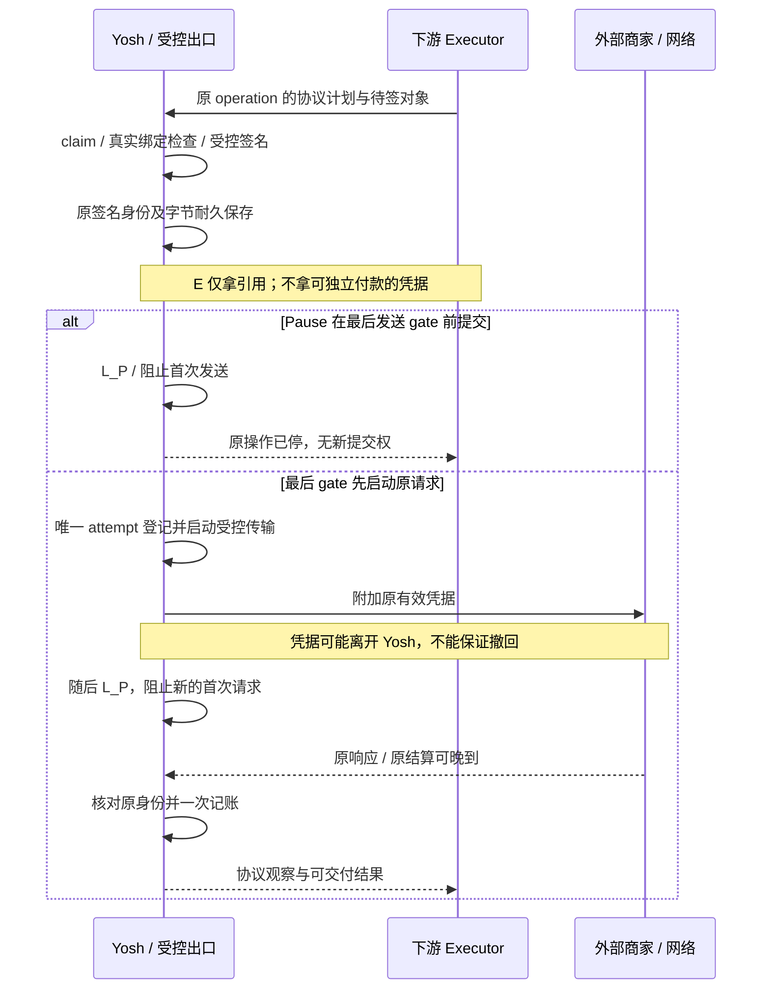
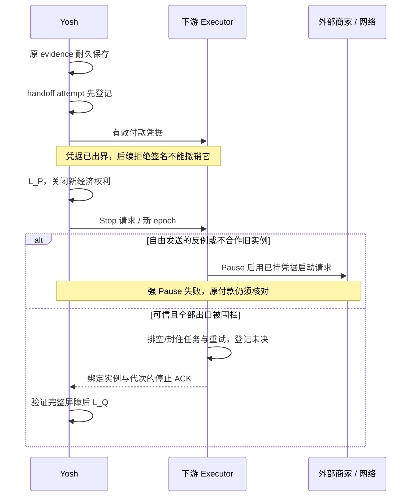

# Yosh — Signing, Submission & Pause Lifecycle Contract

日期：2026-10-17（Asia/Shanghai）。状态：**架构合同草案，等待审阅；不是集成验收或实现授权。** 本轮只新增本文。下文“必须”约束未来方案；“当前”仅描述已核对的源码。四阶段、控制事实与接口名称都是语义模型，不新增数据库枚举或生产 API。

## 1. 结论摘要与证据边界

**固定 Yosh 持钥；优先验证 Yosh 控制最后有效付款出口的方案 B。方案 A 保留为有明确信任前提的对照，不将合作式停止描述成签名撤销。两者均未通过跨进程实验，外部执行器真实付款目前 No-Go。**

- 当前可复用：同一经济策略、Grant、Daily Authority、原子 reserve/claim、受控签名、原证据先保存、首次提交登记、原交易核对、Unknown 预占、一次记账与独立交付恢复。[Y1][Y2][Y3][Y4][Y5]
- 当前本地 Pause 在持久阻止新执行后返回，不等待所有 signer/HTTP 工作结束。已启动请求可能在 Pause 后确认；继续核对并记账是正确行为。[Y1][Y3][Y6]
- 将有效凭据交给另一进程后，Yosh 拒绝新签名并不能阻止旧凭据发送。必须先选定最后出口、凭据持有人、停止屏障及崩溃恢复合同，再抽签名/执行接口。
- 推荐 B 的必要含义是：可独立付款的凭据不进入可自由联网的 Executor；最终发送实际调用与 Pause 由同一受信任控制者排序。仅“发送前问 Yosh 一次，然后交还完整凭据”仍属于 A。
- 若协议或 pay 当前接口无法保留该边界，先记录能力缺口，不把协议实现全部搬回 Yosh，也不降低停止保证后直接实付。

### 1.1 本轮核对结果

| 对象 | 当前核对 | 可支持的结论与限制 |
| --- | --- | --- |
| Yosh 工作树 | `/Users/irin/Desktop/yosh`，`main`，HEAD `f65c9bd30a2cad65493d2e70b15624be26e216ed`；存在原有未提交修改 | 以工作树为准，不以 HEAD 或安装版替代；目标文件在本轮开始时不存在 |
| 上一轮测试对应源码 | 与上一轮新增测试前的文件指纹比较，既有文件无变化；新增 `payment-pause-lifecycle.test.ts` 与当时临时构建副本相同 | 支持继续引用上一轮证据；本轮未重跑测试或执行签名 |
| 定向执行记录 | 保留 JSON：2026-10-17 17:14:02（UTC+8），4 文件、50 PASS、0 FAIL，包含新增 6 项 | 历史本地运行证据，不是本轮运行、安装版验收或跨进程证明；[原执行结果][R1] |
| 新测试的边界 | 真实 SDK、unsigned/signed binding、ledger guard、原交易核对；替换密钥来源、底层 signer、RPC、DNS 与 HTTPS socket | 两个 SQLite handle 在同一 JS 线程用 barrier 排序；非独立进程锁竞争。reserve 验证暂停后新请求拒绝，未另设跨进程 reserve 压力试验。[T1][T2][T3][T4][T5] |
| 现有两份报告 | lifecycle audit 与 local validation 是各自阶段的历史快照 | local validation 中“四项未覆盖”已由后续新测试补充；这是可解释的阶段演进，不覆盖旧报告、不冒充它已更新 |
| 工具/依赖 | 已安装 `@x402/core` / `@x402/svm` 2.25.0，`@solana/kit` 5.5.1，Vitest 4.1.11，Next 16.3.4 | 只核对本地版本，不声称最新上游兼容性 |
| 构建 | 上轮 typecheck/lint 通过；隔离副本 build 编译/类型检查完成，standalone 因临时路径 `EACCES` 未完成 | 本轮未重新构建、安装或启动 App；不能称最终打包已通过 |
| pay 工作树 | `/Users/irin/Desktop/open-source/pay`，`fix/journal-utf8-recovery`，HEAD `df57843e1f728fcc8ff8e42db78e0ad99372cd9d`，workspace 0.30.0；锁定 pay-kit rev `f8ef055b1d1c8ca8245f19bbca819faed9cfa058` | 只读本地源码，未 fetch、测试或联系维护者；不据此断言远端当前状态 |

本轮未发现具有当前可复现证据的 A 类付款安全缺陷。没有跨进程能力不是当前本地实现的 Bug；构建副本路径限制也不是付款安全反例。

## 2. 已固定的职责与信任前提

Yosh 保持私钥、受控签名权及唯一权威账本，负责 CardMember/连接认证、Grant 与版本、Daily Authority、预算、唯一经济事务、Pause/Revocation、原付款证据和 Unknown 恢复。私钥不经 IPC、签名请求、日志、App 或 Agent 接口导出；真实 Keychain 路径本轮未访问。[Y7][Y8]

下游 Payment Executor 保留支付协议能力：报价/挑战处理、协议构造、协议流程协调、响应解释及协议专属恢复材料。目标仍是 `Agent → Yosh Economic Authority → Payment Executor → Merchant / Network`；这描述职责，不要求每个字节都按该链路出站。最终凭据可由 Yosh 受控出口附加，协议代码仍来自官方 SDK/下游组件。

本文威胁前提：Yosh 与其 signer/最终 gate 可信；Agent、商家输入和 Executor 报告不能直接作为经济事实。A 还需要信任所有持有有效凭据的 Executor、线程、子进程、缓存与重试机制。B 尽量缩小该信任范围，但不抵抗 Yosh 本身被攻陷，也不撤销外部已收到的凭据。

**有效付款凭据**不仅是完整可广播交易：买方部分签名若可由商家/Facilitator 补签，也是可付款能力；协议 permit、会话密钥、voucher、缓存 Authorization 等若能产生新消费，同样纳入控制。公开 transaction ID、仅用于读取的关联 ID 则不当然具有消费权。分类须按协议验证，不能只按字段名判断。[Y9][P2]

## 3. 四阶段生命周期合同

四阶段不替代现有 `APPROVED / PAYING / PAYMENT_UNKNOWN / PAID / FAILED / EXPIRED` 等购买状态；原证据状态和交付状态分别保留。`RESULT` 是结果分类，包含待决 Unknown，并不全部是终态。[Y10]

### 3.1 RESERVED

**前置条件：** 后端构造不可变请求与报价；可信 CardMember/Grant/版本、资源身份、网络、资产、整数金额、收款方、钱包及 scope 一致；现行策略允许新消费。在同一事务内重新检查预算、Grant 与阻塞记录后预占。[Y2][Y7][Y11]

**后置条件：** 一条稳定购买记录为 APPROVED，预算与 Grant commitment 计入该金额；尚未拥有签名/发送权。当前映射是 `APPROVED`，无 payload/原证据、无 submission marker。

**不变量：** 同一 owner/scope 下同一请求键复用原购买，变更请求拒绝；不因重试新增预算。Pause 先提交则新 reserve 不被批准、旧记录不能 claim。Pause 不自动取消既有 APPROVED，其预占继续保留；独立的既有过期规则仍可释放未执行批准，不把“保留”解释为永不失效。

**Resume：** 不批量执行旧批准。明确重新请求原操作时，仍用原 ID、原不可变条件并重查当前 Grant、有效期、额度及执行绑定；需要换报价/关键条件时不能静默改写原单。未来取消须独立定义持久终态及执行权失效，本轮不新增。

### 3.2 EXECUTING

**前置条件：** 原 APPROVED 在事务中唯一 claim，重新通过策略/绑定检查；当前后置状态 `PAYING`。claim 证明唯一执行者，不等于可随意签名/发送。后续边界仍检查。[Y2][Y3]

| 子阶段 | 当前源码映射/将来新增事实 | Pause 后处理 | 安全释放预占的条件 |
| --- | --- | --- | --- |
| E1 尚未签名 | PAYING，无 payload，构造/preflight/simulation 等 | 不启动新的底层 signer；执行者终结后可 FAILED | 证明没有外部凭据、没有发送，并且旧任务不能晚启动；当前本地独占路径具备该前提 |
| E2 底层 signer 已进入，尚未返回 | `checkedSigner → signer.signTransactions` 的在途 Promise | 已开始运算可完成；迟到结果隔离，不形成新提交权。Pause 不承诺即时撤销运算 | 运算已结束或已不可产生外发回调；结果仅 Yosh 持有、未发送/未交出；不能在活 signer 所有权不明时仅凭数据库暂时无 payload 释放 |
| E3 有签名，仅 Yosh 持有 | 当前 savePayload 成功则原证据为 SIGNED_NOT_SUBMITTED；若 Pause 先赢，savePayload 可拒绝并不保存结果 | 关闭本地发送；保留已保存证据，安全终结为 NOT_SUBMITTED / FAILED | 唯一控制者确认未外发，所有迟到任务被封住。当前本地可证明；未来需 custody/执行所有权事实 |
| E4 凭据已/可能交 Executor | 当前无此外部路径；未来 handoff 事实 | 已越过 Yosh 独占边界；语义上立即按 MAYBE_SUBMITTED 处理，即使 Executor 声称尚未发给商家 | 初期合同不自动释放；失联、Stop ACK 或“未看到发送日志”均不足。须有可验证最终失败或另经验证的不可再执行/未付款证明 |

**签名不是发送许可，也不是 PAID。** 原交易身份、原字节和经济绑定必须在任何有效凭据离开 Yosh 之前耐久保存。当前路径先验证并生成原身份，再事务保存 payload/evidence，之后才登记提交和调用 HTTP。[Y3][Y9]

**Pause 与结果返回的顺序：** 不能靠两个进程的墙钟判断谁先。当前决定因素是该单后端内实际 signer 启动、savePayload guard、最后 submission guard 与 Pause 提交的顺序；Pause 保持生效时，迟到签名不能越过保存/发送检查。若发送启动先于 Pause，按 SUBMITTED 恢复。未来应由同一权威控制序列决定 `claim/sign job/credential release/send/Pause`，用持久代次使 Pause 前的未提交任务在 Resume 后也不能靠迟到回调复活。

最后一项“代次隔离”是 B 类新增能力：当前 Pause 没有 epoch，现有测试只覆盖 Pause 保持为 true 的窗口，不证明 Pause→Resume 后所有旧异步任务永久失效。不能把拟议强化倒推为已复现 A 缺陷。

### 3.3 SUBMITTED / MAYBE_SUBMITTED

保守边界是**凭据可能已交出**，不等到账本收到交易 hash 或 HTTP 200。当前本地映射：原证据 `SUBMISSION_ATTEMPTED / OUTCOME_UNKNOWN`，购买可为 PAYING 或 PAYMENT_UNKNOWN；将来外部 handoff 不确定也必须保守归类，不能继续借用本地 SIGNED_NOT_SUBMITTED 的释放含义。

| 事实 | 证明什么 | 不证明什么 |
| --- | --- | --- |
| 首次 submission attempt 耐久登记 | 已决定尝试外发，崩溃后必须按可能发送恢复 | 不证明实际请求已经启动，更不证明收款 |
| 原生 HTTP/协议发送调用启动 | 对原凭据启动了外部交换；可能产生不可逆效果 | 不保证对方接收、网络交付或最终结算 |
| 商家响应、Executor outcome、receipt/hash | 供关联/查询的观察值 | 不能单方面证明 PAID 或 FAILED；HTTP 成功不等于买到资源 |
| Yosh 验证的原付款结算证据 | 对同一经济绑定与原身份作权威记账 | 不证明 API 已交付；也不保证所有协议采用同一种最终性模型 |

不变量：保留原 ID、原身份、原 scope 和预占；Pause/撤销/超时/断连/崩溃不释放，不重签、不换 blockhash 或金额制造替代交易，也不以另一付款“修复超时”。submission 登记后、网络调用前恰好崩溃，宁可 Unknown，不推断失败。[Y3][Y4]

### 3.4 RESULT 与 Pause

| 结果 | Pause 的影响 | 财务与恢复合同 |
| --- | --- | --- |
| PAID + COMPLETE | 禁新消费；原结果仍可检索 | 一次 reserved→paid、一次权威确认；重复结果/查询不重记 |
| PAID + 交付 PENDING/不可用 | 付款事实不回退 | 只做声明能力内的交付恢复，复用原凭据或支付标识；不新签、不重新付款；当前持久重试上限四次 |
| 确定 FAILED：可证明未提交 | 不把原 ID 重新开放 | 仅在未提交及未来执行已封死的前提下释放预占，保留原因/证据 |
| 确定 FAILED：原交易最终失败 | 不新建替代单 | 当前 Solana 核对同一原交易 finalized error 才释放；confirmed error、回执失败不能代替 |
| PAYMENT_UNKNOWN | 历史核对继续，仍是待决 | 保留预占和原证据；RPC null/离线、历史缺失、凭据过期、进程退出均不是释放证据 |
| 已付但结果回调未抵达 | 接收晚到结果并主动核对 | outbox 重送同一事实；Yosh 验证后一次 PAID；旧 epoch 的历史事实仍可接收，不能因已暂停而丢弃 |

当前原付款成功允许 exact match 的 confirmed success 记 PAID；错误则继续查 finalized，不能把当前合同误写成所有成功都等待 finalized。[Y4][Y5][Y12]

## 4. Pause 行为与精确完成语义

### 4.1 四个独立控制事实

| 事实 | 精确定义 | 持久化/派生 | 返回/等待 |
| --- | --- | --- | --- |
| Pause Requested | 已提出指定 scope 的暂停意图；请求可能尚未耐久生效 | 客户端瞬时状态即可；要跨重启查询则服务端持久 pauseRequestId、scope、目标代次 | 可立即显示，但不能据此显示“已阻止” |
| New Payments Blocked | Yosh 权威入口已持久关闭：新批准、claim、底层签名启动、凭据新释放/发送权申请被拒 | 当前 paused 已持久；未来 pauseRequestId/控制代次与 paused 同事务提交 | **L_P：事务 COMMIT 成功才成立**；存储失败/ACK 丢失时查询原请求，不能猜成功 |
| In-flight Quiesced | 受影响代次中可启动新经济作用的工作已排空或封死；无未完成 signer/可启动首次提交的任务；已启动请求被分类为可能外发，只继续处理原结果 | 从持久 job/持有者/实例/停止检查点与当前存活性派生；不是新增购买状态。重启后不能复用无条件缓存的 true | **L_Q：完整停止屏障成立**；可以晚于 L_P。若失联者可能持有有效凭据、出口未封或 job 状态不可证，则 pending/unknown；超时不等于成功 |
| Historical Reconciliation Continues | 已外发/可能外发的原款仍可核对、结果可接收，已付交付可按既定能力恢复 | 复用原证据、reconciliation/delivery 持久进度；调度与可用性单独报告 | 不等待它全部终结才完成 Pause；RPC 离线显示 pending，不保证立即成功 |

`New Payments Blocked` 在 A 中必须注明 **authority admission** 范围：不再发新权利，但已拿到凭据的 Executor 可能仍在 drain 期间启动旧操作。若产品要求从 L_P 起连这类首次携款请求也不得新启动，A 只靠 IPC precheck/permit 无法满足。B 只有最后实际出口也纳入同一控制序列，才能把该范围扩大到 `authority + final egress`。

Quiesced 不等于所有链上交易已终结：已启动 HTTP、商家已持有的凭据、可能结算的原交易可继续确认；只读 RPC 也可仍运行。原 signer 尚在执行时保守返回 pending，待其完成且迟到结果隔离后再评估；不把“不会返回到 UI”当停止证明。

B 若已证明外部仅有非消费 handle、Yosh gate 已封死且本地 signer/发送任务已分类完毕，则 Executor 失联本身不阻止 L_Q；可同时报告“停止已确认、下游连接不可用”。不能为了等待无消费权进程的 ACK 无限阻塞，也不能在有效凭据暴露范围尚未证明时套用此例外。

### 4.2 当前本地线性化与未来跨进程排序

当前唯一后端持有 data-directory 写锁。Pause、claim、savePayload、marker 是同步事务；DNS await 在 marker 前；marker commit 与 `submit()`/`https.request()` 启动同步相邻，中间无 await。已开始的 signer/HTTP 不被 Pause 撤销。该性质依赖同一后端控制循环和全部入口经过它，不能直接推广到另一个进程拿到签名的情形。[Y1][Y2][Y3][Y6][Y13]

未来统一序列至少包含：

1. reserve/claim 与 signer job 绑定可信 owner、原 operation 和当前控制代次；实际 signer 启动也经 gate。
2. 结果先验签/绑定并持久化；所有可能的凭据 handoff **先记尝试再发送 IPC**，无 ACK 也保守记录可能暴露。
3. B 的最终 gate 在同一受信任临界区内重查控制/唯一 claim、登记 attempt、启动实际受控传输；不得在“许可”与实际调用之间另让自由进程排队。所有 Pause 写入也通过该控制者，不能另有写库通道绕开序列。
4. L_P 关闭新工作、提升未提交任务代次、拒绝迟到的新执行；随后停止所有旧实例队列、signer 回调、自动重试和缓存消费出口。
5. 汇总持有者/attempt inventory，保存停止检查点后才有 L_Q。存在未知有效凭据持有者/未封住的直连出口则报告不完整，保留预算；B 中只有非消费 handle 的失联进程无需被错误算作凭据持有者。

网络物理发送与 SQLite 无法原子提交。上述“启动”指受控传输调用开始，不承诺网卡字节都在 L_P 前发出；先启动的请求可继续传输或产生效果。不能把 permit 登记时间改名为真实 send 时间来掩盖异步间隙。

### 4.3 建议的快速响应语义（未来接口，未实现）

`requestPause(scope, requestId)` 在 L_P 后快速返回 `pauseRequestId / scope / controlGeneration / newPaymentsBlocked=true / blockedScope / quiescence=pending|confirmed|unknown / historicalRecovery=enabled|pending`；不携带有效付款凭据。HTTP 状态编码可后续选定，不能用一个 `paused:true` 同时表示四种事实。

后台用 `readPauseProgress(pauseRequestId)` 或同义事件返回 active signer 数、已封住/未确认的实例、可能外发数量与原因；只返回摘要。可有界等待 L_Q，超时反馈“新付款已阻止，执行器停止尚未确认”，不自动 Resume，不等待 Unknown 最终结算而无限阻塞 UI。

Resume 使用新的控制代次；只有明确的新领取/继续请求才开放执行。旧 epoch 不能重新申请签名/提交，但旧 operation 的结果、只读核对和已付交付仍被接受。Revocation 同样封住受影响 Grant/owner 的未来执行，不能撤销此前已交出的凭据。Quit 另外负责停止本机调度并等待已跟踪工作；不把当前 `prepareQuit` 已有 drain 描述成 Pause 已有能力。[Y6]

## 5. 签名与凭据交出的安全边界

### 5.1 不可撤回点与持久顺序

每笔操作区分 `signed evidence`、`credential handoff attempt/receipt`、`submission attempt`、`outcome observation`、`verified accounting result`；这些是不同事实。不得以其中一个代替其余事实。

未来必须依次满足：**原意图/预占/claim → 窄签名 job → 验证原签名身份并耐久保存 → 必要的 handoff 尝试登记 → 有效凭据交出/最后发送 → 原结果核对。** 任一存证失败不得把签名返回 Executor。签名只在 Yosh 内存产生、尚未出界时可安全阻止后续支付；外部可使用凭据的首个接收者可能是 Executor、商家或代理，不必是链。

IPC send 前写入 handoff attempt 后崩溃，即使实际上没发也按可能交出；IPC 已发但 ACK 丢失同样处理。不能因为 Yosh 没收到 ACK，把 operation 标为未提交或生成第二份签名。Executor 的“未收到/已删除”只是声明；不构成密码学撤销，也不自动释放预占。

### 5.2 方案 B 的候选时序：Yosh 保留最后出口

图中的 Yosh 出口是拟议可信边界，不表示 Yosh 必须自研整套协议。具体如何让下游协议驱动已批准传输，仍须 PoC 证明。

## 6. 两种提交控制架构的比较

| 维度 | 方案 A：可信 Executor 持有有效凭据并发送 | 方案 B：Yosh 控制有效凭据最后释放/发送 |
| --- | --- | --- |
| 权限控制 | Yosh 管签名和经济许可；Executor 在信任范围内控制最后发送 | Yosh 管签名与最终 gate；Executor 管协议计划/状态推进，不能自由获得付款能力 |
| Pause 保证 | L_P 后不发新授权；可信合作执行者完成 L_Q 后不启动旧首次发送。L_P 到 L_Q 有旧权利发送窗口 | gate 与 L_P 同序时可保证 L_P 后不新启动受控首次发送；此前已启动者仍可能结算 |
| 凭据暴露 | Executor 内存、日志/journal、缓存/子进程必须全部纳入信任与隔离 | 原凭据保留 Yosh/gate，首次出界就是受控请求；派生的 session/token 也必须保留该边界 |
| 进程崩溃 | handoff/提交 ACK 丢失保守 Unknown；不能因重启就认为无有效凭据 | Yosh attempt 写前日志与出口恢复；登记后崩溃仍可 Unknown，不能保证网络物理 exactly-once |
| 旧进程存活 | epoch/lease 只约束会检查它的出口；持有原字节的自由旧实例可绕过 | 外部旧实例仅有非消费引用时可由 gate 拒绝；若曾拿到有效凭据则该部分退化 A |
| 可恢复性 | 双方 journal/outbox、持有者 inventory、原身份及幂等回调；Yosh 最终核对 | Yosh 保留原证据/attempt；Executor 恢复协议进度但不能重签；原结果独立核对 |
| 多协议扩展 | 容易复用自由执行流程，但每个出口/会话消费都须服从停止合同 | 需要协议 SDK 的 transport/signer/credential-store 扩展点；无法表达的协议单独 No-Go |
| Yosh 改动 | 可信身份映射、handoff/job/epoch、外部生命周期恢复、ACK 与隔离 | 上述必要经济事实及最终 gate；受控传输/凭据存储接缝，保留协议专属校验，避免复制协议库 |
| 下游配合 | 窄 signer callback、写前存证、所有出口围栏、无自主签名 fallback、停止屏障、durable outcome | 协议构造/传输可分离、签名引用与受控 transport、响应/会话凭据隔离、原状态恢复 |
| 被攻陷后风险 | 可复制并发送已获凭据，超出一次合作许可；Yosh 只能拒绝后续签名，无法保证强 Pause | 若没有有效消费能力且 gate 不可绕过，攻击面较小；恶意计划仍须真实解析/绑定。Yosh/gate 被攻陷仍失守 |
| 无法消除的风险 | 外部收到的凭据可继续结算；持有者不诚实时无可靠撤销证明 | 已启动/已交商家的能力仍可能结算；存储/网络间隙、商家不支持安全交付恢复仍存在 |

### 6.1 A 的停止合同与信任上限

至少需要可信 Executor 注册、实例 generation、所有付款出口统一 gate、持久 attempt、完整任务/缓存 inventory、单调停止 epoch、排空旧回调与重试后 ACK。ACK 必须绑定 pauseRequestId、scope、目标代次、实例集合/最后处理序列及未决 operation 清单；过期 ACK 不能证明新实例已停。

fencing 必须由**资源实际使用点**拒绝旧权利。若商家/网络不理解 Yosh epoch，Executor 已复制原签名仍能自由提交；lease 失效不改变这一点。可信且不可绕过的外部发送中介可加强保证，但会扩大可信边界，不能将任意代理称为 gate。

已持签名 Executor 失联时只能报告 Yosh 新权利已关闭、外部停止未确认。即使后来有 Stop ACK，最初候选也不凭 ACK 自动释放已/可能交出的有效付款预算；需验证原最终结果或另设计充分证明。A 完全信任 Executor 不私自复制/使用凭据，是必须披露的前提。

### 6.2 B 如何保留下游多协议职责

先调查锁定 SDK/pay 的实际扩展点，优先复用其官方协议构造、headers、challenge、session 与响应处理；Yosh 只验证经济绑定、约束签名、保存证据并执行受控传输。可研究下游返回非消费计划/opaque handle、由 Yosh 托管协议库的最后传输回调等最小接缝，不预设 RPC/类层级或通用插件框架。

需要逐协议回答：签名覆盖哪些请求字段，session/permit 是否可跨请求消费，缓存认证是否让第一次 HTTP 就带消费能力，响应是否产生可转移的新 token，后台重试是否隐含新付款，以及怎样核对最终经济结果。一个 unsigned transaction→signed transaction→HTTP 模型不能自动覆盖这些流程。pay 的 cached authenticate/session 路径已说明仅拦截 402 后的 exact signing 不足。[P2]

职责建议：Executor 提供协议规则和有限状态推进；Yosh 控制经济作用许可、所有有效凭据存储/附加及原结果验证；商家原响应由可信出口接收，向下游传必要协议观察时不得顺带泄露可继续消费的凭据。响应解析、错误分类和安全重试按协议保留，不能让 Executor 自行将“再试一次”变成新签名/新支付。

若库强制把可消费字节交给自由联网的外部进程，B 未成立；若只在“最终释放”检查后仍放任该进程日后发送，边界仍是 A 的 handoff。若实现 B 要重写完整 x402/MPP 库，先记录 SDK 缺口并停止该协议接入，不以兼容之名破坏 Yosh 的最小职责。

### 6.3 推荐与尚缺的选择证据

**优先做 B 的无资金可行性验证，保留当前本地管线。** 需要证明：目标协议所需凭据可留在 gate、全部外发入口可纳管、真实库有足够扩展点、原身份可核对、旧实例绕不过出口。A 只有在接受其合作式信任与两阶段 Pause 语义后才可继续评估，不能冒称与 B 相同保证。

当前无法最终选择具体 API/进程布局；模拟 PoC 也不证明实际 pay 已满足这些接缝。最终选择需同时具备第 11 节故障实验证据及锁定下游版本的真实接口验证，不能凭架构图直接 Go。

## 7. 最小经济事务及幂等合同

本节只定义语义和所有权。每笔付款由 Yosh 维护**一个权威经济事务**；Executor journal 仅为执行与重送日志，不是第二份 Ledger，也不再独立判断 Grant 是否可消费。

### 7.1 不可变经济身份与持久事实

| 事实 | Yosh 必须拥有/持久化 | Executor 可报告与不可相信之处 |
| --- | --- | --- |
| operationId / 请求去重 | 可沿用当前后端 `intent.id` 为稳定经济 ID，保留 owner 绑定的 idempotencyKey、requestHash、原 scope；映射可新增但不改写历史 | 必须回传同一 ID；客户端/进程重启不能换 ID 逃避 Unknown |
| CardMember / Executor 身份 | CardMember、连接代次、可信 Executor 安装/实例映射由后端认证上下文决定；future executor generation 不等于 CardMember | 不能通过请求字段自称别人的 CardMember 或新增 signer 权限 |
| Resource / 请求 | 后端认可的资源版本/身份、规范化 URL、method、query/body/headers、不可变请求摘要、报价及有效期 | 下游给 challenge/构造建议；Yosh 校验，不能提交任意新 URL/任意交易 |
| 经济范围 | network/genesis、asset/mint/token program、decimals、十进制整数字符串 amount、recipient、钱包来源身份与实际 payer | ticker、下游余额、`allow:true` 均不足；不能切网络/钱包解释旧记录 |
| Grant / Daily Authority | Grant ID/version/owner/scope、原授权条件、预算预占和原子 claim | Executor 不写预算、不扩大授权、不消费第二次 Grant |
| 执行/job | 当前 claim 加未来 job/request hash、控制代次、可信 executor instance、不可变参数及开始/结束/失败事实 | lease 只是调度权；失联不证明 signer/发送已结束 |
| signed evidence | 原已签字节、消息/凭据身份、买方签名、quote/request/payload 摘要、付款绑定、恢复查询所需 lifetime/memo 等 | 只有 Yosh 验证通过且耐久保存才能交出；不接受下游任意“已签 hash”代替原证据 |
| credential handoff | 将来保存 custody/provenance、目标实例、credential digest、handoff ID、尝试先于 IPC、ACK 及不确定性 | 接收 ACK 可说明观察到交接，不能证明从未复制、以后不可使用；无 ACK 不等于无交接 |
| submission attempt | 稳定 attempt ID、原 operation/evidence、出口、控制代次、唯一初次发送登记与结果未知切点 | 下游报告实际 send 观察；Yosh 的预登记不伪装成实际送达 |
| outcome / 核对 | 验证过的原成功/最终失败、来源/证明及一次账本转换；观察值与权威结论分开 | transaction ID/receipt/HTTP 200/失败字符串都是候选证据，不直接授权 PAID/释放 |
| 控制与恢复 | paused/控制代次、停止检查点、实例 inventory、原款未决集合、持久退避/游标、已付交付次数、协议/记录兼容版本 | 不能因进程“已启动完成”、TTL 到期、空 journal 或 integration disabled 自行清空未决 |

当前 identity/evidence 实现专用于 Solana x402 exact，已经检查实际指令、账户、金额、mint、fee payer、memo 和签名，不只信报价。未来不能为了抽接口把这些校验降为 opaque bytes 或仅 hash 相同。[Y7][Y9][Y11]

### 7.2 语义操作与失败语义

| 语义操作（非生产 API） | 授权/幂等条件 | 失败后的允许行为 |
| --- | --- | --- |
| reserveOperation | owner/scope/requestKey 唯一；同键同绑定返回原记录，冲突拒绝；原子预算/Grant 判断 | 不产生签名/提交；已存在记录不因暂停/重试重复占额 |
| claimOperation | 仅原 APPROVED 可领取一次；带当前控制代次和可信实例 | 失败不转移执行权；同 ID 查原状态，不创建替代单 |
| requestControlledSignature | job ID、原 operation、完整 unsigned 内容/经济绑定、钱包与权限均校验；只允许窄用途，不提供任意 sign(bytes) | 已持久结果则复用原结果；job 是否完成未知时查原 job，不再次调用 signer。允许重发查询，不允许自动换待签消息 |
| recordSignedEvidence / handoffCredential | 原证据先保存；重复请求查询原接收者/原 digest 的交接事实，不因 ACK 丢失自动再次释放凭据，不隐式扩散新持有者 | 无法确认结果是否交出则 Unknown/custody unknown；保留预算、无替代签名 |
| beginFirstSubmission | 唯一 attempt、完整请求和原证据绑定，经最终 gate；同 ID 重试首先查状态 | 登记后失败、发送/ACK 未知仅核对原交易；不盲重发。第一次登记与网络动作不是物理原子事务 |
| observeOutcome / reconcileOriginal | outcome ID 去重，原 operation/identity 匹配；只读核对独立授权；最终转换事务幂等 | 认证/证据不符隔离并保留原款；重复/乱序消息不能回退 PAID 或释放 Unknown |
| recoverPaidDelivery | 仅已验证 PAID、原 capability/endpoint/证据和持久次数；必要时复用原已付凭据 | 不新 signer、不发生新经济执行；不支持恢复则明确 Unsupported/人工处理 |
| pause / resume / shutdown | requestId 幂等、scope/代次单调、停止证明按当前实例集合判断 | 超时不宣称停稳；断线不恢复付款；关机后重启继续原核对 |

签名 job 的写前事实和外发前结果保存必须覆盖“调用成功但返回丢失”窗口。不能用仅进程内布尔值保证跨重启只签一次；若无法确认旧 job 停止或找到原结果，保持冻结并报告。当前本地独占恢复与未来外部 job 的推论不同。

查询/幂等重放默认只返回状态和非消费引用，不能借“取回既有签名结果”在 Pause 后新交出有效凭据。通用 App/Agent 查询不返回 signed payload；任何实际凭据释放都重新经过 handoff/最后 gate 合同。已付交付恢复仅在原 capability 与受控传输内使用原证据，不开放任意下载付款字节的接口。

### 7.3 幂等与恢复不变量

1. 每个原购买最多一个权威 reservation/claim；每次 budget/Grant 变更在同一事务中发生。Executor journal 不再扣第二次预算。
2. 签名参数一旦绑定不可因重试更换；结果重放返回同一原凭据/状态。RPC 重试、晚回调和重启不产生新付款。
3. 提交登记一次不等于外部 exactly-once。网络动作结果未知时保留预算，通过原 identity 核对；不声称 SQLite 与 HTTP 可物理 exactly-once。
4. 一次权威 PAID 转换、重复 outcome 幂等；同 operation 不同 identity/outcome 冲突隔离。旧 epoch 的**事实**可接收，旧 epoch 的**新执行请求**拒绝。
5. 只有可证明未提交且旧能力已封死，或匹配原付款的可信最终失败，才释放。Unknown 不因尝试次数/有效期/失联自动释放。
6. 初期只接受能证明一个有界经济效果和原结果的协议能力。session/voucher 多动作要另定金额增量、累计上限、nonce/版本与结算证明；不能强塞成“一次 claim，之后不限次数消费”。

## 8. 关闭、回滚及恢复规则

| 事件/对象 | 必须保留的行为 | 不允许的简化 |
| --- | --- | --- |
| 关闭新集成入口 | 拒绝新 reserve/claim，持久关闭相应路由 | 把 integration flag 作为所有恢复代码的总开关 |
| 关闭新签名 | 拒绝新 job；等待/隔离旧 signer 结果，不交出迟到凭据 | 退出 signer 连接就声称旧 job 已取消 |
| 关闭新提交 | 最终 gate 关闭；A 向全部可信实例发停止请求并收集屏障 | 只关闭 UI/MCP入口、让后台重试继续自由付款 |
| 运行中的 Executor/旧实例 | inventory/代次/出口围栏覆盖它们；可能持有有效凭据或仍可外发者失联时保持停止未知；B 的非消费 handle 受已封 gate 约束时可停稳 | 只通知新实例，按 PID 或租约超时猜旧者已死 |
| 已交出的有效凭据 | 保存持有/交接与可能外发事实，按原款核对 | 删除缓存/撤 Grant 就把原款当未支付 |
| PAYMENT_UNKNOWN | 原 identity、scope、预占、历史查询与退避继续 | 清记录、迁移成新钱包、换签名重试 |
| 已付但回调丢失 | 结果接收入口继续接收旧 operation；outbox 重送；Yosh 主动核对 | 要求用户重新买一次才能触发记账 |
| PAID 交付失败 | 独立、限次恢复；端点/凭据仍绑定原购买 | 用新支付恢复响应，或停集成就丢失已付结果 |
| Yosh 单方重启 | 先关闭新入口，取得本地 owner；读取 provenance/交接事实，重连或封住所有外部实例，再恢复 | 认为本机 owner lock 自动证明 pay 无在途付款 |
| Executor 单方重启 | 新 generation，先查原 operation/attempt；恢复结果/outbox，不自动再次执行付款 | journal 重放直接再次调用 signer/发送新交易 |
| 回滚/旧 Yosh | 保留兼容恢复版本，关闭新功能但保留账本/结果接收/核对；不兼容二进制不得写这些记录 | 将新库交旧启动清理函数、靠“旧版本会忽略新字段”保证安全 |

### 8.1 `recoverUnsubmittedOnStartup` 的适用边界

当前该函数只允许**唯一服务 owner、没有其他活 signer/执行者**时运行；无 payload 或 SIGNED_NOT_SUBMITTED 且无 send marker，可证明本地尚未提交。owner 是独立 SQLite 写锁，进程死亡释放；不约束未来 pay 进程或已外发的字节。[Y13]

未来必须先有明确且持久的 execution provenance/custody，再按记录分类恢复：

- 已知旧本地记录：保持既有恢复规则，验证迁移没有改变金额、状态和原证据。
- 外部记录但可证明未交出、旧 job 已终结且唯一出口封死：才考虑本地式未提交释放。
- 外部已/可能 handoff、send marker 缺失、Executor 仍活或状态不可证：保留 Unknown/预占；缺 marker 不证明未付款。
- 来源/版本无法解释：冻结、报出待恢复，不按默认 local 分支清理。

**仅在新表写 `minimumReaderVersion` 并不能约束不认识它的旧二进制。** 在启用第一笔 external record 前，须实证不兼容旧版无法打开并执行财务写入：可研究受验证的启动/安装兼容门或存储层写入保护，保持同一权威 Ledger；具体机制待设计。若无法阻止旧版误释放，就禁止该回滚路径并保留恢复兼容二进制，不得让用户试着降级。单纯 feature flag 不够。

关闭顺序应为：持久阻止新经济工作 → 最终出口/全部实例停止与未决分类 → 保存恢复责任与兼容能力 → 允许关机/关闭集成；恢复端点与原款核对不得随购买入口一起卸除。已有外部凭据不能因回滚恢复成“本地未提交”。

## 9. Yosh 内部解耦的最小方向

本轮不抽接口、不建 Adapter。下列顺序是后续范围建议，不是新的路线图或阶段实施授权。

| 当前模块 | 耦合与必须保持的逻辑 | 可研究的最小接缝 / 推迟项 |
| --- | --- | --- |
| authority-policy / spend-grant / atomic-money | 金额、策略、Grant scope/version，已有纯规则 | 保持一个实现；不让 Executor 再做权威判断 |
| purchase-ledger / monetary-scope | 预占、唯一 claim、所有者、预算/Grant commitment、状态、事件与恢复事务；quote/intent/evidence 类型含 x402/Solana 字段 | 优先保留现有事务；将来附加经过版本化的执行来源与证据处理，不能先换整套 Ledger 或全量通用化 |
| request-registered-resource-purchase / market-spend-adapter | 原请求实例、x402 challenge、报价绑定、reserve/execute/reuse | 可先识别“取得并验证报价”“执行原批准”的调用边界；不可丢掉 immutable request 与原单重放 |
| approved-payment | 混合 claim、x402 binding、preflight、签名、HTTP header/发送、核对、交付 | 最终 gate/持有者确定后再分离协议执行步骤；当前入口保留为安全基线。先换成任意 Executor.execute 过早 |
| solana-payment / purchase-signing-authorization | 官方 SDK、真实 unsigned 交易、模拟、Mainnet 窄签名与绑定 | 仅能暴露经批准 operation 的窄请求；保留解析/允许指令等 x402/Solana 专属验证；不变成通用任意签名器 |
| original-payment-evidence / original-payment-record / reconcile-transaction | SPL 指令、fee payer 补签、原消息/签名、网络与最终失败规则 | 当前 validator 完整保留；未来按已支持协议提供具体证明类型/核对器，不假定所有协议都是 tx hash + RPC |
| safe-resource-fetch / resource-challenge | URL、SSRF、DNS pinning、redirect/大小、x402 wire challenge | 可研究受控传输出口，但须覆盖所有新经济请求与会话缓存；不能只把 fetch 换成外部自由客户端 |
| delivery-recovery / reconciliation schedule | PAID 交付与 Unknown 只读核对分离，持久 claim/次数/游标 | 复用调度/财务不变量；协议恢复能力先声明并校验，未知付款不借交付接口重放 |
| app-runtime / owner lock / 管理及 MCP入口 | 同一后端业务入口、Pause、Quit、启动恢复 | 将来增加代次/实例停止协调；管理/Agent 分权仍保留，App/MCP 不直连私钥或另建授权路径 |

不应提前设计“任意链任意协议任意签名”的插件框架，也不将付款成功、API 成功、提交成功压成一个 `execute(): success`。只支持经过验证的协议能力；若每个新协议都需要新的经济授权规则，则先确定规则与证据，再扩展接口。[Y3][Y7][Y9][Y11][Y12]

迁移必须保持一个权威 reserve/claim/Grant 路径。同一 operation 只选一个 executor provenance，不能本地尝试不确定后转外部再试，也不能外部结果丢失后 fallback 本地付款。新旧执行共存时用原记录选择恢复器，不根据当前 feature flag 改写历史归属。

## 10. A / B / C 责任划分

| 类别 | 本轮结论 | 后续处理 |
| --- | --- | --- |
| A 当前独立 Yosh 实际缺陷 | **未确认有当前可复现付款安全缺陷。** 暂停不释放旧 APPROVED、不等待 signer、允许已发款确认、允许 PAID 交付恢复、本地独占启动释放未提交，均有明确成立前提 | 如后续得到反例，独立保存失败用例并修复；不夹带在外部 Adapter 迁移中。当前不以未来缺口要求修补生产代码 |
| B Yosh 外部能力 | 可信 Executor 映射、持久 signer job/代次、handoff/custody/provenance、最终 gate、完整 Pause 进度、外部恢复分类与兼容阻断、幂等 outcome inbox | 先审阅合同并做无资金可行性实验，证明后分步设计；当前均未实现 |
| C 下游协同 | 可插入窄 signer/受控 transport、全部经济出口和缓存认证覆盖、实例 fencing/停止 ACK、跨重启 operation/journal/outbox、原证据/恢复数据、协议 capability 协商、禁自主钱包 fallback | 只记录为未来 RFC #505 / PoC 接口需求；不修改 pay、不向上游发送消息、不假定维护者已接受 |

已核对的 pay MCP `pay → handle_pay → fetch_with_payment → execute_payment → FetchClient::fetch` exact 路径由本地 signer 构造付款 headers 并直接请求；未发现与 Yosh operation/Grant/handoff/停止屏障同义的强制接缝。cached authenticate/session 还能在首次请求附带 Authorization，必须一并覆盖。[P1][P2][P3]

不能因此说“pay 完全没有 journal”：专用 push 路径先将签名记录 fsync，再调用 broadcaster，并用私有 permit 登记 broadcast 结果。这个 permit 约束 journal 记录接口，不能据此声称网络广播 API 本身都需要该 permit。该专用路径不自动成为 MCP exact、session 或 Yosh 的交接/停止合同，也不使原签名可撤销。[P4]

## 11. 最小无资金可行性实验设计（本轮不编写、不运行）

### 11.1 实验构成与观测

独立进程 `Yosh 模拟 authority/gate` 与 `Executor 模拟端`；另有假商家/假结算器和测试编排器。使用隔离临时 SQLite、一次性离线 signer 或仅供假结算器识别的 capability，禁止真实 Keychain/产品 Ledger/Mainnet。IPC 与假商家只在测试私有通道通信，无真实外网权限。先验证候选合同，不使用真实 pay；以后另行授权验证锁定库接缝。

两侧各持久记录 operation、instance/generation、job、evidence digest、handoff/attempt、消息序列/ACK、停止检查点和 outcome；仅 Yosh 账本改变钱。使用编排器可控的跨进程 barrier，按观测事件排序，不用随机 sleep/墙钟猜竞态。记录 signer start/complete、credential exposure、真实 fake merchant 请求启动、假结算次数、PAID 事件及 paid/reserved/Grant commitment。

A 对照包含一个明确不合作的旧 Executor：已拿凭据后忽略 epoch。B 对照仅让旧实例持有无消费能力的 handle；若能取得凭据并绕过 gate，这就是 B 假设失败，不将失败从报告删掉。

### 11.2 故障切点与判据

| # | 切点/调度 | 必须观察的结果 / 推翻条件 |
| --- | --- | --- |
| 1 | reserve 后 Pause/claim 两种事务先后；再做 reserve/暂停独立竞争 | Pause 先提交拒绝新权利；claim 先赢仍不能越过后续 gate；同 operation 只有一个经济 claim/预占，不只跑同线程顺序测试 |
| 2 | signer 已进入，挂起返回；L_P 后放行 | 启动 1、完成可为 1；无新 handoff/首次请求，旧 job 不因 Resume 复活；未外发证明成立才释放 |
| 3 | 签名存证完成、handoff 前暂停 | 原 evidence 已保存，无凭据出界；停止后可安全未提交终结；若先交出再补证即失败 |
| 4 | Executor 已拿有效凭据、尚未发送；暂停 | A 只有完整可信停止屏障后才报告 L_Q；失联不报成功。B 外部拿到有效凭据即否定“不暴露”假设；handle 必须无法绕过 gate |
| 5 | 首次真实假商家请求启动与 L_P 竞争，两种顺序 | B：L_P 先赢则请求 0，启动先赢则原款可继续；A：明确 L_P→L_Q 窗口，不能把预许可算成已真实发送来通过 |
| 6 | handoff/permit 前后断开 Executor，模拟不确定 IPC 到达；分别测试 A 有效凭据与 B 非消费 handle | A 或暴露范围不可证时：新权利拒绝、quiescence unknown、保留原预算。B 已证明仅 handle、gate 封死且本地任务停稳时可 L_Q，无需等失联端 ACK；可证明未外发才释放，否则仍保留原款。两者都不能以无 ACK/空 journal 释放或补签 |
| 7 | 新实例上线后放行仍活的旧实例/旧缓存/旧定时重试 | 旧权利不能在 gate 生效；A 若旧者能直发，必须被实验发现并否定强保证；Stop ACK 需覆盖全部实例 |
| 8 | attempt 或 handoff 登记成功后杀死一端，丢弃结果 ACK | 重启保守 Unknown，查原 operation/evidence；不创建新 attempt/签名。保留“登记后尚未发送”的歧义以验证不会误释放 |
| 9 | 请求已启动，暂停后假结算器再确认原付款 | 一次 PAID、reserved→paid；结果即使来自旧 epoch 仍可核对；不误报已取消、不第二次付款 |
| 10 | 重复/乱序 outcome，Yosh 与 Executor 分别重启；关闭集成再恢复 | 一次经济记账、原证据不改、原交付限次恢复；无新 signer/首次付款；关闭购买入口仍接收历史结果 |
| 11 | 已付交付恢复、cached auth/session 自动重试、首个请求就带消费能力 | 所有可能产生新经济效果的出口都进 gate；纯原款核对/已付交付能继续；隐藏新消费即失败 |
| 12 | external record 交给不兼容旧 Yosh 的隔离副本 | 在任何财务清理前被拒绝；旧函数不得把“无本地 marker”当未付款释放。仅设置新字段但旧版照常写库即失败 |

每项至少断言：原 identity/digest 与不可变绑定、预占/paid/剩余额、唯一 claim、签名 start/complete、首次请求/假结算计数、一次 PAID 事件、持久控制代次及重启状态。结果未知不是实验失败本身；错误释放、重签、虚假 L_Q、或未披露的越界发送才是合同失败。

### 11.3 必须失败的简单方案反例

仅实现 `authorize → sign → Executor 自由发送`：让 Executor 持有有效凭据并停在发送前，Yosh Pause 后再放行它。预期假商家仍收到请求并可结算，证明强 Pause 不成立。

该反例否定简单外部合同，不证明当前 Yosh 本地路径有同样缺陷。模拟通过也不能标记“pay 已集成”或许可真实资金。

## 12. P0 / P1 / P2 决策与 Go / No-Go

| 级别 | 必须明确的决策 / 证据 | 当前状态与门槛 |
| --- | --- | --- |
| P0 | 采用的保证是 L_P 起所有首次付款出口关闭，还是 A 的 authority 先关、L_Q 后合作停止；有效凭据的全部持有人与最终发送者是谁 | 优先验证 B；A 仅作条件候选，最终进程/SDK接缝未选定。语义含糊即 No-Go |
| P0 | 原证据先保存、handoff 写前事实、未知交接、sign job 跨重启去重、Pause/Resume 旧代次隔离 | 未来 B/C，当前未实现；任一窗口能误释放/重签则 No-Go |
| P0 | 最终 gate 不可绕过：首次 auth、session/voucher、缓存、后台重试、旧实例都覆盖；非合作情形反馈真实 | 必须跑第 11 节实验并审阅实际锁定协议接缝；只靠 precheck/lease 不通过 |
| P0 | external provenance、单方重启、关闭集成仍恢复、旧版本财务写入阻断 | 必须在第一条 external record 前验证；不能让当前启动恢复误用本地独占推论 |
| P1 | 第一批支持的协议/方法/凭据形态、响应传递、协议专属校验与核对、恢复能力/Unsupported | 先限定现有可证明 exact 能力；session 等另立合同，不为未知协议做通用化 |
| P1 | 可信映射、outcome inbox/outbox、进度接口、bounded drain、操作观察与诊断脱敏 | 后续 Yosh + 下游共同设计；不增加第二 Ledger/Grant，等待审阅与授权 |
| P2 | 完整故障回归/多实例压力、锁定 pay 实际 PoC、性能/安装版/Pause/退出/回滚验收及正式打包 | 当前本地定向测试不能替代；standalone 限制仍未解决。不得提前标验收完成 |

**可以 Go：** 审阅这份合同、选择候选保证并另行授权编写第 11 节无资金实验。实验是下一项待授权工作，本轮没有执行。

**生产解耦 Go：** P0 决策有明确证据、候选合同通过故障实验，且锁定 SDK/下游接缝能实际实现同一保证后，才考虑另行授权分步抽接口；现有本地路径与财务不变量继续回归。

**真实付款 No-Go（当前）：** 跨进程实验/真实接口验证尚缺、持有/出口合同未最终落实、兼容恢复未证明。即使后续技术门槛通过，也仍需具体 API/收款方、用途及金额上限的付款授权；本文不提供该授权。

## 13. 源码、函数与行号

以下均为本轮核对的本地工作树位置；链接不表示本轮运行成功。引用中的后续语义设计不等于这些函数已实现外部合同。

| 引用 | 文件、函数与证据 |
| --- | --- |
| Y1 | [PurchaseLedger.setPaused:498][Y1]；事务 [atomic:264](/Users/irin/Desktop/yosh/src/modules/purchases/purchase-ledger.ts:264)；[settings PUT:12](/Users/irin/Desktop/yosh/src/app/api/app/settings/route.ts:12)；[AppRuntime.setPaused:620](/Users/irin/Desktop/yosh/src/modules/app/app-runtime.ts:620) |
| Y2 | [reserve:675][Y2]；[claim:732](/Users/irin/Desktop/yosh/src/modules/purchases/purchase-ledger.ts:732)；[assertCanSign:509](/Users/irin/Desktop/yosh/src/modules/purchases/purchase-ledger.ts:509)；[savePayload:756](/Users/irin/Desktop/yosh/src/modules/purchases/purchase-ledger.ts:756)；[evaluateSpendAuthority:52](/Users/irin/Desktop/yosh/src/modules/authority/authority-policy.ts:52) |
| Y3 | [executeApprovedPayment:136][Y3]：signer/load/prepare/save 在 153–161，DNS/marker/submit 在 169–171，catch 在 185；[markSubmissionAttempt:806](/Users/irin/Desktop/yosh/src/modules/purchases/purchase-ledger.ts:806) |
| Y4 | [reconcileStoredOriginalPayment:115][Y4]；[inspect:95](/Users/irin/Desktop/yosh/src/modules/payment/reconcile-transaction.ts:95)：confirmed success 与 finalized failure 区分 |
| Y5 | [reconcileApprovedPayment:88][Y5]；[confirmOriginalPayment:835](/Users/irin/Desktop/yosh/src/modules/purchases/purchase-ledger.ts:835)；[failOriginalPayment:850](/Users/irin/Desktop/yosh/src/modules/purchases/purchase-ledger.ts:850)；[unknown:939](/Users/irin/Desktop/yosh/src/modules/purchases/purchase-ledger.ts:939) |
| Y6 | [AppRuntime.start/recover:280][Y6]，启动恢复在 288，调度 330/355；[prepareQuit:380](/Users/irin/Desktop/yosh/src/modules/app/app-runtime.ts:380)；[track:275](/Users/irin/Desktop/yosh/src/modules/app/app-runtime.ts:275) |
| Y7 | [SpendIntentSchema:12][Y7]；[SpendAuthorityBinding:16](/Users/irin/Desktop/yosh/src/modules/authority/spend-grant.ts:16)；[createX402SpendIntent:14](/Users/irin/Desktop/yosh/src/modules/resources/market-spend-adapter.ts:14)；[resourcePaymentBinding:12](/Users/irin/Desktop/yosh/src/modules/payment/resource-challenge.ts:12)；[assertProductionPaymentGate:12](/Users/irin/Desktop/yosh/src/modules/purchases/production-execution-gate.ts:12) |
| Y8 | [loadBuyerSigner:7][Y8]；[loadEnvironmentWalletSigner:127](/Users/irin/Desktop/yosh/src/modules/app-wallet/product-wallet.ts:127)；[purchaseSigningAuthorization:8](/Users/irin/Desktop/yosh/src/modules/purchases/purchase-signing-authorization.ts:8)；[prepareSolanaPayment:55](/Users/irin/Desktop/yosh/src/modules/payment/solana-payment.ts:55)，实际 signer 启动 110 |
| Y9 | [createSignedPaymentIdentity:76][Y9]；identity schema 20、unsigned 检查 159、完整证据校验 169、补签匹配 182；[OriginalPaymentRecordSchema:7](/Users/irin/Desktop/yosh/src/modules/purchases/original-payment-record.ts:7)；[ledger 原绑定校验:768](/Users/irin/Desktop/yosh/src/modules/purchases/purchase-ledger.ts:768) |
| Y10 | [PurchaseStatusSchema:3][Y10]；转换表 24；[OriginalPaymentStateSchema:19](/Users/irin/Desktop/yosh/src/modules/purchases/original-payment-record.ts:19)；[managedSummary:955](/Users/irin/Desktop/yosh/src/modules/purchases/purchase-ledger.ts:955)；[grantCommitted:352](/Users/irin/Desktop/yosh/src/modules/purchases/purchase-ledger.ts:352) |
| Y11 | [requestRegisteredResourcePurchase:26][Y11]：reuse 32、原单查找 50、reserve 66；[monetaryScopeId:28](/Users/irin/Desktop/yosh/src/modules/purchases/monetary-scope.ts:28) |
| Y12 | [recoverPaidDelivery:53][Y12]；[receiveOriginalDelivery:44](/Users/irin/Desktop/yosh/src/modules/purchases/delivery-recovery.ts:44)；[recoverApprovedPayment:197](/Users/irin/Desktop/yosh/src/modules/purchases/approved-payment.ts:197)；[delivery claim:40](/Users/irin/Desktop/yosh/src/modules/purchases/purchase-delivery-store.ts:40)；[PaymentReconciliation:9](/Users/irin/Desktop/yosh/src/modules/purchases/payment-reconciliation.ts:9) |
| Y13 | [acquireDataDirectoryOwnership:12][Y13]；[AppRuntime 取锁:88](/Users/irin/Desktop/yosh/src/modules/app/app-runtime.ts:88)；[recoverUnsubmittedOnStartup:535](/Users/irin/Desktop/yosh/src/modules/purchases/purchase-ledger.ts:535)；[failUnsubmitted:866](/Users/irin/Desktop/yosh/src/modules/purchases/purchase-ledger.ts:866)；[prepareSafeResourceFetch:7](/Users/irin/Desktop/yosh/src/modules/resources/safe-resource-fetch.ts:7) |
| T1 | [真实 SDK/guard/安全传输/原款核对正向对照:186][T1]；fixture 的外部替身在 14–23 |
| T2 | [Pause 先赢:207][T2]；[claim 先赢:238](/Users/irin/Desktop/yosh/tests/unit/payment-pause-lifecycle.test.ts:238) |
| T3 | [signer 已进入未返回:279][T3]；实际保存因 Pause 拒绝且原证据有效的断言在 297–303 |
| T4 | [DNS 挂起:320][T4]；真实 lookup 断言 325，marker 因 Pause 拒绝 341–343 |
| T5 | [首次 HTTP 已启动再 Pause:359][T5]；原交易核对/一次 PAID/重开不重付在 385–412 |
| P1 | [MCP exact build→fetch:1218][P1]；[其它 exact 分支:1172](/Users/irin/Desktop/open-source/pay/rust/crates/mcp/src/tools/curl.rs:1172)、[1379](/Users/irin/Desktop/open-source/pay/rust/crates/mcp/src/tools/curl.rs:1379)；[MCP Params:69](/Users/irin/Desktop/open-source/pay/rust/crates/mcp/src/tools/curl.rs:69)；[LocalContext caller:128](/Users/irin/Desktop/open-source/pay/rust/crates/mcp/src/context.rs:128) |
| P2 | [首次请求 cached authenticate/session:1080][P2]；[session/subscription 分支:1410](/Users/irin/Desktop/open-source/pay/rust/crates/mcp/src/tools/curl.rs:1410)；[响应解释:1599](/Users/irin/Desktop/open-source/pay/rust/crates/mcp/src/tools/curl.rs:1599) |
| P3 | [FetchClient 最终 send:832][P3]；[静态 permissions 可选:34](/Users/irin/Desktop/open-source/pay/rust/crates/cli/src/commands/mcp.rs:34)；[precheck:214](/Users/irin/Desktop/open-source/pay/rust/crates/mcp/src/permissions.rs:214)；[workspace 版本:8](/Users/irin/Desktop/open-source/pay/rust/Cargo.toml:8)、[pay-kit rev:122](/Users/irin/Desktop/open-source/pay/rust/Cargo.toml:122)、[lock:8806](/Users/irin/Desktop/open-source/pay/rust/Cargo.lock:8806) |
| P4 | [push journal 的私有 permit:131][P4]；[签名 journal 先落盘:315](/Users/irin/Desktop/open-source/pay/rust/crates/core/src/client/push/journal.rs:315)；[push executor 存证→广播:264](/Users/irin/Desktop/open-source/pay/rust/crates/core/src/client/push/executor.rs:264)；均不是 MCP exact 全局 Pause 合同 |

[Y1]: /Users/irin/Desktop/yosh/src/modules/purchases/purchase-ledger.ts:498
[Y2]: /Users/irin/Desktop/yosh/src/modules/purchases/purchase-ledger.ts:675
[Y3]: /Users/irin/Desktop/yosh/src/modules/purchases/approved-payment.ts:136
[Y4]: /Users/irin/Desktop/yosh/src/modules/payment/reconcile-transaction.ts:115
[Y5]: /Users/irin/Desktop/yosh/src/modules/purchases/approved-payment.ts:88
[Y6]: /Users/irin/Desktop/yosh/src/modules/app/app-runtime.ts:280
[Y7]: /Users/irin/Desktop/yosh/src/modules/authority/spend-intent.ts:12
[Y8]: /Users/irin/Desktop/yosh/src/modules/payment/wallet.ts:7
[Y9]: /Users/irin/Desktop/yosh/src/modules/payment/original-payment-evidence.ts:76
[Y10]: /Users/irin/Desktop/yosh/src/modules/purchases/purchase-state.ts:3
[Y11]: /Users/irin/Desktop/yosh/src/modules/purchases/request-registered-resource-purchase.ts:26
[Y12]: /Users/irin/Desktop/yosh/src/modules/purchases/delivery-recovery.ts:53
[Y13]: /Users/irin/Desktop/yosh/src/modules/app/data-directory-owner.ts:12
[T1]: /Users/irin/Desktop/yosh/tests/unit/payment-pause-lifecycle.test.ts:186
[T2]: /Users/irin/Desktop/yosh/tests/unit/payment-pause-lifecycle.test.ts:207
[T3]: /Users/irin/Desktop/yosh/tests/unit/payment-pause-lifecycle.test.ts:279
[T4]: /Users/irin/Desktop/yosh/tests/unit/payment-pause-lifecycle.test.ts:320
[T5]: /Users/irin/Desktop/yosh/tests/unit/payment-pause-lifecycle.test.ts:359
[R1]: /var/folders/l7/7_2w6sp51p57k00hbxp2k5c40000gn/T/yosh-pause-regression-nt9hfu5c/final-regression.json
[P1]: /Users/irin/Desktop/open-source/pay/rust/crates/mcp/src/tools/curl.rs:1218
[P2]: /Users/irin/Desktop/open-source/pay/rust/crates/mcp/src/tools/curl.rs:1080
[P3]: /Users/irin/Desktop/open-source/pay/rust/crates/core/src/client/fetch.rs:832
[P4]: /Users/irin/Desktop/open-source/pay/rust/crates/core/src/client/push/journal.rs:131
