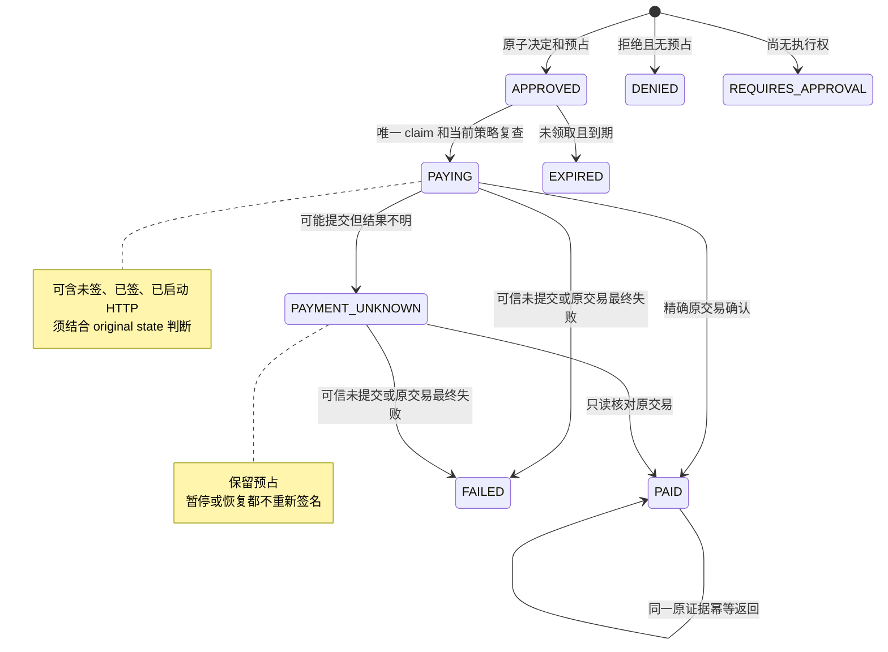
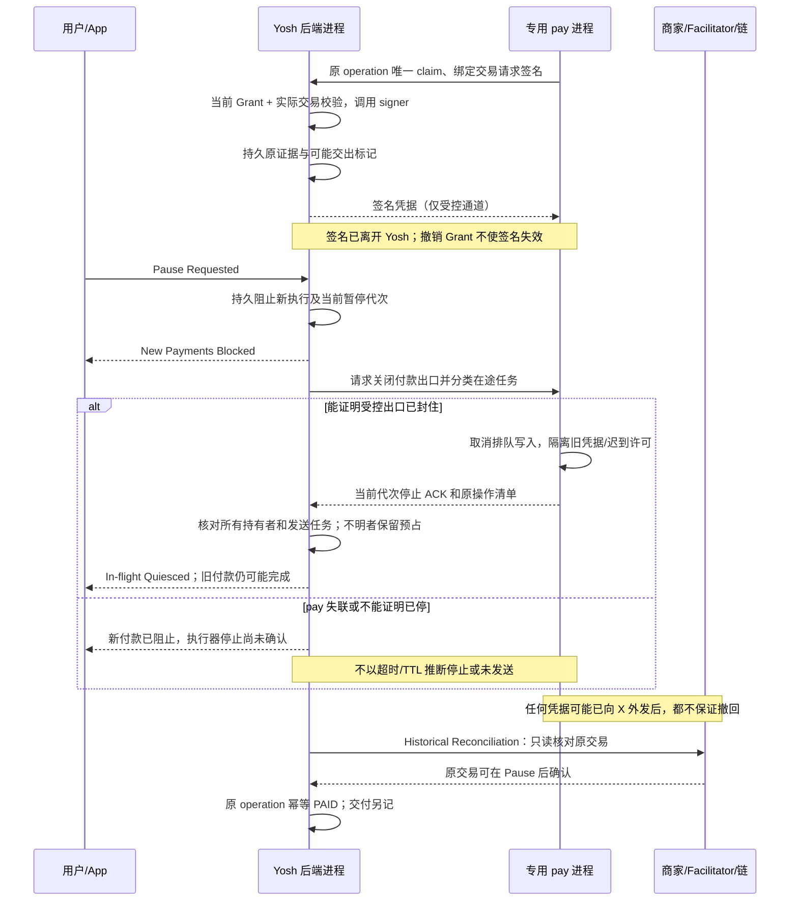

# Yosh × pay.sh — Payment Lifecycle & Pause Semantics Audit

日期：2026-10-17（Asia/Shanghai）。范围：只读源码审计与设计建议。**核心对象是 Yosh 当前独立运行的付款生命周期；不开展联合开发。** 本轮只新增本文，不修改生产代码、App、钱包、真实账本、总计划或依赖，不运行支付、签名、服务、测试、构建或安装，不 Commit/Push。

## 1. 执行摘要

**当前 Yosh 的单后端付款控制有真实源码基础；不能把未来双进程的缺口倒推为现有实现的缺陷。** `reserve` 原子预占，`claim` 唯一领取执行权，真实 signer 调用前再检查，原 payload/交易身份先持久化，首次付款 HTTP 请求前再检查并标记；Unknown 仅核对原交易，不重新签名或购买。[Y3][Y4][Y5][Y6][Y7]

当前 Pause 是**持久的付款准入控制**，不是取消订单、撤销签名或等待所有在途工作结束的 API。它停止后续受控签名/首次付款请求的启动；已经启动的 signer 调用、HTTP 请求、商家结算和历史恢复不因此自动撤销。`prepareQuit` 才等待本地已跟踪操作；不得把它的行为写成 Pause 已有能力。[Y1][Y2][Y5][Y8]

### 1.1 按责任分类的结论

| 分类 | 本轮结论 | 后续归属 |
| --- | --- | --- |
| A：Yosh 独立运行的实际缺陷 | **本轮未确认可以定为 A 的付款安全缺陷。** 暂停不立刻释放 APPROVED、暂停不等待所有 Promise、PAID 的交付恢复继续运行，以及独占启动释放可证明未提交的本地记录，均不能仅因未来接 pay.sh 而判错 | 没有据此提出生产代码修补。下文的本地验证缺口若被反例证实，再单独建立 A 类修复，先补失败用例，不与外部适配捆绑 |
| B：Yosh 为外部 Executor 新增/解耦 | 签名结果可能交出后的持有事实、外部所有权、受控签名与发送协调、暂停完成证据、外部恢复和关闭兼容性，当前均未实现 | 进入后续 Yosh 解耦/Adapter 设计；不改掉现有正确的本地恢复推论 |
| C：pay.sh/跨系统接口 | mandatory authority hook、绑定购买的 signer 适配、全部付款出口的围栏、durable journal/outbox、跨重启购买 ID 和停止确认，当前 pay MCP exact 路径不具备同义合同 | 仅记录为未来 RFC #505 需求，不在本轮实现或向上游发消息 |

**钱包方向保持用户已选的首选研究模式：Yosh 持钥，pay.sh 执行支付协议。** Yosh 持钥能控制新签名，但不能使已交给 pay.sh 的签名失效。若 pay.sh 可以不受控地保存/发送该凭据，Pause 无法强制阻止它提交；必须先明确受信任执行边界并用隔离实验验证，否则实付继续 Blocked。

本轮结论来自源码与已有测试定义，**没有运行测试，也没有重验安装版、真实宿主或链上状态**。“未确认 A”不等于完整安全证明。

### 1.2 基线与文档版本

- Yosh：`/Users/irin/Desktop/yosh`，分支 `main`，HEAD `f65c9bd30a2cad65493d2e70b15624be26e216ed`。已有 wallet/runtime/ledger、测试和 plan.md 未提交修改，审计以当前工作树为准；不使用 HEAD 代替这些内容。
- pay.sh：`/Users/irin/Desktop/open-source/pay`，分支 `fix/journal-utf8-recovery`，HEAD `df57843e1f728fcc8ff8e42db78e0ad99372cd9d`；已有未跟踪 `docs/architecture/`。未拉取或切分支。
- Yosh lockfile：`@x402/core` / `@x402/svm` 2.25.0、`@solana/kit` 5.5.1；pay 锁定 `solana-pay-kit` revision `f8ef055b1d1c8ca8245f19bbca819faed9cfa058`、`solana-keychain` revision `44b479df245167ca3b3a4e04d6d907146306d342`。[V1][V2]
- 下载目录实际只找到 [Yosh-pay-integration-master-plan.md](/Users/irin/Downloads/Yosh-pay-integration-master-plan.md)，含 2026-10-17 三点审阅修订和阶段 1.5；**未找到 V2 文件，没有待裁决的版本冲突**。本轮参考的 SHA-256 为 `286dcf6726f4b0645763d0324184be5d0203e85dddb8b1eeeae8dd52dd48cc02`。
- 同时参考项目 [plan.md](/Users/irin/Desktop/yosh/plan.md)、[原集成审计](/Users/irin/Desktop/yosh/docs/architecture/pay-sh-integration-audit.md)、[原付款恢复设计](/Users/irin/Desktop/yosh/docs/architecture/mainnet-readiness/original-payment-recovery.md)、[条件主网执行](/Users/irin/Desktop/yosh/docs/architecture/mainnet-readiness/conditional-mainnet-execution.md)。历史验收不作为本轮运行证据。
- 总计划中的 `pay-sh-signing-submission-contract.md` 是前次编辑时预留、尚未生成的文件；不把该链接当已存在的设计证据，本轮也不修订该计划。
- 已读取 [RFC #505](https://github.com/solana-foundation/pay/issues/505)。可见讨论涉及启动 YAML 和可选外部授权，不能据此声称生命周期 hook 已获接受或实现。后文 C 类均为接口建议。

## 2. 当前 Yosh 真实状态机

### 2.1 实际调用链

`request_purchase` strict schema → `scripts/mcp.ts::callApp` → 认证的 `/api/agent/purchases` → `AppRuntime.requestPurchase / performPurchaseRequest` → `requestPaidResourcePurchase` → Mainnet 的 `requestRegisteredResourcePurchase` → `PurchaseLedger.reserve` → `executeApprovedPayment` → 官方 x402 SDK + checked signer → 持久原证据 → 首次携款 HTTP 请求 → buyer RPC 核对 → `confirmOriginalPayment` / Unknown / finalized failure → 独立交付及恢复。[E1][E2][E3][E4][Y3][Y5]

Agent 提交稳定 requestId、Resource ID、用途及获准输入，不提交金额、交易、私钥或批准事实。后端构造不可变请求、取得报价并绑定成员/Grant；重放先取 `(CardMember, requestId)` 原记录，同键改参拒绝。Mainnet 请求的 `PAYING/PAYMENT_UNKNOWN/PAID` 重放走恢复，只有尚未执行的 `APPROVED` 会尝试原批准的唯一 claim。[E4][Y9]

主审范围是当前 App/MCP 的 registered Mainnet 实付主线及共享付款/恢复模块；Devnet 与历史测试入口按实际分支区分，模拟 PAID 另作标记。旧模型执行器和自建 Paid API 不被当成新的产品路径。

### 2.2 三套事实必须分开

| 事实 | 当前表示 | 不代表什么 |
| --- | --- | --- |
| Purchase 状态 | `APPROVED / PAYING / PAYMENT_UNKNOWN / PAID` 等 | PAYING 不证明已签名；APPROVED 不证明当前仍可执行；PAID 不证明 API 已交付 |
| 原凭据/提交事实 | `purchases.payload`、`original_payments`、buyer signature/message identity、submission marker | 有签名不代表结算成功；marker 代表可能发送，不代表商家收到；无回执不代表没付 |
| 外部结算事实 | 正确网络上的精确原交易经 buyer RPC 匹配，成功或 finalized failure | HTTP 成功、商家 receipt、任意 txid 或 executor 自报 outcome 均不能单独代替 |

`OriginalPaymentState` 当前为 `SIGNED_NOT_SUBMITTED / SUBMISSION_ATTEMPTED / OUTCOME_UNKNOWN / CONFIRMED / FINALIZED_FAILED / NOT_SUBMITTED`。交付另有 `NOT_PAID / PENDING / DELIVERING / COMPLETE / EXHAUSTED / UNSUPPORTED`，receipt 也单独记录。[Y10][Y11][Y12]

### 2.3 全部实际 Purchase Status

| 状态 | 当前准确含义 | 预算 |
| --- | --- | --- |
| APPROVED | 初始决策批准，账本已预占；尚未唯一 claim，不是可离线执行的许可 | 保留预占 |
| DENIED | 被当前授权/预算规则拒绝；不执行付款 | 不计入预占 |
| REQUIRES_APPROVAL | 初始决策要求另行批准；不是 Agent 已得到授权 | 不计入预占 |
| EXPIRED | 未 claim 的过期 APPROVED 经到期处理转换；不是链上交易失败 | 退出预占统计 |
| PAYING | claim 已提交；覆盖构造、签名、保存证据、可能发送及等待核对的多个时刻 | 保留预占 |
| PAYMENT_UNKNOWN | 结果未定，或执行/恢复无法证明成功或最终失败；可能缺证据 | 保留预占 |
| PAID | live 路径已经确认精确原付款；模拟模式另有模拟确认，不是链上证据 | 预占转已付；交付另记 |
| FAILED | 已证明未提交，或精确原交易 finalized 失败；须看证据区分 | 不再预占；不等于退款 |

`purchase-state.ts` 定义全部八项及受控转换；旧 `REJECTED / NEEDS_CONFIRMATION` 只作兼容读取。`decision.decision` 是初始决策，不随执行终态自动改写，不能替代 `status`。[Y4]

### 2.4 关键时间点、唯一性和金额

1. **预占：** `reserve` 的 `BEGIN IMMEDIATE` 中查重、算承诺、评估 Daily Authority/Grant、插入决定和购买；APPROVED 一写入就参与预占统计，不存在先返回批准再独立扣预算。[Y3]
2. **唯一执行权：** `claim` 同事务要求 `APPROVED`、未过期、未暂停、当前 Grant/资源/额度有效且无冲突付款，再转换 `PAYING`。第二个 claim 不再符合状态。reserve 去重不等于执行领取。[Y6]
3. **真实签名：** `solana-payment.ts::checkedSigner.signTransactions` 先严格核对 unsigned transaction、simulation、最后同步授权检查，才调用底层 `signer.signTransactions`；此前加载 Keychain signer 不等于交易已签。[Y7][Y13]
4. **保存原证据：** `approved-payment.ts:161` 同步调用 `savePayload`，事务内写原 payload 和 `OriginalPaymentRecord`。绑定金额、币种/精度、双方 ATA、buyer signature、message hash、fee payer、memo、网络/创世哈希、blockhash/lifetime 等，且重新验证实际签名身份。[Y5][Y10][Y14]
5. **可能产生不可撤回付款效果：** DNS 安全解析完成后，`markSubmissionAttempt` 先持久化，随后无 `await` 间隔调用 `submit()`。从这一步保守视为可能把签名凭据交给商家；不等待 facilitator/RPC 广播才认定风险。[Y5][Y15]
6. **确认：** `reconcileApprovedPayment` 核对正确网络、精确原 message 和 buyer signature；成功转 PAID，原交易 finalized 失败转 FAILED，缺失/错误/超时保留 Unknown。赞助方补签会改变 wire bytes；在首个 fee-payer 签名槽未完成时，客户端可能尚无最终 canonical txid。原 buyer message 身份不能改变。[Y16][Y17]

日预算在同 monetary scope 下统计当日 PAID + 所有 APPROVED/PAYING/PAYMENT_UNKNOWN；未决预占跨日继续计入。Grant 是生命周期累计。金额以整数处理；确认转已付发生在确认日，不在暂停时释放。`hasBlockingPayment` 对 PAYING 串行化，并对 Unknown 按 scope、证据及 Resource/endpoint 关联阻挡，不能简化成所有 Unknown 永久冻结全部无关消费。[Y18]

## 3. 当前 Yosh Pause 真实行为

### 3.1 点击到后端返回

原生 `.paused` 操作 → `OverviewClient.setPaused` → 独立认证管理 `PUT /api/app/settings` → `AppRuntime.setPaused` → `PurchaseLedger.setPaused`。它只在事务内更新当前 monetary scope 的 `monetary_controls.paused`；不撤销 Grant、不修改购买、不主动释放预占、不 abort 正在执行的 signer/HTTP、不等待 `active` Promise。[Y1][Y2][U1]

UI 的成功提示是 `Payments paused`，展示由 `budget.paused` 得到 `Paused`。这证明控制开关已保存，**源码没有为它提供“所有在途操作已停止”的独立事实**；现有文案也没有明说已撤回原交易，不能仅凭一个 Paused 标签定为 A 类资金缺陷。[U1][U2]

作用域是当前环境/钱包/网络/资产的共享控制，涵盖该 scope 下所有 CardMembers；切换 Agent 不生成独立暂停或日额度。暂停管理请求本身还在传输/认证/读取 body 时，后台可能已经开始付款，不能把点击时刻视为后端已经阻止新执行的时刻。[Y1][Y18]

### 3.2 在哪里检查 Pause，检查几次

以下以**一次正常成功、managed、registered Resource、Mainnet、SDK 调用一次 checked signer 的首次付款**为边界。`assertCanSign` 可达 8 次，另有 reserve 和 claim 两处独立准入检查；不是所有模式/失败/恢复路径都固定十次。

| 检查位置 | Mainnet 正常路径次数 | 来源 |
| --- | --- | --- |
| reserve → evaluateSpendAuthority | 1 | `authority-policy.ts:72`，与写购买同事务 |
| claim 当前 controls.paused | 1 | `purchase-ledger.ts:743` |
| 加载 signer 前、加载后 beforeSign | 2 | `approved-payment.ts:153 / 155` |
| prepareSolanaPayment 入口 productionGuard | 1 | `solana-payment.ts:68` |
| Mainnet preflight 返回后 productionGuard | 1 | `solana-payment.ts:83` |
| simulation 后 onSimulation → beforeSign | 1 | `solana-payment.ts:104` |
| 真实 signer 调用前 productionGuard | 1 | `solana-payment.ts:105`，到调用之间没有 await |
| savePayload 内 assertCanSign | 1 | `purchase-ledger.ts:758` |
| markSubmissionAttempt 内 assertCanSign | 1 | `purchase-ledger.ts:808` |

上述 guard 均有当前源码调用依据，不是根据回调名称推定。`productionGuard` 通过 `purchaseSigningAuthorization` 再进入 ledger，并验证原请求/报价和已有 payload；Devnet 没有这些 Mainnet 专用 guard，reconciliation/已付交付恢复有意不做新消费 Pause 检查。[Y5][Y7][Y13]

### 3.3 当前竞态的准确结论

- **Pause vs reserve/claim：** 依 SQLite 写事务获得锁并提交的顺序，不按用户点击的墙钟顺序。Pause 先提交，后续新批准/claim 被拒；claim 先提交仍必须经过后续签名/首次发送守卫。现有事务已解决本地领取竞争，不需要为了未来 pay 反称它缺少原子性。[Y2][Y3][Y6]
- **Pause 发生在 Keychain/preflight/simulation/DNS 的 await 中：** await 后有相应 guard；在当前单后端中不会仅凭 await 前的旧检查继续开始新签名/首次付款请求。[Y5][Y7][Y15]
- **底层 signer 调用已经开始：** Pause 不取消它。结果返回时若仍暂停，`savePayload` 会拒绝；当前 catch 在没有已保存/可能外发证据时走未提交失败。即使内存曾产生签名，只要未离开当前受控后端且唯一发送链路尚未启动，这个释放推论仍成立。**不是“没落盘就从未签名”。**[Y5][Y6]
- **Pause 位于保存 payload 后、DNS 完成前：** 最后 `markSubmissionAttempt` 仍检查，暂停则不会启动首次请求；凭据仍仅由本地受控后端持有，可在未提交规则下终结。[Y5][Y15]
- **marker 与 submit：** 二者在当前 JS 同一同步执行段，管理 Pause handler 不能插入两者之间；这建立的是“新请求启动”的顺序，不是对网卡每一个字节的撤回保证。已启动请求仍可在 Pause ACK 后发送缓冲数据、到达商家或结算，应归入 MAYBE_SUBMITTED。[Y5][Y15]
- **Pause 后很快 Resume：** 没有取消标记或暂停代次。旧 APPROVED 在未过期且授权仍有效时可在原 requestId 重放中 claim；已开始的 PAYING 工作若尚未碰到暂停检查，也可能在恢复后继续。该行为是“暂停不是取消”的现状，不能未经产品决策就定为漏洞。PAYMENT_UNKNOWN/PAID/FAILED 等不会因此回到 APPROVED。[Y9][Y4]
- **签名或请求完成/确认发生在 Pause 后：** 不等于在 Pause 后新启动签名/付款。必须保留启动、凭据是否交出和确认时刻三种事实，避免误报竞态。[Y5]

### 3.4 本地独占、退出与恢复

`AppRuntime` 在打开 ledger 前取得 data-directory owner lock；它是在专用 `backend-owner.sqlite` 上保持的 SQLite 写锁。`close` 拒绝仍有 active 操作，`prepareQuit` 设置 `accepting=false`、停止新支付、停止恢复调度并等待 active。启动未提交释放函数的注释也明确禁止其他 live executor/signer 仍存在时使用。[Y8][Y19]

因此当前 `recoverUnsubmittedOnStartup` 对本地“无 payload 的 PAYING”以及有可信 `SIGNED_NOT_SUBMITTED`/无 send marker 的记录释放，是**有前提的正确设计**；不是 A。未来 pay.sh 可跨 Yosh 重启继续持有签名时，该前提不再覆盖 external records，需要 B/C 独立所有权和恢复规则。

本轮未运行已有 owner-lock、暂停、重启测试，也未审验安装版，以上只证明源码边界。

## 4. 四种情形下的安全处理

本节 RESERVED / EXECUTING / SUBMITTED / RESULT 是分析阶段，**不建议直接新增四个数据库枚举**。必须结合真实 Purchase Status、original state、持有者和外发事实判断。

### 4.1 RESERVED：已预占、未 claim

映射：`APPROVED`、无已领取执行权、尚无付款 payload。当前 Pause 立即持久封住后续 claim，但**不立即释放已有预占**；请求层可能返回仍是 APPROVED 的原记录。到期处理可转 EXPIRED，日/Grant 统计随之不再预占。[Y3][Y6][Y9]

两种安全产品选择：

1. **维持现状，暂停但不取消：** 保留 APPROVED 和预占；暂停时拒绝 claim；Resume 后只允许原操作在原报价/Grant 仍有效时领取，不自动批量执行。
2. **暂停同时取消未领取购买：** 只有在同一事务确认未 claim、未签且持久封死该 operation 后才能释放；以后同 ID 必须返回取消终态，不能再 claim。当前没有对应 APPROVED→取消的入口，不能用只支持 PAYING/UNKNOWN 的 `failUnsubmitted` 冒充已有实现。

建议不在本轮改变现状。是否采用第二种是 P0 产品决策（B），不是当前 A；取消所需记录形式留给后续设计，不必先增加四个总状态。

### 4.2 EXECUTING：claim 后，尚未确定对外提交

| 子阶段 | 当前 Yosh 独立运行 | 未来 Yosh 持钥 + pay 执行的要求 |
| --- | --- | --- |
| B1：尚未调用 signer | PAYING，后续同步 guard 拒绝新签名；初始执行者 catch 依据未提交事实转 FAILED | B：原 operation 保持唯一；撤销执行权且排除旧持有者继续动作后才能取消/释放 |
| B2：signer 正在执行 | 已开始调用不能靠 Pause 撤回；返回后不允许新提交，尚未交出则可安全终结 | B/C：将签名 job 纳入暂停等待；迟到签名只入受限证据/隔离状态，不得在暂停后交出新的可执行结果；不依赖取消 Promise 假定密码运算已停 |
| B3：已签、尚未交给 pay | 当前相当于仅本地持有；无 marker 且独占控制发送，可证明未提交 | B：先持久原证据；签名返回通道有交出边界，响应/ACK 丢失也要记录可能交出；不能先返回再尝试 savePayload |
| B4：pay 已持有签名、尚称未发 | 当前产品没有这种外部持有状态 | **B/C Blocker：** Grant 撤销不让签名失效；必须控制所有持有副本、发送队列、重试及旧进程，收到可信停止确认。只有 pay 自报“未发送”或日志缺失不够；无法证明安全不可再用时保留预占并按 Unknown 恢复 |

**不能直接把当前 `savePayload` 暴露成外部 signer 的存证 API：** 当前它会在暂停时拒绝写 payload。在纯本地路径中结果未交出，所以安全；未来如果先给 pay 签名再因暂停无法保存，Yosh 会丢失可核对身份。外部合同必须把“记录已经发生的签名事实”与“是否允许继续执行/交出”分开，暂停不能阻止记录旧事实。[Y6][Y10]

暂停后的未提交释放需要同时满足：原 operation 已被封住；不存在仍可用的签名/提交权限；可证明凭据没有交给商家/facilitator/RPC 等不受控方。首版对已可能交出的记录建议保守保留；若希望自动释放，须另行证明全持有者/全部发送任务已封住且从未外发。删除一份缓存、过 TTL、心跳失联都不是证明。

### 4.3 SUBMITTED / MAYBE_SUBMITTED

映射：Purchase 仍可能是 PAYING，也可能已转 PAYMENT_UNKNOWN；original state 为 `SUBMISSION_ATTEMPTED / OUTCOME_UNKNOWN`。首次携款 HTTP 写入已启动，或 marker 已落盘但崩溃使是否真正发送不明，都按可能付款处理。[Y5][Y10]

- 新 reserve 的批准、claim、新签名/付款启动必须受 Pause 阻止；原外部结算仍可能继续。
- 保存并核对原 buyer-signed identity；没有 canonical txid 时使用 buyer 公钥/签名、message、memo 等匹配赞助方补签后的原交易。不能以任意 receipt txid 代替验证。[Y14][Y16][Y17]
- HTTP 4xx/5xx、重复 402、连接关闭、Abort、RPC 查无记录或 blockhash 过期均不能单独证明未付款；不释放 Unknown，不重新签名，不换 blockhash 重付。[Y5][Y16]
- 当前买方恢复是只读 RPC，不再向商家补发未确认凭据。pay 崩溃后未来由 Yosh 原证据主动核对，executor outbox 只重复送同 outcome；缺失 outcome 不代表失败（B/C）。[Y16]
- Pause 后原付款确认，正常幂等记 PAID，预占转已付并保持交付状态独立；不退回预算、不伪装取消。[Y10][Y11]

协议上的原因：x402 SVM exact 的赞助流程先将部分签名付款凭据交给商家，再由 sponsor 补签并广播。**不可保证撤回的边界是凭据离开受控域，不是看到 txid 的时刻。** 这是从协议流程及本地 pay-kit 的 `settle_exact` 得出的边界判断。[x402 exact 规范](https://raw.githubusercontent.com/coinbase/x402/main/specs/schemes/exact/scheme_exact_svm.md) [K2]

### 4.4 RESULT：PAID / FAILED / UNKNOWN

- **PAID：** 已消费保留，暂停不会退款；继续确认历史事实和可支持的交付恢复。API 交付失败不能抹掉已付事实。[Y10][Y11]
- **精确原交易 finalized failure：** 记录 FAILED，释放该币种付款预占；这不等于所有网络费用退回。当前 Mainnet gate 拒绝 buyer 作为 sponsor，不能将本次 USDC 记账结论推广到未来自行付 gas 模式。[Y10][Y16][Y20]
- **可证明从未提交且执行权不能再用：** 本地可按现有未提交失败规则释放；external 必须额外满足持有/围栏证明。不能只按状态名称 FAILED 或 pay 自报错误释放。[Y6][Y19]
- **PAYMENT_UNKNOWN：** 保留承诺及原证据，继续只读核对；即使长时间未知也不自动释放。过期只能限制未来接收，不能证明过去没结算。Solana 文档区分提交与确认，并说明有效期；Yosh 当前选择了更保守的未知款恢复规则。[Solana 提交文档](https://solana.com/docs/rpc/http/sendtransaction) [确认与有效期](https://solana.com/developers/cookbook/transactions/confirmation) [Y16]
- **链上成功但交付失败：** PAID + PENDING/UNSUPPORTED/EXHAUSTED，使用 Resource 已声明的原付款恢复能力；最多四次恢复重试，次数/退避持久化，不签第二笔。[Y11][Y12]
- **已付但 pay 回传丢失：** 未来仅重送原 outcome，由 Yosh 原证据核对后幂等确认。不得重新执行购买（B/C）。当前本地已实现相同原交易核对及重复确认幂等，不需要另一套会计规则。[Y10][Y16]

当前 `claimDelivery` 有意不检查 Pause/Grant active；它要求已验证 PAID、持久交付 claim 和原请求绑定。恢复可以重放同一份已付凭据或查询已声明的缓存/identifier，不重新签名。这是当前已付款履约语义，**不是 A 类“暂停绕过”**。外部设计需要分清安全履约重放和未确认付款重发，不能用“继续恢复”绕过新付款控制。[Y11][Y21]

## 5. pay.sh 的执行与签名边界（对照，均不实施）

### 5.1 已有能力与具体缺口

| 问题 | 锁定源码事实 | 分类 |
| --- | --- | --- |
| 何时生成有效凭据 | pay-kit `build_payment` 构造 unsigned tx 后调用 `TransactionSigner`，随后编码；pay-core 包成 payment header | C：已有构造/签名能力，无 Yosh 控制 |
| 何时发送 | `curl.rs` 三个 exact 分支取得 `BuiltPayment.headers`，接入同一个 fetch closure；直接 exact 在 1236 调用；最终 HTTP `.send()` 在 fetch.rs:833 | C：已有发送，无跨进程暂停围栏 |
| 外部授权接缝 | 选定 offer、`permissions.authorize_x402` 后、`build_payment_with_override` 前有候选位置：1176、1221、1381 | C：可修改的接缝，不是现成 Hook；发送前也须受控 |
| 可否不交出私钥 | kit 接受 `&dyn TransactionSigner`，理论可用远程/跨进程受控 signer；pay-core 当前会选 accounts/store signer | B/C：Yosh 专用桥不存在，不能把已有 remote backend 当作现成 Yosh 集成 |
| 有签名后能否独立提交 | 当前 builder 给 curl 可用 header，fetch 不再询问 Yosh；有凭据可走商家结算 | C：能使用所得凭据；撤销 Yosh Grant 无法使旧签名无效 |
| 身份/购买 ID | `LocalContext.scope(_call)` 忽略 caller，返回共享 accounts/approval；`curl::Params` 没有持久 operationId | C：需可信 member/executor 映射和跨重启续接 ID，不能用 JSON-RPC ID |
| 崩溃证据 | exact MCP 的 BuiltPayment/header/结果主要在调用内存；未见同义的每购买原证据+首次外发标记+持久 outcome outbox | C：可能丢签名身份、是否交出/发送和响应；专用 push/session journal 不等价 exact 购买恢复 |
| 是否知道消费成功 | `interpret_retry` 保留 exit code/body/content type，丢弃 headers 等事实；Completed 不是链上付款确认 | C：需原证据/响应事实回送，由 Yosh 独立核对 |

证据：[P1][P2][P3][P4][P5][K1][K2]。上述缺口属于 future integration，**不构成 Yosh 当前 A 类缺陷**。

### 5.2 为什么 AuthGate / YAML 不能解决 Pause

- `Gate::for_policy(false, override)` 返回 Disabled；ephemeral 直接取内联 keypair；不需要本地 credentials 的 hardware provider 不走该 credential AuthGate；legacy OnePassword backend 忽略传入 Gate。它们不等于钱包不受保护，只是**不能把该 override 当作全部付款必经的经济授权口**。[P6][P7][P8]
- 已加载 local MemorySigner/remote signer 的实际 `sign_transaction` 委托也不是 Yosh 当前 Grant/预算/提交生命周期。`AuthIntent`、钱包交互审批不替代 reserve/claim/发送后核对。[P4][P6]
- 首次 fetch 前已有 subscription/session 缓存认证；有 MPP、upto、batch、SIWX fallback 等分支。external exact 模式必须逐项拒绝不支持模式、处理缓存及模型自填付款头，不能只在一条 exact match arm 加检查。[P1]
- YAML 在 CLI options 构建时读取并编译，保存于 LocalContext；没有与 Yosh Pause 关联的动态 reload 或在途 drain 合同。origin/network/amount 限制是额外防线，不撤销已签凭据。无 YAML/flags 时 `permissions=None`，不能假定默认已启用一个静态预算。[P2][P9]
- hosted PolicyGate 的内存 UTC 日计数按签名意图记录，不是 Yosh 的持久 paid+reserved 账本，不作为本地 Pause 的替代方案。[P10]
- 本地 fetch 的 Unrestricted 分支没有与 hosted 相同的显式 10s/60s 超时配置，还支持 debugger proxy/redirect。未来有凭据请求须限制所有转发、日志、重试和未登记目的地；不能只守住到某个函数的首次调用。[P5]
- `do_paid_fetch` 的 session request mutex 覆盖请求/重试周期，只是当前进程的局部串行化，不是 Yosh 的提交/暂停围栏。未来停止控制通道不能被同步 HTTP 或同一请求锁无限阻塞，否则无法提供有界的停止进度。[P1]

### 5.3 未来 RFC #505 最小需求（C）

记录需求，不发 PR/评论、不要求上游已承诺：稳定 operation ID；独立可信 executor 上下文；所有支持 exact 分支 mandatory reserve/claim；绑定购买的 signer 插入点；交出签名前存证；唯一受控携款 HTTP 出口；首次外发前 durable journal/发送登记；暂停停止与在途分类 ACK；旧实例隔离/恢复；可重放 outcome outbox；保留精确响应线索供 Yosh 核对。YAML 和钱包审批继续作为附加约束，不能兜底绕过 Yosh。

## 6. 两种钱包模式比较及最小执行合同

### 6.1 钱包对照

此处 A/B 是**钱包方案名称**，与缺陷分类 A/B/C 不同。当前首选研究方向仍为钱包方案 A，不因对照而改变。

| 维度 | 钱包方案 A：Yosh 持钥（首选研究） | 钱包方案 B：pay.sh 持钥（仅对照） |
| --- | --- | --- |
| 新签名控制 | Yosh 可按原购买/当前 Grant 验证并拒绝新签名，私钥不进入 pay | pay 自持可签名能力，Yosh 拒绝也不能从密码学上阻止它自行签名 |
| 已签后的提交 | 签名交给 pay 后仍须管持有/发送；持钥本身不解决 | 同样有发送竞态，且 pay 还可产生新签名 |
| Pause 强制边界 | 可缩小到 Yosh signer + 可信发送端；已交出凭据仍有信任假设 | 必须额外信任全部 signer/发送路径服从外部控制；风险面更大 |
| 权限隔离 | 窄签名仅接受绑定 operation，禁止任意 message/transaction 签名；pay 不拿密钥 | pay 管钱包权限；不允许通过普通 Agent 接口改变账户绕过 Yosh |
| 发送前证据 | 可在 Yosh 返回签名前落盘，最有利于独立恢复 | 必须依赖 pay 在签名/外发前提供持久证据与 ACK，失联更复杂 |
| 账本归属 | 沿用正确的原 Yosh wallet/monetary scope，仍需验证 executor 不产生第二预占/额度 | 外部钱包不能伪装原 Yosh scope 或继承旧 Grant；新钱包不得悄悄获得额外共享额度 |
| 崩溃恢复 | Yosh 可保留原签名身份；仍需知道签名是否可能交出、旧 pay 是否活着 | 双方状态协调、钱包 identity、签名和外发不确定性都依赖 external journal |
| 复杂度 | 需跨语言受控 signer 和提交协调，不能只加一次权限查询 | 初次调用可能较容易，但可信预算/撤销/恢复合同更难，不据此推荐 |

依据：[Y6][Y13][Y14][Y19][P1][P4][P6][K1]。结论是继续研究 Yosh 持钥，**不是已经证明该模式满足实付要求**。

### 6.2 必须先确定的持有与最后发送权（B/C，未定案）

两种候选都保持 Yosh 私钥留本地：

1. **把签名交给受控 pay executor：** pay 继续执行携款请求。必须把该专用进程、受限 journal、所有付款出口及其生命周期纳入可信执行边界；可验证停止 ACK、无旧实例写入、无模型/日志/其他进程得到副本。被攻陷且已持有签名的 executor 仍可绕过，epoch/token 不能在链上阻止它。是否接受这个信任边界须 P0 定案。
2. **签名结果留在 Yosh 控制域，只给 pay handle：** 由受控最后发送组件在校验原 operation 后附加凭据。更利于强制提交排序，但改变了最后一跳职责，需要明确它与 pay 协议执行的分工、SDK 复用和响应交付；不是本轮决定实现的新代理或替换方案。

不默认选择第二种，也不把第一种的合作式停止说成对恶意持有者的密码学撤销。若不接受受信任 pay 假设，又要求完整签名留在自由运行的 pay 进程且可强制撤回，当前要求彼此不相容，应记录 Blocker，不进入实付。

### 6.3 最小合同草案（设计职责，不是已有接口）

- **绑定和预占（B）：** `(executor, member, operationId)` 持久唯一，绑定 Resource/request/challenge、整数金额/资产/网络/收款方、钱包、fee payer、Grant/version；共用现有原子预算事务。单次 claim 后不能换 operation 或重签替代付款。
- **受控签名（B/C）：** 只为已 claim 的原购买校验实际 unsigned message、允许指令、费用及 signer 身份；所有签名 job 在开始前登记为在途。签名后把原 payload/identity 持久保存，**可能交出标记先于 IPC 响应**；暂停可禁止交出，但不能阻止记录已经发生的事实。普通 query/Agent/UI/日志不返回可付款字节。
- **提交登记（B/C）：** pay 的唯一付款出口先登记原 evidence hash、实例和执行代次，Yosh durable ack 后才可进入受控发送段。发送段的本地检查、写入任务与 Pause 停止屏障必须序列化；只返回一个 `submitAllowed=true` 再自由 HTTP 发送仍有竞态。
- **单次与未知（B/C）：** 不承诺跨 DB+HTTP 的物理 exactly-once。提交登记后崩溃或 ACK 丢失，可能牺牲可用性进入 Unknown，不能为“确保成功”再发另一笔。签名/提交 API 重试先查询原操作；迟到响应不能复活旧执行权。
- **结果（B/C）：** pay 只报告观察事实并持久 outbox；Yosh 验证同 operation/原证据、主动核对正确网络，幂等转 PAID/精确失败。用户撤销/暂停不阻断历史结果入账。
- **围栏（B/C）：** epoch/实例 ID/执行 lease 仅是约束受控组件的手段。停止 ACK 要证明所有受影响签名/付款写入任务已停止启动、排队任务不可被迟到许可唤醒；旧进程失联而仍可持有签名时，不能仅因 lease/TTL 到期就宣称已停或释放。
- **重启与关闭（B）：** external records 不走旧本地“无 payload/marker 即未提交”释放推论；关闭新入口仍保留原证据、inbox/outbox、只读对账及安全的已付交付恢复。回滚版本必须识别 external 数据，否则拒绝不兼容降级。

## 7. 推荐 Pause 行为矩阵

“已实现”仅指本地源码有实现；“部分”指前提或产品语义有限；“新增”不表示现有缺陷。矩阵延续当前安全行为，外部增强仍待验证。

| 执行阶段 / 源码映射 | Pause 后允许做什么 | 禁止做什么 | 预算如何处理 | 如何恢复 | 当前证据与责任 |
| --- | --- | --- | --- | --- | --- |
| RESERVED：APPROVED，无 claim | 查询原单、暂停保留、按规则到期 | 暂停时 claim；不封死操作就先释放 | 当前保留；到期 EXPIRED 退出预占；主动取消另定 | Resume 后原单可重验，不能偷偷造新单 | 本地已实现；暂停即取消未实现 B [Y3][Y6][Y9] |
| EXECUTING B1：PAYING，未签 | 执行者停止、证明未提交后终结 | 新调用 signer、旧 claim 绕过暂停 | 暂时保留，未提交终结后释放 | FAILED 只返回原结果 | 本地已实现；外部执行权撤销需 B/C [Y5][Y6] |
| EXECUTING B2：signer 调用在途 | 等待/隔离迟到结果、记事实 | 保证取消已开始密码运算；把结果直接给外部后释放 | 停住且未交出/未发送可释放，否则保留 | 本地 catch；外部须登记 job 和围栏 | 本地部分：不等待 signer；外部新增 B/C [Y5][Y7] |
| EXECUTING B3：仅 Yosh 持有已签凭据，无 marker | 封住本地发送后未提交终结 | 只因“签了”记 PAID；返回凭据后仍按本地无外发处理 | 本地可证明未提交则释放 | 独占本地启动/执行者终结 | 本地已实现且前提成立；外部交出标记需 B [Y6][Y19] |
| EXECUTING B4：pay 已/可能持有签名，称未发 | 停新执行、查持有/发送事实 | 撤销 Grant 即宣称签名失效；失联后自动释放 | 不能证明从未外发且不可再用则保留 | Unknown/持有者对账；不得重签 | 当前无此路径；B/C Blocker |
| SUBMITTED：PAYING + SUBMISSION_ATTEMPTED | 读取响应、只读核对、接受原确认 | 当作取消；Abort 后释放；重新付款 | 保留直到原成功或精确最终失败 | 原 identity → PAID / FAILED / UNKNOWN | 本地已实现；pay journal/回传需 C [Y5][Y16] |
| MAYBE_SUBMITTED：marker 后崩溃/超时 | 保守 Unknown、历史核对 | 以 HTTP 错误/ACK 丢失/RPC null 推断没付 | 保留 | 查同一原付款，不重发未确认凭据 | 本地已实现；外部所有权需 B/C [Y10][Y16] |
| RESULT：PAID + COMPLETE | 读原结果、显示暂停前付款已确认 | 退预算、再次买 | 已消费保留 | 原结果幂等返回 | 本地已实现 [Y9][Y10] |
| RESULT：精确原交易 FINALIZED_FAILED | 持久最终失败 | 将普通错误冒充最终失败 | 释放付款预占，非退款承诺 | 原单失败结果；不自动创建替代单 | 本地已实现 [Y10][Y16] |
| RESULT：NOT_SUBMITTED 且执行权已封死 | 记录未付款终结 | 旧签名/claim 恢复使用 | 满足证明后释放 | 保留终态及同 ID 去重 | 本地有前提地实现；外部证明需 B/C [Y6][Y19] |
| RESULT：PAYMENT_UNKNOWN | 持久退避核对、接收原 outcome | TTL/过期后释放、Resume 重签 | 保留 | 原 evidence；无证据则报未解决 | 本地已实现；外部采集需 B/C [Y16][Y22] |
| RESULT：PAID 但交付失败 | 既定能力的交付恢复，或明确 Unsupported | 再付一次取响应、借恢复发新交易 | 保留已付；重试不改财务统计 | 持久四次恢复上限，原凭据/cache/identifier | 本地已实现；外部需保留等价合同 B/C [Y11][Y12][Y21] |
| RESULT：实际已付但 pay 回传丢失 | Yosh 主动查原付款，pay 重送同 outcome | 再次执行购买；把回调缺失当失败 | 核对前保留，成功后转已付 | inbox/outbox 幂等；原交易一次记账 | 同义本地能力已实现；external B/C 未实现 [Y10][Y16] |

### 7.1 四项控制事实与 UI/持久边界

| 控制事实 | 当前 Yosh | 推荐外部语义（B/C，未实现） | 持久与展示 |
| --- | --- | --- | --- |
| Pause Requested | 点击/请求在途，不是 ledger 状态 | 用户意图正在提交，不能宣称系统已停止 | UI 请求过程可瞬时；需要跨重启续接的 request ID/目标才持久 |
| New Payments Blocked | `monetary_controls.paused=true` 提交；新批准/claim/后续签名/首次提交守卫拒绝 | durable block + 范围/代次先提交，保持 fail closed | 当前 paused 已持久；未来代次与完成检查点需设计 |
| In-flight Quiesced | **无独立持久/派生完成事实**，Pause 不等待所有操作 | 已知受控签名/发送任务已排空或被封住；已可能外发明确分类。不是全部购买终态 | 可从当前代次、有效实例和持久停止检查点派生；旧会话重启后不可沿用“已停止”缓存 |
| Historical Reconciliation | Pause 不停只读 RPC、原付款记账和已付交付恢复；Quit 会停调度 | 开关关闭、Pause、撤销后仍保留安全历史恢复 | 复用已有 reconciliation/delivery 持久进度，展示为独立事实 |

暂停接口应先快速给出**已保存且新付款已阻止**，再用同一请求查询停止进度；建议用有界等待后返回“执行器停止尚未确认”，不把超时当成功，也不自动恢复付款。具体等待时限和是否使用异步查询是待审阅产品选择，不在本轮硬编码。

只有当前受影响 scope 的全部受控 signer/发送者都完成可验证停止屏障，才可报告整个执行系统已暂停。pay 失联时可报告 Yosh 已阻止新授权，不能报告 pay 已停。无需等待旧链上交易得到终态才完成停止确认；它们可继续 Unknown/确认，并明确提示“此前发出的付款仍可能完成”。

Resume 只解除当前控制；不使旧 epoch/取消权重新有效，不使未知款回到可签状态，不自动重放 FAILED/PAID/EXPIRED。对于从未执行的 APPROVED 是继续保留还是暂停即取消，沿第 4.1 节选择；现状是保留，不擅自改变。

## 8. 状态图与跨进程时序图

### 8.1 当前 live Purchase 转换及独立证据

以下是现有转换的简图；节点不是新 schema。PAID 自循环表示原证据幂等重放，不表示再付款。

可信未提交转换受第 3.4 节独占前提限制；不能把图中箭头直接开放给外部 callback。暂停是控制事实，不自动成为 Purchase 状态转移。[Y4][Y6][Y10]

### 8.2 两进程设计候选：签名交给受控 pay 后再 Pause

**下图全部跨进程控制接口均未实现，不是当前产品保证。** 场景取最危险的“pay 已有签名、尚未外发”。付款出口是否真正可控仍须证明。

发送与 Pause 同时发生：如果受控发送段先取得执行次序，立刻持久归入可能外发并保留预占；如果停止屏障先封住出口，后到的发送、签名响应、旧许可和重试都不得启动。**在 Yosh 查一次 epoch 再放任 pay 自由发送，不满足这个顺序。** 攻陷的 pay 直接使用旧签名不在合作式围栏保证内；若要排除该信任假设，必须重新选择第 6.2 节的凭据持有/最后发送边界。

## 9. P0 / P1 / P2 决策清单

优先级是进入阶段的门槛；A/B/C 是问题归属，两者正交。**不把所有未来开发都列 P0。** 本轮没有已确认 A 修复项，以下不授权实现。

### 9.1 P0：开始 Yosh 经济权限解耦前必须确定

| 编号 | 必须确定的设计决策 | 建议/取舍 | 归属 |
| --- | --- | --- | --- |
| P0-1 | 权威经济事务和付款事实分界 | 保留唯一 ledger、同 scope paid+reserved/Grant 累计与唯一 claim；状态与签名持有/外发/交付分开；不复制 policy engine | B；复用本地已有正确能力 |
| P0-2 | 签名持有者和最终付款出口的可信边界 | Yosh 持钥方向保持；在第 6.2 节“受控 pay 持有”与“签名不离开控制域”间明确可接受的信任假设。不能同时放任 pay 自持凭据又承诺强制撤回 | B；C 仅列接口可行性要求 |
| P0-3 | Pause 成功的精确定义及范围 | durable block 与 Quiesced 分开；作用于明确 monetary scope/Grant 范围；不承诺旧交易不再确认，失联不报全系统已停 | B，产品语义先定；不是 A |
| P0-4 | 未提交释放、取消及 Resume 的合同 | 现状 Pause 保留 APPROVED；若要暂停即取消须事务式封死原 operation。已可能交出/外发且无未提交证明一律保留；Unknown 不重签 | B；不修改现有本地正确推论 |
| P0-5 | 最小可行性与停止条件 | 解耦前用第 10 节最小实验验证严格原交易识别及签名交出/发送顺序；失败先修合同。当前只设计，实验另行授权 | B 的设计门；涉及 pay 的部分记 C，不联合实现 |

**需要用户审阅的新选择集中于 P0-2、P0-4，以及暂停等待时限/显示方式。** Yosh 持钥首选、未知不重付、旧付款可继续确认等已经明确，不重复当成待批准事项。没有源码依据要求把本地先做一次大重写。

### 9.2 P1：进入外部 Adapter / PoC 前必须解决

| 编号 | 待落实能力 | 归属 |
| --- | --- | --- |
| P1-1 | executor 独立认证、成员映射、稳定 operationId、实例接管与最小权限；capability 不等于受控程序完整性 | B + C 接口需求 |
| P1-2 | 外部记录所有权、签名 job/可能交出/首次外发证据、增量迁移；本地启动释放不误处理外部记录 | B |
| P1-3 | 窄签名、原交易严格验证、存证 ACK 与发送登记；覆盖暂停中的迟到结果、丢 ACK 和只查询原单 | B + C 接口需求 |
| P1-4 | 所有付款出口/缓存/重试/fallback 的 mandatory hook、停止 ACK、durable journal/outbox；不用普通 AuthGate 代替 | C，仅未来 RFC #505 |
| P1-5 | Pause 有界完成查询、重新启动需重验停止状态、关闭仍可恢复、不兼容回滚保护 | B；pay 生命周期需 C |

### 9.3 P2：真实 Mainnet 前必须验收

- 锁定版本的实际 pay 交易、v0/无 ALT/原版 SPL USDC、赞助补签保持原 message，与 Yosh 严格识别器实际兼容；不放宽检查换兼容（B/C）。
- 真实双进程并发与崩溃矩阵，旧进程存活、迟到许可、隐藏重试、付款 HTTP 交出边界、Pause ACK 后无新付款启动；不能仅依赖一个 mock 函数（B/C）。
- 原 Yosh 独立支付、Unknown、重启、Grant/日额度、已付交付恢复及安装版真实宿主回归；若发现本地反例，单独按 A 修复与验收，不被集成进度掩盖。
- 当前 signer/钱包身份和本机安全通道的真实可用性按届时证据复核；已有 [钱包 Stage 0/1 记录](/Users/irin/Desktop/yosh/docs/architecture/wallet-onboarding-stage0-1.md) 的稳定签名/用户在场验收限制不能被文档当成已经解除。
- 明确小额实付的 Resource、网络/资产、收款方、用途、钱包与金额上限，另获实际付款授权；本轮没有这项授权。

### 9.4 A 类独立修复建议的处理

本轮没有确认需立即修补的 A 项，故不制造修复清单。建议后续先验证两个**本地证据缺口**：延迟 signer 返回时 Pause ACK 的准确边界；真实安全 DNS 准备过程中暂停后首次请求启动计数。现有回归定义覆盖相关 guard，但不能替代这两处精确调度证据。若违反当前“确认暂停后不得新启动签名/首次付款请求”的合同，归为 A：在实际发生问题的 signer/transport 边界先补失败用例，独立修复，不引入 pay、external schema 或新的钱包模式。若只是已经启动的调用稍后完成/旧交易稍后确认，则不是反例，不升级 A。

## 10. 最小无资金实验建议（本轮未执行）

分两层，先验证 Yosh 本地，防止将 future integration 需求错判为现有缺陷。只用临时数据库、固定测试身份、Mock secret store/signer、假 RPC/商家；禁止打开现有目录、Keychain 或外网，不产生真实可支付签名。

### 10.1 先验证当前 Yosh 独立运行

使用原有模块边界的可控 Promise/barrier，不用随机 sleep；读取 guard/事件计数不记录凭据：

1. reserve 后挡住 claim，同时发 Pause；分别控制两种事务先后顺序。Pause 先提交则 claim 拒绝，预占当前保留；claim 先提交仍须在后续 guard 停止。两个并发 claim 最多一个成功。
2. 分别挡住 Keychain 返回、Mainnet preflight、simulation、底层 signer 已进入后的返回，以及 `prepareSafeResourceFetch` 的 DNS 阶段；Pause 提交后放行。区分 signer **调用启动计数**与完成计数；已开始 signer 可以完成，但不得启动首次携款请求。未提交释放后原 ID 不重新执行。
3. 首次 HTTP 请求已开始再 Pause，让假商家延后返回并让原假交易确认；期望一次 PAID、预占转已付，不误报未付款。
4. HTTP 超时/错误、RPC null、confirmed 失败但未 finalized、崩溃重启均保留原 Unknown/原 evidence；不加载第二次 signer、不发新的未确认付款请求。
5. 暂停/撤销后，已验证 PAID 的交付重试仍保持一次消费，未付 Unknown 不进入交付重放。

已有定义可作为基础：[T1][T2][T3][T4][T5]。部分 Mainnet signing tests mock 了 unsigned binding 检查，不能仅凭这些测试就宣称交易格式已真实兼容 pay-kit。

### 10.2 再验证选定外部合同的最小反例

在后续另行授权的实验中，以两个隔离进程代表 Yosh 与 executor，加一个假商家/结算记录器。第一步不必连真实 pay.sh；这只能验证候选合同，不能当 pay 实际接缝通过。若要验证真实 pay，另按 C 类范围审阅授权。

| 故障切点 | 要观测的必要结果 |
| --- | --- |
| claim 与 Pause 并发 | 同一 operation 仅一执行者；暂停后的旧权利不能被恢复 |
| 签名结果准备返回/可能交出，暂停先发生 | 原证据在 Yosh 已持久；迟到结果不可变成新的发送权限 |
| pay 已持有签名但未发，Pause ACK 完成后再放行原任务 | 无新的付款 HTTP 启动；若做不到，合同失败，不能以增加 precheck 次数修饰 |
| 发送许可在 Pause 后迟到、内部线程重试、旧实例仍活着 | 许可/回调不能唤醒旧写入；停止 ACK 必须覆盖这些任务 |
| 提交标记落盘但 ACK 丢失，任一进程重启 | 查同一 operation，保守 Unknown；无替代签名/新付款 |
| 付款凭据已交假商家，返回前暂停或崩溃 | 假结算仍可完成；原付款最终一次记账，预占不误释放 |
| outcome 重复/乱序/丢失 | outbox 只重送原事实，Yosh 原证据核对一次 PAID |
| executor 失联/不合作 | 新授权被阻止，但不得报全系统已停；不能根据 TTL 释放 |
| 关闭实验入口后重启 | Unknown、outcome 和安全已付交付仍可恢复；不重新签名 |

对照组应故意仅实现 `authorize → sign → 自由发送`，在签名返回后 Pause，再允许 executor 使用已得凭据；预期假商家能收到付款。这证明该合同不足，**不证明当前 Yosh 单后端有同一缺陷**。真实签名/网络验证、完整压力和安装版验收留到后续 P2，不在本轮运行。

## 11. 源文件与函数行号证据

以下链接指向本轮工作树的起始行；都是源码证据，不是运行通过记录。设计推论已标为 B/C 或待验证，没有用未来计划补足现有实现。

### Yosh

| 引用 | 文件与关键函数 |
| --- | --- |
| Y1 | [管理 settings route:12][Y1]：输入认证后调用 setPaused；[管理认证:20](/Users/irin/Desktop/yosh/src/modules/app/management-auth.ts:20) |
| Y2 | [PurchaseLedger.setPaused:498][Y2]：只写 monetary control；assertCanSign 在 509 |
| Y3 | [PurchaseLedger.reserve:675][Y3]：atomic 在 264、WAL/FULL 在 116、expireUnclaimed 在 718；[policy:52](/Users/irin/Desktop/yosh/src/modules/authority/authority-policy.ts:52) |
| Y4 | [purchase-state.ts:3][Y4]：八项 enum；transitions 在 24 |
| Y5 | [executeApprovedPayment:136][Y5]：guard、加载 signer、savePayload、DNS、marker→submit、catch |
| Y6 | [PurchaseLedger.claim:732][Y6]：savePayload 在 756、failUnsubmitted 在 866 |
| Y7 | [prepareSolanaPayment:55][Y7]：checkedSigner 在 86、实际调用在 110、官方 SDK 在 126 |
| Y8 | [AppRuntime.prepareQuit:380][Y8]：track 在 275；setPaused 在 620；startup 在 288、调度在 330 |
| Y9 | [requestRegisteredResourcePurchase:26][Y9]：原单重放在 32，reserve/execute 在 66 |
| Y10 | [original-payment-record.ts:7][Y10]；[原证据存储与确认](/Users/irin/Desktop/yosh/src/modules/purchases/purchase-ledger.ts:782)：markSubmissionAttempt 在 806、confirm 在 835、fail 在 850、unknown 在 939 |
| Y11 | [recoverPaidDelivery:53][Y11]：observeDeliveryReceipt 在 13，首次交付在 44 |
| Y12 | [delivery-state.ts:8][Y12]：四次恢复上限及交付/receipt enum；[持久 claim](/Users/irin/Desktop/yosh/src/modules/purchases/purchase-delivery-store.ts:40) |
| Y13 | [purchaseSigningAuthorization:8][Y13]；[loadBuyerSigner:7](/Users/irin/Desktop/yosh/src/modules/payment/wallet.ts:7)；[loadEnvironmentWalletSigner:127](/Users/irin/Desktop/yosh/src/modules/app-wallet/product-wallet.ts:127)；[Keychain 读取实现](/Users/irin/Desktop/yosh/src/modules/payment/keychain.ts:50) |
| Y14 | [signed identity schema:20][Y14]：createSignedPaymentIdentity 在 76、实际指令识别在 95、unsigned 检查在 159、补签匹配在 182 |
| Y15 | [prepareSafeResourceFetch:7][Y15]：DNS 在 18，返回同步启动 request 的闭包在 27 |
| Y16 | [reconcileApprovedPayment:88][Y16]：recoverApprovedPayment 在 197 |
| Y17 | [reconcileStoredOriginalPayment:115][Y17]：network 在 81、inspect 在 96、history 在 54 |
| Y18 | [PurchaseLedger.managedSummary:955][Y18]：grantCommitted 在 352、scope 在 155、hasBlockingPayment 在 653 |
| Y19 | [data-directory owner:12][Y19]；[AppRuntime 获取所有权](/Users/irin/Desktop/yosh/src/modules/app/app-runtime.ts:86)；[本地启动未提交释放](/Users/irin/Desktop/yosh/src/modules/purchases/purchase-ledger.ts:535) |
| Y20 | [assertProductionPaymentGate:12][Y20]：最后拒绝 buyer 作为 fee payer |
| Y21 | [PurchaseLedger.claimDelivery:564][Y21]：不看 Pause，要求已验证 PAID 与原请求绑定 |
| Y22 | [PaymentReconciliation:9][Y22]：claim/退避在 38，持久游标在 53，恢复在 63，due 在 66 |
| E1 | [MCP request_purchase:89][E1] |
| E2 | [scripts/mcp.ts::callApp:17][E2]：购买接线在 52 |
| E3 | [agent purchases route:9][E3]；[AppRuntime 购买入口](/Users/irin/Desktop/yosh/src/modules/app/app-runtime.ts:721) |
| E4 | [requestPaidResourcePurchase:60][E4]：Mainnet 转 registered；安全输出 result 在 38，不返回签名 payload |
| U1 | [BackOverview paused action:563][U1]；[OverviewClient.setPaused](/Users/irin/Desktop/yosh/apps/macos/Yosh/YoshApp/Services/OverviewClient.swift:113)；[ManagementTransport](/Users/irin/Desktop/yosh/apps/macos/Yosh/YoshApp/Services/ManagementTransport.swift:91) |
| U2 | [AuthorityOverviewPresentation:69][U2]：Paused 来源于 budget.paused；[后端语义](/Users/irin/Desktop/yosh/src/modules/app/authority-surface.ts:37) |

### pay.sh / 锁定 pay-kit

| 引用 | 文件与关键函数 |
| --- | --- |
| P1 | [curl.rs::do_paid_fetch:1036][P1]：Params 在 71，缓存预附加在 1080，三个 exact 构造在 1176/1221/1381，interpret_retry 在 1599 |
| P2 | [context.rs::CallScope:24][P2]：auth_override 在 47、LocalContext.scope 在 129 |
| P3 | [core x402::build_payment_with_override:161][P3]：选择 signer 在 214，payment header 构造在 264 |
| P4 | [ResolvedSigner.sign_transaction:125][P4]：实际委托，不是结果恢复接口 |
| P5 | [fetch_raw HTTP builder:785][P5]：hosted timeout、proxy/redirect、实际 send 在 833 |
| P6 | [Gate::for_policy:185][P6]；[ephemeral/Keypair 路径](/Users/irin/Desktop/open-source/pay/rust/crates/core/src/signer.rs:481) |
| P7 | [remote signer loader:402][P7]：credentials/gate 与 hardware 分流在 421 |
| P8 | [legacy OnePassword.keystore:297][P8]：忽略 Gate |
| P9 | [CLI McpCommand.options:34][P9]；[PermissionConfig:14](/Users/irin/Desktop/open-source/pay/rust/crates/mcp/src/permissions.rs:14)；authorize_x402 在 214 |
| P10 | [PolicyGate.authenticate:158][P10]：MemoryLedger 在 75、PolicyApproval 在 224 |
| K1 | [pay-kit exact build_payment:25][K1]：签名在 97，encode 在 99；[sign slot](/Users/irin/.cargo/git/checkouts/pay-kit-faefdef5c8b4a8fb/f8ef055/rust/crates/kit/src/core/signing.rs:17) |
| K2 | [pay-kit settle_exact:657][K2]：赞助方补签在 673，广播在 681 |
| V1 | [Yosh package-lock.json:3360][V1]：x402 core 在 5962、svm 在 5980 |
| V2 | [pay Cargo.toml:122][V2]：keychain revision 在 134，已对照 Cargo.lock |

### 已读测试定义与交付核对

| 引用 | 本轮只读定义，未运行 |
| --- | --- |
| T1 | [approved-payment.test.ts:95][T1]：Keychain await 时暂停、actual boundary；startup 在 128 |
| T2 | [mainnet-signing.test.ts:107][T2]：simulation 后 pause/revoke/quit；文件 19/21 的 mock 限制见第 10 节 |
| T3 | [original-payment-recovery.test.ts:142][T3]：未提交、独占恢复、finalized failure、Unknown、同原证据幂等和重启 |
| T4 | [app-management.test.ts:410][T4]：claim/save 时检查 Pause；prepareQuit 在 250；startup 在 269 |
| T5 | [durable-delivery.test.ts:342][T5]：暂停/撤销后履约不改金额；持续 Unknown 恢复在 464 |

交付核对限于报告结构、源码链接行号、Markdown/图表静态检查，以及两个工作树和下载计划的内容指纹对比。测试定义不作为本轮测试通过证据。本轮不更新总计划，完成本文后停止，等待用户审阅。

本轮实际文档核对：11 项指定章节、2 张 Mermaid 图、47 个引用定义和 69 个本地链接/行号检查无错误；文件内容指纹对比显示 Yosh 仅新增本文，原有 493 个文件内容不变，pay 原有 739 个文件内容不变且无新增，两个 HEAD 均不变，下载目录总体计划内容与修改时间不变。没有运行自动化测试或宣称图表已在目标阅读器渲染验收。

[Y1]: /Users/irin/Desktop/yosh/src/app/api/app/settings/route.ts:12
[Y2]: /Users/irin/Desktop/yosh/src/modules/purchases/purchase-ledger.ts:498
[Y3]: /Users/irin/Desktop/yosh/src/modules/purchases/purchase-ledger.ts:675
[Y4]: /Users/irin/Desktop/yosh/src/modules/purchases/purchase-state.ts:3
[Y5]: /Users/irin/Desktop/yosh/src/modules/purchases/approved-payment.ts:136
[Y6]: /Users/irin/Desktop/yosh/src/modules/purchases/purchase-ledger.ts:732
[Y7]: /Users/irin/Desktop/yosh/src/modules/payment/solana-payment.ts:55
[Y8]: /Users/irin/Desktop/yosh/src/modules/app/app-runtime.ts:380
[Y9]: /Users/irin/Desktop/yosh/src/modules/purchases/request-registered-resource-purchase.ts:26
[Y10]: /Users/irin/Desktop/yosh/src/modules/purchases/original-payment-record.ts:7
[Y11]: /Users/irin/Desktop/yosh/src/modules/purchases/delivery-recovery.ts:53
[Y12]: /Users/irin/Desktop/yosh/src/modules/purchases/delivery-state.ts:8
[Y13]: /Users/irin/Desktop/yosh/src/modules/purchases/purchase-signing-authorization.ts:8
[Y14]: /Users/irin/Desktop/yosh/src/modules/payment/original-payment-evidence.ts:20
[Y15]: /Users/irin/Desktop/yosh/src/modules/resources/safe-resource-fetch.ts:7
[Y16]: /Users/irin/Desktop/yosh/src/modules/purchases/approved-payment.ts:88
[Y17]: /Users/irin/Desktop/yosh/src/modules/payment/reconcile-transaction.ts:115
[Y18]: /Users/irin/Desktop/yosh/src/modules/purchases/purchase-ledger.ts:955
[Y19]: /Users/irin/Desktop/yosh/src/modules/app/data-directory-owner.ts:12
[Y20]: /Users/irin/Desktop/yosh/src/modules/purchases/production-execution-gate.ts:12
[Y21]: /Users/irin/Desktop/yosh/src/modules/purchases/purchase-ledger.ts:564
[Y22]: /Users/irin/Desktop/yosh/src/modules/purchases/payment-reconciliation.ts:9
[E1]: /Users/irin/Desktop/yosh/src/modules/mcp/server.ts:89
[E2]: /Users/irin/Desktop/yosh/scripts/mcp.ts:17
[E3]: /Users/irin/Desktop/yosh/src/app/api/agent/purchases/route.ts:9
[E4]: /Users/irin/Desktop/yosh/src/modules/purchases/request-paid-resource-purchase.ts:60
[U1]: /Users/irin/Desktop/yosh/apps/macos/Yosh/YoshApp/Views/Card/BackOverview.swift:563
[U2]: /Users/irin/Desktop/yosh/apps/macos/Yosh/YoshApp/Models/AuthorityOverviewPresentation.swift:69
[P1]: /Users/irin/Desktop/open-source/pay/rust/crates/mcp/src/tools/curl.rs:1036
[P2]: /Users/irin/Desktop/open-source/pay/rust/crates/mcp/src/context.rs:24
[P3]: /Users/irin/Desktop/open-source/pay/rust/crates/core/src/client/x402.rs:161
[P4]: /Users/irin/Desktop/open-source/pay/rust/crates/core/src/signer.rs:125
[P5]: /Users/irin/Desktop/open-source/pay/rust/crates/core/src/client/fetch.rs:785
[P6]: /Users/irin/Desktop/open-source/pay/rust/crates/core/src/backend/mod.rs:185
[P7]: /Users/irin/Desktop/open-source/pay/rust/crates/core/src/remote/mod.rs:402
[P8]: /Users/irin/Desktop/open-source/pay/rust/crates/core/src/backend/local.rs:297
[P9]: /Users/irin/Desktop/open-source/pay/rust/crates/cli/src/commands/mcp.rs:34
[P10]: /Users/irin/Desktop/open-source/pay/rust/crates/mcp/src/policy.rs:158
[K1]: /Users/irin/.cargo/git/checkouts/pay-kit-faefdef5c8b4a8fb/f8ef055/rust/crates/kit/src/x402/client/exact/payment.rs:25
[K2]: /Users/irin/.cargo/git/checkouts/pay-kit-faefdef5c8b4a8fb/f8ef055/rust/crates/kit/src/x402/server/exact.rs:657
[V1]: /Users/irin/Desktop/yosh/package-lock.json:3360
[V2]: /Users/irin/Desktop/open-source/pay/rust/Cargo.toml:122
[T1]: /Users/irin/Desktop/yosh/tests/unit/approved-payment.test.ts:95
[T2]: /Users/irin/Desktop/yosh/tests/unit/mainnet-signing.test.ts:107
[T3]: /Users/irin/Desktop/yosh/tests/unit/original-payment-recovery.test.ts:142
[T4]: /Users/irin/Desktop/yosh/tests/unit/app-management.test.ts:410
[T5]: /Users/irin/Desktop/yosh/tests/unit/durable-delivery.test.ts:342
